#+title: Components and communication
#+startup: showall inlineimages hideblocks
#+property: header-args:mermaid :results file graphics replace :background-color "'#282c34'" :theme dark

* System overview

Goblins runs native shells and agents in Linux sandboxes. Nix produces the configuration and executable closures. A host daemon owns live identity and permission decisions; one supervisor process per goblin owns the sandbox runtime, while frontends present state and the sandbox client requests operations. A session is a live instance of a named configuration, with an authoritative session ID and a human-readable name/tree path.

#+begin_src mermaid :file diagrams/components-system-overview.svg :background-color "'#282c34'"
flowchart TD
    Builders["Nix builders"] --> Manifest["Store manifest and pinned executables"]
    Manifest --> CLI["Host CLI, TUI and Emacs"]
    CLI <-->|"host.sock: state and decisions"| Daemon["Daemon: controller and messaging thread"]
    Daemon <-->|"Inherited control channel"| Supervisor["Per-goblin supervisor: engine, worker, relay and terminals"]
    CLI <-->|"Direct terminal stream after attachment"| Supervisor
    Supervisor --> Helper["Mount helper and Bubblewrap"]
    Supervisor --> Nix["Nix work and restricted evaluator"]
    Supervisor --> Jobs["Approved host jobs"]
    subgraph Sandbox["One goblin sandbox"]
        Init["goblins-init"] --> Agent["Shell, Codex or Claude Code"]
        Agent --> Client["Restricted goblin client and hooks"]
        Profile["Approved closures and package profile"] --> Agent
    end
    Helper -->|"Launch with approved mounts"| Init
    Supervisor <-->|"Private init control"| Init
    Client <-->|"request.sock: checked JSON-RPC"| Supervisor
    Daemon <-->|"Scope control"| Scope["Separate scope process: namespaces, network, storage and Docker"]
    Supervisor <-->|"Membership and Docker leases"| Scope
    Scope --- Sandbox
#+end_src

#+RESULTS:

The daemon owns live identity, decisions, records and messaging; each supervisor owns its goblin's runtime and sandbox-facing transports. The blocking session worker is a thread inside that supervisor, while the messaging worker remains a daemon thread. Scope processes, helpers, Bubblewrap, evaluators and Docker are separate processes. Terminal traffic goes directly between a supervisor and frontend after attachment; approval input remains on host connections. [[file:../adr/0018-per-goblin-supervisors.md][ADR 0018]] records these boundaries.

* Build products and source map

Both host and sandbox expose a command named =goblins=, but they execute different binaries with different authority.

| Product or module     | Responsibility                                                      | Source                 |
|-----------------------+---------------------------------------------------------------------+------------------------|
| Nix builders          | Compose scopes, sandbox settings, agent presets and host package    | [[file:../../nix/builders/][nix/builders/]]          |
| Host wrapper          | Select store manifest with =--runtime= and execute controller binary  | [[file:../../packages/daemon/wrapper.nix][goblins.nix]]            |
| =goblins-controller=    | Daemon authority, host CLI, TUI, terminal and exec frontends          | [[file:../../packages/daemon/src/][packages/daemon/src/]] |
| =goblins-client=        | Sandbox CLI, init and editor client                                 | [[file:../../packages/sandbox-cli/src/][packages/sandbox-cli/src/]]     |
| Sandbox aliases       | Install =goblins=, =goblins-request=, =goblins-init= and =goblins-editor=   | [[file:../../packages/sandbox-cli/default.nix][internal-goblins.nix]]   |
| =goblins-protocol=      | Typed requests, mailbox operations, validators, terminal relay and pure private init wire data | [[file:../../libs/api/src/][libs/api/src/]]   |
| =goblins-runtime= | Internal commands, events, policy, pure exec-size validation, launch declarations and resource leases | [[file:../../libs/runtime/src/][runtime contract]] |
| =goblins-supervisor-bwrap= | Pinned executable: per-goblin supervisor, scope actor and one-shot preflight/maintenance | [[file:../../packages/supervisor-bwrap/][supervisor package]] |
| =goblins-supervisor= | Linux engine, worker, relay, terminals and scope implementation | [[file:../../libs/supervisor/src/][runtime implementation]] |
| =goblins-unix= | Shared POSIX descriptor/filesystem and ancillary I/O helpers, plus the test fork guard | [[file:../../libs/unix/src/lib.rs][unix helpers]] |
| =goblins-jsonrpc= | JSON-RPC values, envelopes and bounded framing | [[file:../../libs/jsonrpc/src/lib.rs][jsonrpc/lib.rs]] |
| =goblins-init= | Private init transport and compatibility re-exports of shared wire data | [[file:../../libs/init/src/lib.rs][init/lib.rs]] |
| =goblins-mount-helper=  | Namespace setup and live mount operations                           | [[file:../../packages/mount-helper/src/main.rs][src/main.rs]]            |
| Emacs frontend        | Status/approval buffer, terminal integration and TRAMP access       | [[file:../../emacs/][emacs/]]                 |
| Agent launchers/hooks | Sandbox-only Codex and Claude configuration and integration         | [[file:../../nix/goblins/][nix/goblins/]]           |
| =goblins-codex=         | Codex adapter: owns the goblin's conversation, follows the attached terminal, delivers reminders | [[file:../../packages/adapter-codex/src/][packages/adapter-codex/src/]]      |
| =goblins-claude=        | Claude adapter: wakeup ledger for its hooks and plugin monitor, activity reports | [[file:../../packages/adapter-claude/src/][packages/adapter-claude/src/]]     |

The daemon links only public/shared contracts, runtime declarations and Unix helpers. Every real runtime uses the pinned supervisor executable; no Local adapter, debug backend escape hatch, supervisor library or init transport library is linked into the daemon, including its test dependencies. Controller actor tests use a separately built production supervisor executable as a check-only fixture, while policy fixtures use Fake; this does not put fixture paths into the installed daemon or add implementation sources to its Nix fileset.

A Codex goblin runs the App Server and =goblins-codex= as its main command, without a terminal; each attach starts Codex's own terminal as a client of that server ([[file:../adr/0016-server-and-client-goblins.md][ADR 0016]]).

The protocol crate has no Nix, launch or approval authority. The sandbox client depends on that protocol rather than the controller/helper. Nix builders adapt =agent-sandbox.nix= specifications for the Rust runtime; the runtime uses Bubblewrap and pasta rather than its static Python launcher.

* Communication channels and authority

| Channel                                 | Participants                         | Contents and authority                                                                                        |
|-----------------------------------------+--------------------------------------+---------------------------------------------------------------------------------------------------------------|
| =STATE/host.sock=                         | Host CLI, TUI, Emacs to controller   | JSON-RPC launch, inspect, decide, subscribe, stop, exec and messaging calls; host authority                   |
| =/run/goblins/request.sock= | Sandbox client to its supervisor | Checked JSON-RPC; fixed policy/support enforced before relay to the daemon |
| =attach.sock= | Frontend to daemon attachment handshake | Target, readiness and attach-client authorization; accepted stream transferred to runtime |
| =terminal.sock= and attached streams | Frontend to supervisor terminal broker | Legacy handshake and terminal bytes; no approval authority |
| Supervisor control socket | Daemon =Supervised= client to one supervisor | Typed commands/events, relayed calls and explicit descriptor handoff/adoption |
| Worker channels | Supervisor engine to its session worker | Bounded commands/completions for blocking launch, Nix and grants |
| Messaging channels | Controller to daemon messaging worker | Authorized calls, ordered raid/operation events, responses and inbox/log status |
| Scope control and leases | Daemon and supervisors to separate scope process | Setup, membership, Docker activation and capability ownership |
| Helper pipes | Supervisor worker to mount helper | Private bounded commands and acknowledgements; no public helper listener |
| Init control socket | Supervisor to sandbox =goblins-init= | Private exec/control protocol and passed descriptors |
| Docker socket | Attached members to scope engine | Shared Docker API under the engine's combined approved grants |

The host state directory is private, and =host.sock= has mode =0600=. The sandbox receives only its own request endpoint, bind-mounted from a listener created for that session. The supervisor associates that listener with its one goblin, and the controller derives the actor from the corresponding runtime, not a caller-supplied session ID. =initialize= negotiates API version and capabilities; it does not let a sandbox choose host authority.

Public RPC uses JSON-RPC 2.0 with =Content-Length= framing. Parsing rejects duplicate keys and enforces bounded frames, deadlines and typed parameters. Host state subscriptions send an initial snapshot followed by sequenced =state.changed= notifications containing replacement snapshots. A gap or daemon-instance change requires a fresh subscription. See [[file:../../libs/jsonrpc/src/lib.rs][framing]], [[file:../../libs/api/src/rpc.rs][RPC types]], [[file:../../packages/daemon/src/host.rs][host.rs]] and [[file:../../packages/daemon/src/controller.rs][controller.rs]] for exact limits and methods.

* Sandbox and package boundary

The supervisor worker resolves configuration, validates file grants, roots required store paths and launches the helper. The helper sets up namespaces and starts Bubblewrap with the approved mounts and seccomp policy. The payload runs without the helper's mount authority. The helper has no setuid bit or host capabilities; its temporary authority is within user namespaces.

A live package grant resolves an approved output on the host, roots its closure, mounts missing store paths read-only, then atomically publishes a new package-profile generation. Existing processes keep running. Command precedence remains stable: later grants add commands without replacing earlier commands. Unless the configuration explicitly enables =allowNix=, the agent receives only approved closures rather than the host store and Nix daemon socket. Dev shell evaluation uses a separate restricted host-side evaluator which does have the Nix daemon socket.

Namespace/mount failures have different consequences. A refused mount can leave already-mounted approved paths in place without publishing the new profile. An unacknowledged mount makes the actual mount state uncertain and stops the session. See [[file:../../libs/supervisor/src/session.rs][session.rs]], [[file:../../libs/supervisor/src/binds.rs][binds.rs]], [[file:../../libs/supervisor/src/seccomp.rs][seccomp.rs]] and [[file:../../packages/mount-helper/src/main.rs][the helper]].

* Scopes and raids

These are separate relationships, with separate authorization rules.

| Relationship   | What it controls                                                                                     | Lifetime and restrictions                                                                                   |
|----------------+------------------------------------------------------------------------------------------------------+-------------------------------------------------------------------------------------------------------------|
| Scope          | Shared network, optional PID namespace, managed storage and optional Docker engine                   | Starts with first member, releases live resources with last member; persistent data can outlive members     |
| Raid           | Discovery and direct messaging; the owner runs members and stops the members created in it          | At most one raid per goblin; owner departure pauses it until the host picks an owner or dissolves it        |

Goblins a raid owner runs share its workspace, scope and current dev shell generation, but use their own configuration's packages, environment and file grants, resolved from the daemon's current manifest: the last validated one the host used. They copy the owner's approvals as an auto-approve set at launch and can reuse those exact outputs on request without a new decision. They are not children: an owner stopping does not stop them. Running sessions keep the configuration they started with.

A separate scope process owns shared infrastructure independently of individual supervisor lifetimes. Membership and Docker leases are separate: idle Docker can stop while scope members remain, and another holder can keep leased resource directories alive after the original goblin stops. Scopes are trust groups. Shared PID namespaces expose processes to peers; managed storage is writable by members; Docker members control one engine whose filesystem grants are combined. Joining a scope does not authorize messaging. Raids authorize messages, and an owner's control of the members it created; they do not weaken sandbox file or terminal authorization.

* State and persistence

| State                                                                  | Owner and location                                                    | Persistence                                                                               |
|------------------------------------------------------------------------+-----------------------------------------------------------------------+-------------------------------------------------------------------------------------------|
| Live sessions, decisions, subscriptions and raids                      | Controller memory                                                     | No restart restoration of live sessions or raids                                          |
| Session resources, roots, profile and helper diagnostics               | Per-session resource directory under daemon state                     | Released with session cleanup; shared leases may retain resources longer                  |
| Mailboxes, claim generations and operation receipts                    | Messaging worker memory                                               | Scoped to one daemon instance; journal is not a restart recovery database                 |
| Communications audit                                                   | =communications-INSTANCE.jsonl=                                         | Retained for online/offline inspection; append writes are not a per-event fsync guarantee |
| Server output                                                          | =server.log=                                                            | Retained host diagnostics                                                                 |
| Scope storage and Docker data                                          | Host-user cache, managed by scope leases                              | Persistent scopes retain data while idle; temporary scopes delete it after last member    |
| Configuration/source snapshots                                         | Nix store with runtime GC roots                                       | Roots protect running branches, packages and trusted generations                          |
| Workspace                                                              | Host cwd mount, or disposable snapshot selected by server =--workspace= | Cwd writes affect the host; snapshots are disposable and the goblins a raid owner runs share its copy  |

The default daemon state directory is =$XDG_RUNTIME_DIR/goblins= (or =/run/user/UID/goblins=), falling back to =/tmp/goblins-control-UID= when the runtime directory is absent. =--state-dir= overrides it. Persistent scope stores use an exclusive lock to prevent two controllers from opening the same persistent scope. Scope sharing is within a controller.

Host CLI maintenance runs in the pinned executable's one-shot =Maintenance= mode; the daemon imports declarations rather than =cleanup.rs=. Startup manifest validation/rooting similarly uses one-shot =Preflight=, while pure manifest data helpers remain in the runtime contract. =scope clear= acquires selected persistent scope/engine locks before removing their stores. =gc= collects unleased temporary stores and resources of the selected stopped server; persistent scopes, history and audit/server logs remain. A cache maintenance gate serializes temporary-store creation with GC, temporary stores have lifetime leases, and session-resource leases extend through trusted helper/guardian teardown. The =--clean-storage= helper removes entries relative to a pinned parent descriptor, refuses mount crossings and maps subordinate IDs for scope/Docker data. Host-mounted files and shared Nix store outputs are never cleanup targets.
