#+title: Components and communication
#+startup: showall inlineimages hideblocks
#+property: header-args:mermaid :results file graphics replace :background-color "'#282c34'" :theme dark

* System overview

Goblins runs native shells and agents in Linux sandboxes. Nix produces the configuration and executable closures. A host daemon owns live sessions and permission decisions; frontends present that state and the sandbox client requests operations. A session is a live instance of a named configuration, with an authoritative session ID and a human-readable name/tree path.

#+begin_src mermaid :file diagrams/components-system-overview.svg :background-color "'#282c34'"
flowchart TD
    Builders["Nix builders"] -->|build| Manifest["Store manifest and sandbox specifications"]
    subgraph Host["Host user environment"]
        CLI["Host goblins CLI"]
        UI["TUI and Emacs"]
        Daemon["Headless Goblins daemon"]
        Nix["Host Nix and Nix daemon"]
        Helper["Per-session mount helper"]
        Eval["Bubblewrap evaluator"]
    end
    Manifest -->|launch configuration| CLI
    CLI <-->|"host.sock: JSON-RPC"| Daemon
    UI <-->|"host.sock: state and decisions"| Daemon
    Daemon -->|"worker subprocesses"| Nix
    Daemon <-->|"private command and reply pipes"| Helper
    Daemon -->|"dev shell evaluation"| Eval
    Eval -->|"store and Nix daemon socket"| Nix
    subgraph Sandbox["One goblin sandbox"]
        Init["goblins-init"]
        Agent["Native shell, Codex or Claude Code"]
        Client["Restricted goblins client and hooks"]
        Profile["Mounted closures and live package profile"]
        Init -->|"spawn and supervise"| Agent
        Agent -->|"invoke"| Client
        Profile -->|"commands and dependencies"| Agent
    end
    Helper -->|"launch Bubblewrap and apply mounts"| Sandbox
    Client <-->|"request.sock: JSON-RPC"| Daemon
    Daemon <-->|"private control socket with descriptor passing"| Init
    CLI <-->|"terminal stream via daemon"| Agent
    subgraph Scope["Optional shared scope"]
        Namespaces["Network and optional PID namespace"]
        Storage["Managed storage"]
        Docker["Rootless Docker engine and socket"]
    end
    Sandbox --- Namespaces
    Sandbox --- Storage
    Client -->|"Docker client when attached"| Docker
    Daemon -->|"scope leases and activation"| Scope
#+end_src

#+RESULTS:

The diagram groups by responsibility. The daemon's session and messaging workers are threads in the daemon process, not separate services. Helpers, Bubblewrap, evaluator invocations, namespace keepers, network plumbing and Docker are subprocesses. The terminal arrow summarizes a daemon relay; the host CLI never directly shares its approval input with the payload.

* Build products and source map

Both host and sandbox expose a command named =goblins=, but they execute different binaries with different authority.

| Product or module     | Responsibility                                                      | Source                 |
|-----------------------+---------------------------------------------------------------------+------------------------|
| Nix builders          | Compose scopes, sandbox settings, agent presets and host package    | [[file:../../nix/builders/][nix/builders/]]          |
| Host wrapper          | Select store manifest with =--runtime= and execute controller binary  | [[file:../../nix/packages/goblins.nix][goblins.nix]]            |
| =goblins-controller=    | Daemon library, host CLI, TUI, terminal and exec frontends          | [[file:../../crates/controller/src/][crates/controller/src/]] |
| =goblins-client=        | Sandbox CLI, init, editor client, hooks and notification monitor    | [[file:../../crates/client/src/][crates/client/src/]]     |
| Sandbox aliases       | Install =goblins=, =goblins-request=, =goblins-init= and =goblins-editor=   | [[file:../../nix/packages/internal-goblins.nix][internal-goblins.nix]]   |
| =goblins-protocol=      | Framing, typed requests, mailbox operations, init/terminal protocol | [[file:../../crates/protocol/src/][crates/protocol/src/]]   |
| =goblins-mount-helper=  | Namespace setup and live mount operations                           | [[file:../../src/main.rs][src/main.rs]]            |
| Emacs frontend        | Status/approval buffer, terminal integration and TRAMP access       | [[file:../../emacs/][emacs/]]                 |
| Agent launchers/hooks | Sandbox-only Codex and Claude configuration and integration         | [[file:../../nix/goblins/][nix/goblins/]]           |

The protocol crate has no Nix, launch or approval authority. The sandbox client depends on that protocol rather than the controller/helper. Nix builders adapt =agent-sandbox.nix= specifications for the Rust runtime; the runtime uses Bubblewrap and pasta rather than its static Python launcher.

* Communication channels and authority

| Channel                                 | Participants                         | Contents and authority                                                                                        |
|-----------------------------------------+--------------------------------------+---------------------------------------------------------------------------------------------------------------|
| =STATE/host.sock=                         | Host CLI, TUI, Emacs to controller   | JSON-RPC launch, inspect, decide, subscribe, stop, exec and messaging calls; host authority                   |
| =/run/goblins/request.sock=               | Sandbox client to controller         | JSON-RPC requests associated with that session; permissions, raid members, inbox, raids and integration |
| Session =terminal.sock= / =sessions.attach= | Attachment client to terminal broker | Framed terminal input/output after attachment handshake; raw bytes are not approval RPC                       |
| Worker channels                         | Controller to session worker         | Bounded Rust =sync_channel= commands and completions                                                            |
| Messaging channels                      | Controller to messaging worker       | Calls, directory/raid/operation events, notification delivery reports and responses                           |
| Helper pipes                            | Session worker to mount helper       | Private bounded commands and acknowledgements; no public helper listener                                      |
| Init control socket                     | Controller to sandbox =goblins-init=   | Private execution/control protocol and passed file descriptors                                                |
| Docker socket                           | Attached members to scope engine     | Docker API for the shared engine                                                                              |

The host state directory is private, and =host.sock= has mode =0600=. The sandbox receives only its own request endpoint, bind-mounted from a listener created for that session. The controller derives the actor from the listener role, not a caller-supplied session ID. =initialize= negotiates API version and capabilities; it does not let a sandbox choose host authority.

Public RPC uses JSON-RPC 2.0 with =Content-Length= framing. Parsing rejects duplicate keys and enforces bounded frames, deadlines and typed parameters. Host state subscriptions send an initial snapshot followed by sequenced =state.changed= notifications containing replacement snapshots. A gap or daemon-instance change requires a fresh subscription. See [[file:../../crates/protocol/src/rpc.rs][rpc.rs]], [[file:../../crates/controller/src/host.rs][host.rs]] and [[file:../../crates/controller/src/controller.rs][controller.rs]] for exact limits and methods.

* Sandbox and package boundary

The worker resolves configuration, validates file grants, roots required store paths and launches the helper. The helper sets up namespaces and starts Bubblewrap with the approved mounts and seccomp policy. The payload runs without the helper's mount authority. The helper has no setuid bit or host capabilities; its temporary authority is within user namespaces.

A live package grant resolves an approved output on the host, roots its closure, mounts missing store paths read-only, then atomically publishes a new package-profile generation. Existing processes keep running. Command precedence remains stable: later grants add commands without replacing earlier commands. The entire host store and host Nix daemon socket are not made available to the agent. Dev shell evaluation uses a separate restricted host-side evaluator which does have the Nix daemon socket.

Namespace/mount failures have different consequences. A refused mount can leave already-mounted approved paths in place without publishing the new profile. An unacknowledged mount makes the actual mount state uncertain and stops the session. See [[file:../../crates/controller/src/session.rs][session.rs]], [[file:../../crates/controller/src/binds.rs][binds.rs]], [[file:../../crates/controller/src/seccomp.rs][seccomp.rs]] and [[file:../../src/main.rs][the helper]].

* Scopes and raids

These are separate relationships, with separate authorization rules.

| Relationship   | What it controls                                                                                     | Lifetime and restrictions                                                                                   |
|----------------+------------------------------------------------------------------------------------------------------+-------------------------------------------------------------------------------------------------------------|
| Scope          | Shared network, optional PID namespace, managed storage and optional Docker engine                   | Starts with first member, releases live resources with last member; persistent data can outlive members     |
| Raid           | Discovery and direct messaging; the owner runs members and stops the members created in it          | At most one raid per goblin; owner departure pauses it until the host picks an owner or dissolves it        |

Goblins a raid owner runs share its workspace, scope and current dev shell generation, but use their own configuration's packages, environment and file grants, resolved from the daemon's current manifest: the last validated one the host used. They copy the owner's approvals as an auto-approve set at launch and can reuse those exact outputs on request without a new decision. They are not children: an owner stopping does not stop them. Running sessions keep the configuration they started with.

Scopes are trust groups. Shared PID namespaces expose processes to peers; managed storage is writable by members; Docker members control one engine whose filesystem grants are combined. Joining a scope does not authorize messaging. Raids authorize messages, and an owner's control of the members it created; they do not weaken sandbox file or terminal authorization.

* State and persistence

| State                                                                  | Owner and location                                                    | Persistence                                                                               |
|------------------------------------------------------------------------+-----------------------------------------------------------------------+-------------------------------------------------------------------------------------------|
| Live sessions, decisions, subscriptions and raids                      | Controller memory                                                     | No restart restoration of live sessions or raids                                          |
| Session resources, roots, profile and helper diagnostics               | Per-session resource directory under daemon state                     | Released with session cleanup; shared leases may retain resources longer                  |
| Mailboxes, claim generations, operation receipts and integration state | Messaging worker memory                                               | Scoped to one daemon instance; journal is not a restart recovery database                 |
| Communications audit                                                   | =communications-INSTANCE.jsonl=                                         | Retained for online/offline inspection; append writes are not a per-event fsync guarantee |
| Server output                                                          | =server.log=                                                            | Retained host diagnostics                                                                 |
| Scope storage and Docker data                                          | Host-user cache, managed by scope leases                              | Persistent scopes retain data while idle; temporary scopes delete it after last member    |
| Configuration/source snapshots                                         | Nix store with runtime GC roots                                       | Roots protect running branches, packages and trusted generations                          |
| Workspace                                                              | Host cwd mount, or disposable snapshot selected by server =--workspace= | Cwd writes affect the host; snapshots are disposable and the goblins a raid owner runs share its copy  |

The default daemon state directory is =$XDG_RUNTIME_DIR/goblins= (or =/run/user/UID/goblins=), falling back to =/tmp/goblins-control-UID= when the runtime directory is absent. =--state-dir= overrides it. Persistent scope stores use an exclusive lock to prevent two controllers from opening the same persistent scope. Scope sharing is within a controller.

Host CLI maintenance lives in =cleanup.rs=. =scope clear= acquires selected persistent scope/engine locks before removing their stores. =gc= collects unleased temporary stores and resources of the selected stopped server; persistent scopes, history and audit/server logs remain. A cache maintenance gate serializes temporary-store creation with GC, temporary stores have lifetime leases, and session-resource leases extend through trusted helper/guardian teardown. The =--clean-storage= helper removes entries relative to a pinned parent descriptor, refuses mount crossings and maps subordinate IDs for scope/Docker data. Host-mounted files and shared Nix store outputs are never cleanup targets.
