#+title: Daemon internals
#+startup: showall inlineimages hideblocks
#+property: header-args:mermaid :results file graphics replace :background-color "'#282c34'" :theme dark

* Responsibility and execution model

The daemon is a headless host process. It owns policy, identity, lifecycle and permission state without opening an approval terminal. The TUI, Emacs and CLI are clients; closing a frontend does not stop sessions. The server entry point repeatedly calls =Controller::tick=, sleeping 5 ms between ticks. This is a nonblocking polling loop rather than an async executor.

#+begin_src mermaid :file diagrams/daemon-responsibility-and-execution-model.svg :background-color "'#282c34'"
flowchart TB
    Host["Host connections"] --> HostListen["host.sock listener"]
    Sandbox["Sandbox connections"] --> SessionListen["Per-session request listeners"]
    subgraph Daemon["Daemon process"]
        HostListen --> Connections["Connection decoder and bounded output queues"]
        SessionListen --> Connections
        Connections --> Dispatch["Role-aware RPC dispatch"]
        Dispatch --> Loop["Controller event loop"]
        Records["Sessions, pending permissions, launch receipts, raids"] <--> Loop
        Loop --> Publish["Snapshot publisher"]
        Publish --> Connections
        Terminal["Terminal brokers, buffers and attachments"] <--> Loop
        Exec["Exec and editor coordination"] <--> Loop
        Loop -->|"Work: bounded channel"| Worker["One session worker thread per goblin"]
        Worker -->|"Completed: bounded channel"| Loop
        Worker --> Session["Session: launch, grants, roots, resource leases"]
        Loop -->|"Calls and ordered state events"| Messaging["Dedicated messaging worker thread"]
        Messaging -->|"Responses and notification decisions"| Loop
        Messaging --> Mailbox["Mailbox and claims"]
        Messaging --> Integration["Native agent integration state"]
        Messaging --> Journal["Communications JSONL journal"]
    end
    Session --> Helper["Mount helper and Bubblewrap"]
    Session --> Nix["Nix commands and evaluator"]
    Session --> Scope["Scope keeper, storage and Docker leases"]
    Terminal <-->|"PTY master"| Payload["Sandbox payload"]
    Exec <-->|"Private init control and descriptors"| Init["goblins-init"]
    Journal --> Disk["Host state directory"]
#+end_src

#+RESULTS:

* State ownership

=Controller= owns the host listener, all RPC connections, an =Active= record per session, retained permission records, launch idempotency receipts, exec/editor coordination and raid state. Each =Active= contains its visible =SessionRecord=, terminal broker, worker handle, request listener, pending permission, inheritance capability and granted-output map.

The session worker exclusively owns the =Session= that performs blocking launch, Nix, profile and helper operations. Startup hands the controller the PTY master, sandbox request listener, init control socket, namespace identity, exit-watch descriptor and inheritance capability. The controller uses these handles to serve public requests while the worker continues managing resource lifetime. Work results change the controller's visible state; the worker does not mutate its records directly.

The messaging worker owns mailbox mutations, claim generations, retry receipts, integration state and journal I/O. The controller sends a session directory and ordered raid/operation events with calls or sync batches. This keeps mailbox authorization and its audit history serialized in one place. A raid join only authorizes communication after it has been recorded; removals apply even when logging fails. Host routes remain available if raid logging fails. See [[file:../../crates/controller/src/mailbox.rs][mailbox.rs]] and [[file:../../crates/controller/src/messaging.rs][messaging.rs]].

* Event loop and responsiveness

A tick advances terminal brokers, drains messaging responses, polls init and editor work, accepts a bounded number of connections, drains session-worker results, processes connection input/output, advances auxiliary operations and publishes changed state. Terminal activity is processed before native notification delivery decisions so a notification does not race stale idle information. See [[file:../../crates/controller/src/controller.rs][Controller::tick]].

Slow Nix builds and helper operations stay in session workers; journal I/O stays in the messaging worker. All public connections are nonblocking, and bounded decoding/output budgets keep a slow client from monopolizing the loop. Work submission uses =try_send=: capacity exhaustion is reported instead of waiting in the event loop. Cancellation tokens let disconnect, denial, session stop and daemon shutdown invalidate outstanding work.

The queues are intentionally finite. Session workers have command capacity 4 and result capacity 16; the messaging service has capacities 64 in each direction. Controller outboxes retain ordered operation/raid events until the messaging worker accepts them. New permission requests are refused if the operation backlog is full, preserving room to record completions. Other limits bound sessions, retained decisions, terminal data and snapshots. Treat exact limits as implementation details in =controller.rs= and =initialize= capability/limit results, not configuration promises.

* RPC dispatch

=Connection= tracks role, initialization, decoder, request deadlines, pending calls, subscription state and queued responses. The accepted socket assigns =Role::Host= or =Role::Sandbox(session)=. Dispatch validates the method and typed parameters against that role before changing state.

Host callers can choose root configurations, decide permissions and inspect the whole controller. Sandbox callers can request their own capabilities, and a raid owner can run permitted members and list and stop the members created in its raid. Sandbox records omit host paths, process IDs and private diagnostics. Raid membership alone grants only messaging.

=state.subscribe= returns a snapshot with daemon instance, subscription ID and sequence. Dirty state is published as a replacement snapshot. Clients must reconnect/resubscribe after a sequence gap rather than applying guessed patches. Historical session/permission records are bounded and may be evicted; the communications log serves a different audit purpose.

* Permission lifecycle

A request reserves a pending slot in its session and keeps the requesting connection open. It has a request ID and separate approval identity. Host decisions include session, request and approval identity so stale approval screens cannot decide a replacement request. The controller checks caller disconnect/EOF before accepting a decision.

#+begin_src mermaid :file diagrams/daemon-permission-lifecycle.svg :background-color "'#282c34'"
stateDiagram-v2
    [*] --> pending: Valid request
    pending --> pending: Preview or refresh evaluation
    pending --> denied: Host denies
    pending --> cancelled: Caller disconnects or session stops
    pending --> failed: Evaluation or worker failure
    pending --> realizing: Host approves or inherited trust
    realizing --> ready: Docker or dev shell apply succeeds
    realizing --> mounting: Closure built or reused
    mounting --> publishing: Mounts acknowledged
    publishing --> ready: Profile or environment published
    realizing --> failed: Apply failure
    mounting --> failed: Apply failure
    publishing --> failed: Apply failure
    realizing --> cancelled: Cancellation
    mounting --> cancelled: Cancellation
    publishing --> cancelled: Cancellation
    denied --> [*]
    cancelled --> [*]
    failed --> [*]
    ready --> [*]
#+end_src

#+RESULTS:

This shows the common grant lifecycle. Package grants emit the intermediate =mounting= and =publishing= states; Docker and dev shell work can finish from =realizing= without emitting every intermediate state. The pending record is visible while preview work runs. Dev shell approval is rejected until the candidate preview exists; denial can cancel evaluation immediately.

An approval acknowledges a decision, not successful application. The worker later reports the terminal result. Permission RPC results use =ready=, =denied= or =error=; controller records distinguish =failed= and =cancelled=. The original waiting client receives the terminal result, and integrated agents can also receive an inbox operation notice. An inherited package grant skips human approval but still mounts/publishes in the requesting session. An already-enabled Docker request is also automatic.

* Terminal, exec and editor handling

The daemon owns payload PTYs and terminal brokers. Attachments receive buffered output and then a framed live stream; input is relayed to the PTY. Detach changes attachment state and keeps the sandbox running. Terminal state distinguishes process exit, PTY EOF, completed draining and interrupted transport. Stopped records can remain attachable while retained output is available. See [[file:../../crates/controller/src/terminal.rs][terminal.rs]] and [[file:../../crates/protocol/src/terminal.rs][protocol/terminal.rs]].

Host =goblins exec= uses the private init-control channel to create a process inside the existing sandbox. Descriptor passing supplies stdio or a new PTY; the init process starts and reaps that process. It does not create a new goblin session. =editor.open= routes sandbox file requests to a registered host Emacs connection; Emacs accesses sandbox files through TRAMP. See [[file:../../crates/controller/src/controller/exec.rs][controller/exec.rs]], [[file:../../crates/client/src/init.rs][client/init.rs]] and [[file:../../crates/controller/src/controller/editor.rs][controller/editor.rs]].

* Resource ownership and shutdown

Session cleanup kills remaining member processes, stops its helper and releases roots, mounts, workspace references and scope/Docker leases. Reference-counted shared resources remain while another member needs them. The last scope member releases namespace/network infrastructure; temporary storage is removed, while persistent scope/Docker data remains.

The worker closes the helper's command pipe for orderly teardown. The helper kills the sandbox init through a pinned pidfd while its Bubblewrap monitor is still alive to reap it, then waits for that monitor before exiting. Shutdown therefore does not depend on an external subreaper's next polling cycle. If the helper cannot finish within two seconds, the worker kills it and falls back to parent-death teardown so a stuck mount cannot indefinitely block shutdown.

Stopping a session stops only it: there is no tree to cascade through. A raid owner leaving pauses its raid while members remain, and the host resolves it with a new owner or dissolution. Control rights over created members are checked against the controller's raid state on every call, so a pause or ownership change revokes them at once.

=server.stop= requests orderly daemon shutdown over the host API; server management uses locks and the live connection rather than killing a recorded PID. Controller destruction cancels outstanding operations, transfers queued audit events while draining results, cancels and joins session workers, cleans session directories and removes =host.sock=. The messaging worker finishes remaining mailbox cleanup before it is joined. This is orderly cleanup, not persistence/recovery of running sandboxes after a crash.
