#+title: Daemon internals
#+startup: showall inlineimages hideblocks
#+property: header-args:mermaid :results file graphics replace :background-color "'#282c34'" :theme dark

* Responsibility and execution model

The daemon is a headless host process. It owns policy, identity, lifecycle and permission state without opening an approval terminal. The TUI, Emacs and CLI are clients; closing a frontend does not stop sessions. The server entry point repeatedly calls =Controller::tick=, sleeping 5 ms between ticks. This is a nonblocking polling loop rather than an async executor.

#+begin_src mermaid :file diagrams/daemon-responsibility-and-execution-model.svg :background-color "'#282c34'"
flowchart TB
    Host["Host CLI, TUI and Emacs"] --> Listen["host.sock and attach.sock"]
    subgraph Daemon["Daemon process"]
        Listen --> Loop["Controller: identity, live state, approvals and attachment handshake"]
        Records["Sessions, history, receipts and raids"] <--> Loop
        Loop <--> Clients["Nonblocking Supervised clients"]
        Loop <--> Messaging["Messaging thread: mailboxes and journal"]
    end
    Clients <-->|"Commands, events and typed FD handoff"| Engine
    subgraph Supervisor["One supervisor process per goblin"]
        Engine["Engine and control actor"] <--> Worker["Blocking session worker"]
        Engine <--> Relay["request.sock relay and policy gate"]
        Engine <--> Terminals["PTYs, buffers and server log"]
        Engine <--> Init["Private init control"]
        Engine --> JobsControl["Host-job control"]
        Worker --> HelperControl["Helper and Nix control"]
    end
    HelperControl --> Helper["Mount helper, Bubblewrap and Nix child processes"]
    JobsControl --> Jobs["Host-job supervisor and command processes"]
    Sandbox["Sandbox client"] <-->|"JSON-RPC"| Relay
    Host <-->|"Direct terminal stream after handoff"| Terminals
    Loop <-->|"Scope control"| Scope["Separate scope process"]
    Worker <-->|"Membership and Docker leases"| Scope
#+end_src

#+RESULTS:

* State ownership

=Controller= owns the host listener and connections, modern attach handshakes, an =Active= record per session, permission records, launch receipts, history and raid state. Each =Active= holds visible state, fixed policy/support metadata, pending operations and a nonblocking =Supervised= client. The daemon derives sandbox actors from that runtime's identity; it never accepts a sandbox-supplied actor. It holds no payload PTY master, init channel or sandbox request listener.

Each supervisor's =Engine= owns its request relay, init control, helper exit observation, terminal brokers, server log and host-job operations. Its session worker exclusively owns the blocking =Session= that performs launch, Nix, profiles and helper operations. Commands and semantic events cross the daemon boundary as typed data and explicit descriptor transfers; the worker never mutates controller records directly. A member's accepted placeholder waits for the owner's complete =Handoff= before the daemon starts its supervisor. Resource and manifest leases protect capabilities across that transfer.

The separate scope process owns namespaces, network plumbing, shared storage and Docker activation. The daemon coordinates scope selection and membership; supervisors hold membership and engine leases. A member leaving does not transfer the scope to another goblin or stop peers.

The messaging worker owns mailbox mutations, claim generations, retry receipts, operation receipts and journal I/O. The controller sends a session directory and ordered raid/operation events with calls or sync batches. This keeps mailbox authorization and its audit history serialized in one place. A raid join only authorizes communication after it has been recorded; removals apply even when logging fails. Host routes remain available if raid logging fails. See [[file:../../packages/daemon/src/mailbox.rs][mailbox.rs]] and [[file:../../packages/daemon/src/messaging.rs][messaging.rs]].

* Event loop and responsiveness

A tick polls bounded rounds of runtime events and messaging results, advances attachment handshakes and exec/editor state, handles host and relayed sandbox calls, advances auxiliary operations and publishes changed snapshots. Terminal status reaches the controller as events; terminal bytes stay in the supervisor. The messaging worker retains serialized mailbox/journal work. See [[file:../../packages/daemon/src/controller.rs][Controller::tick]] and [[file:../../packages/daemon/src/supervised.rs][Supervised]].

Blocking Nix and helper operations stay in the supervisor worker. Its engine continues polling init, relay connections, exits and terminals during a build. The daemon's process client reads events even while command writes are blocked, and prioritizes ownership acknowledgements at free frame boundaries. Public connections and private control channels use bounded nonblocking queues; capacity exhaustion returns to the caller instead of blocking the controller. Cancellation, signals, stop and relay close/reply commands retain their dedicated delivery rules.

Worker command/result channels remain internal to each supervisor; the messaging thread remains in the daemon. Controller outboxes retain ordered raid/operation events until messaging accepts them. A full operation backlog refuses new permission requests while preserving completion reporting. Exact queue budgets and public capability limits are specified in [[file:../API.org][API.org]] and implemented in [[file:../../libs/runtime/src/supervisor/outbound.rs][outbound.rs]], [[file:../../libs/supervisor/src/engine.rs][engine.rs]] and [[file:../../packages/daemon/src/messaging.rs][messaging.rs]].

* RPC dispatch

=Connection= tracks role, initialization, decoder, request deadlines, pending calls, subscription state and queued responses. A host listener assigns =Role::Host=. The supervisor emits =SandboxOpened=, validated =SandboxCall= and =SandboxClosed= events; the controller creates the corresponding =Role::Sandbox(session)= connection without a sandbox socket. Fixed =Policy= and backend =Support= are checked in the relay, while role dispatch, live state, raid authorization and approvals remain in the controller. Replies return through =SandboxSend=; =SandboxClose= ends the relayed connection.

Host callers can choose root configurations, decide permissions and inspect the whole controller. Sandbox callers can request their own capabilities, and a raid owner can run permitted members and list and stop the members created in its raid. Sandbox records omit host paths, process IDs and private diagnostics. Raid membership alone grants only messaging.

=state.subscribe= returns a snapshot with daemon instance, subscription ID and sequence. Dirty state is published as a replacement snapshot. Clients must reconnect/resubscribe after a sequence gap rather than applying guessed patches. Historical session/permission records are bounded and may be evicted; the communications log serves a different audit purpose.

* Permission lifecycle

A request reserves a pending slot in its session and keeps the requesting connection open. It has a request ID and separate approval identity. Host decisions include session, request and approval identity so stale approval screens cannot decide a replacement request. The controller checks the relayed connection lifetime before accepting a decision; a supervisor reports a sandbox hangup with =SandboxClosed=.

#+begin_src mermaid :file diagrams/daemon-permission-lifecycle.svg :background-color "'#282c34'"
stateDiagram-v2
    [*] --> pending: Valid request
    pending --> pending: Preview or refresh evaluation
    pending --> denied: Host denies
    pending --> cancelled: Caller disconnects or session stops
    pending --> failed: Evaluation or worker failure
    pending --> realizing: Host approves or inherited trust
    realizing --> ready: Docker or dev shell apply succeeds
    realizing --> mounting: Closure built or reused
    mounting --> publishing: Mounts acknowledged
    publishing --> ready: Profile or environment published
    realizing --> failed: Apply failure
    mounting --> failed: Apply failure
    publishing --> failed: Apply failure
    realizing --> cancelled: Cancellation
    mounting --> cancelled: Cancellation
    publishing --> cancelled: Cancellation
    denied --> [*]
    cancelled --> [*]
    failed --> [*]
    ready --> [*]
#+end_src

#+RESULTS:

This shows the common grant lifecycle. Package grants emit the intermediate =mounting= and =publishing= states; Docker and dev shell work can finish from =realizing= without emitting every intermediate state. The pending record is visible while preview work runs. Dev shell approval is rejected until the candidate preview exists; denial can cancel evaluation immediately.

An approval acknowledges a decision, not successful application. The worker later reports the terminal result. Permission RPC results use =ready=, =denied= or =error=; controller records distinguish =failed= and =cancelled=. The original waiting client receives the terminal result, and integrated agents can also receive an inbox operation notice. An inherited package grant skips human approval but still mounts/publishes in the requesting session. An already-enabled Docker request is also automatic.

* Terminal, exec and editor handling

The supervisor owns every PTY master, terminal broker, output buffer and the bounded server log. The daemon binds the legacy =terminal.sock= for synchronous launch acceptance and hands its listener to the supervisor; acceptance, handshake and I/O then belong to the runtime. The modern =attach.sock= hello, target selection, readiness and client lifecycle stay in the daemon. Once authorized, =Command::Attach= transfers the accepted frontend stream to the supervisor. Output and input pass directly between that stream and its terminal, without traversing the daemon control channel. See [[file:../../libs/supervisor/src/terminals.rs][terminals.rs]], [[file:../../libs/supervisor/src/terminal.rs][terminal.rs]] and [[file:../../packages/daemon/src/controller/attach.rs][controller/attach.rs]].

A goblin configured with =onAttach= runs its main command without a PTY. The supervisor drains its output pipe into the server log. The controller waits for fresh variables, requests a client exec on a new PTY and coordinates =onDetach= and cancellation; the supervisor owns the client PTY and routes init events back as data. Detach keeps the main goblin running. A stopped goblin can retain terminal output; EOF, completed drain and interrupted transport remain distinct statuses.

Host =goblins exec= sends an internal spawn command through the supervisor to =goblins-init=, with explicit stdio or a new PTY. Init starts and reaps the command inside the existing sandbox; the controller correlates results and cancellation. Pure shared init wire types and exact spawn-size validation live in the contract libraries; init transport remains outside the daemon. =editor.open= still routes to the host Emacs connection, which uses TRAMP for sandbox access. See [[file:../../packages/daemon/src/controller/exec.rs][controller/exec.rs]], [[file:../../libs/api/src/init.rs][shared init contract]] and [[file:../../packages/sandbox-cli/src/init.rs][sandbox init]].

* Resource ownership and shutdown

The supervisor worker stops the helper and payload, releases roots, mounts and workspace references, and drops membership/Docker/resource leases. The scope process cleans processes left in a departing member's mount namespace. Other holders can retain leased resources; the last membership releases live namespace/network resources and the last Docker lease stops its engine. Persistent data remains according to scope policy.

The worker closes the helper command pipe for orderly teardown. The helper kills sandbox init through a pinned pidfd while its Bubblewrap monitor can still reap it, then waits for that monitor. A bounded fallback kills an unresponsive helper; parent-death signaling also protects the helper and sandbox. Host jobs have their own lifetime pipe and subreaper cleanup under the supervisor. No daemon thread enters a sandbox namespace.

Stop acceptance, visible =Stopped=, authoritative =Released= and complete runtime end are separate milestones. The supervisor acknowledges =Stopping= and later reports =Stopped=; resource release is monotonic and can precede terminal drain. The daemon marks a runtime released only after the release notification and preceding events/transfer traffic are drained. Live-name and history reservations use that release authority, so resource-directory disappearance or visible stopped state alone is insufficient. A released supervisor can serve retained terminal output until its terminals are evictable; =ended()= also requires complete event delivery and child reap. See [[file:../../libs/runtime/src/lib.rs][Runtime]], [[file:../../libs/supervisor/src/supervisor_process.rs][control actor]] and [[file:../../packages/daemon/src/supervised.rs][process client]].

Stopping a goblin stops only it. An owner leaving pauses its raid while created members keep running. A supervisor that dies before =Stopped= fails its goblin and closes its relayed calls and pending exports; a terminal-only loss preserves the stopped record and released name/history authority while reporting interrupted terminal transport. It does not invoke =onDetach= or affect other supervisors. Control EOF stops children, and parent-death signaling is the independent backstop.

=server.stop= requests orderly shutdown over the host API. The controller requests stop from all runtimes, pumps their channels concurrently within the acknowledgement/cleanup budget, then aborts and reaps remaining children. It retains transfer guards through confirmed child death, reconciles scope children and drains messaging before joining its thread and removing =host.sock=. Stopped output does not prolong the normal per-goblin cleanup deadline; daemon shutdown still closes all children. Abrupt failure can leave directories and roots; there is no live-session recovery.
