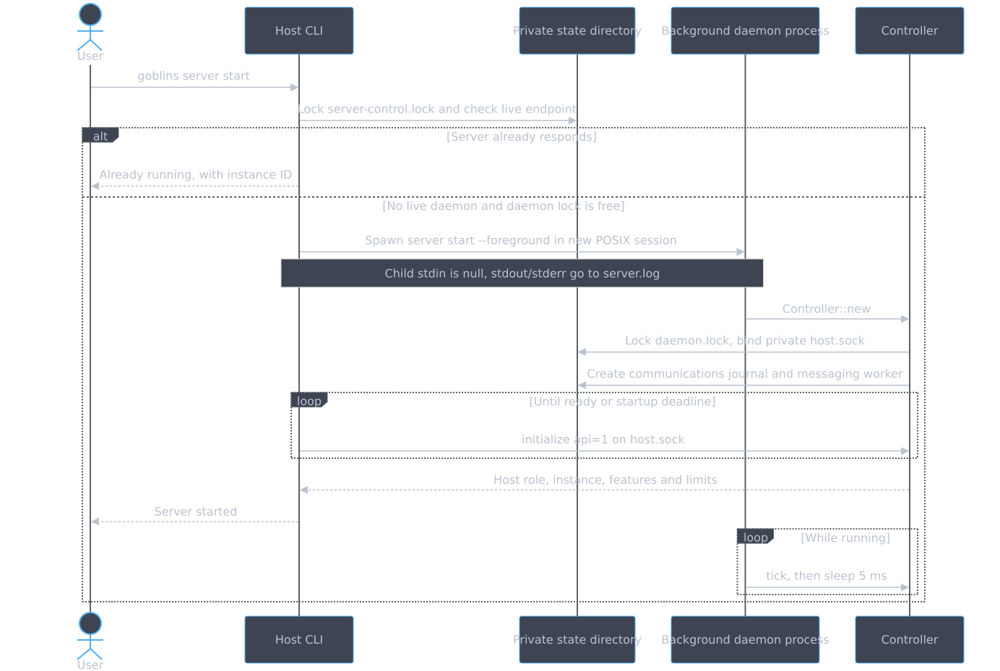
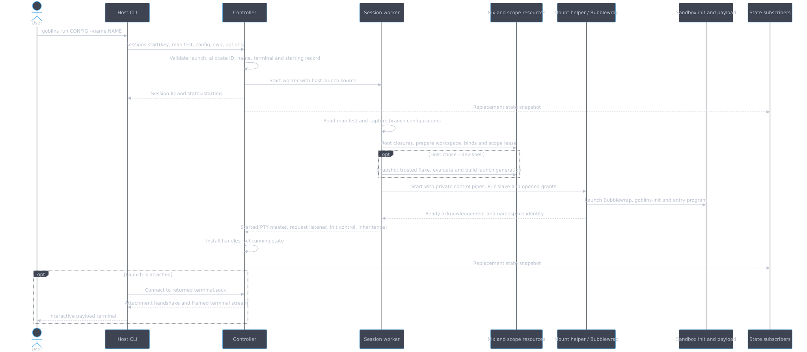
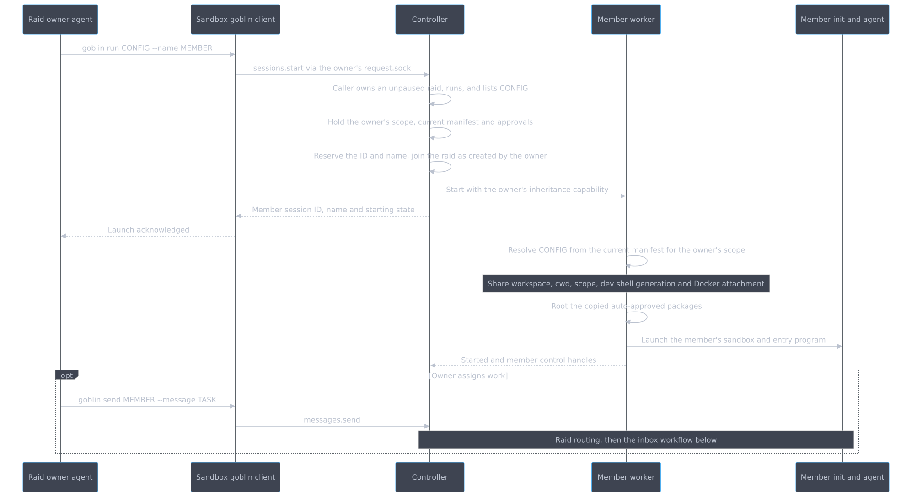
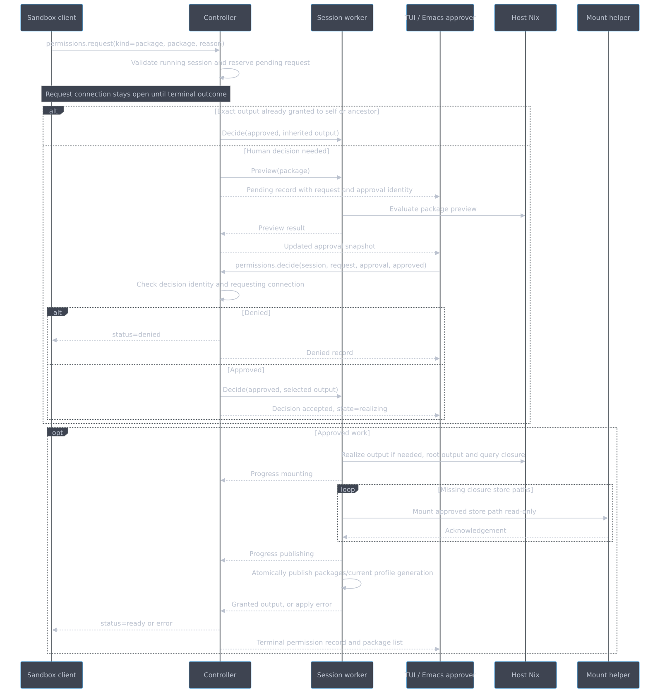
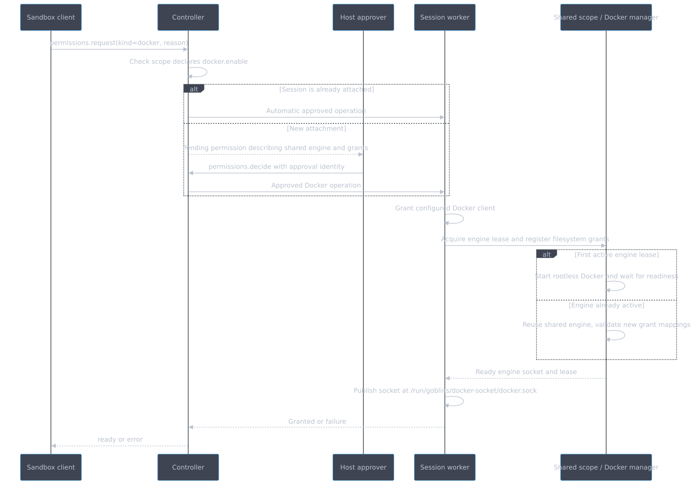
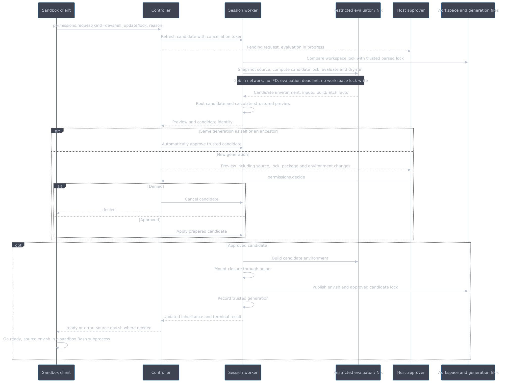
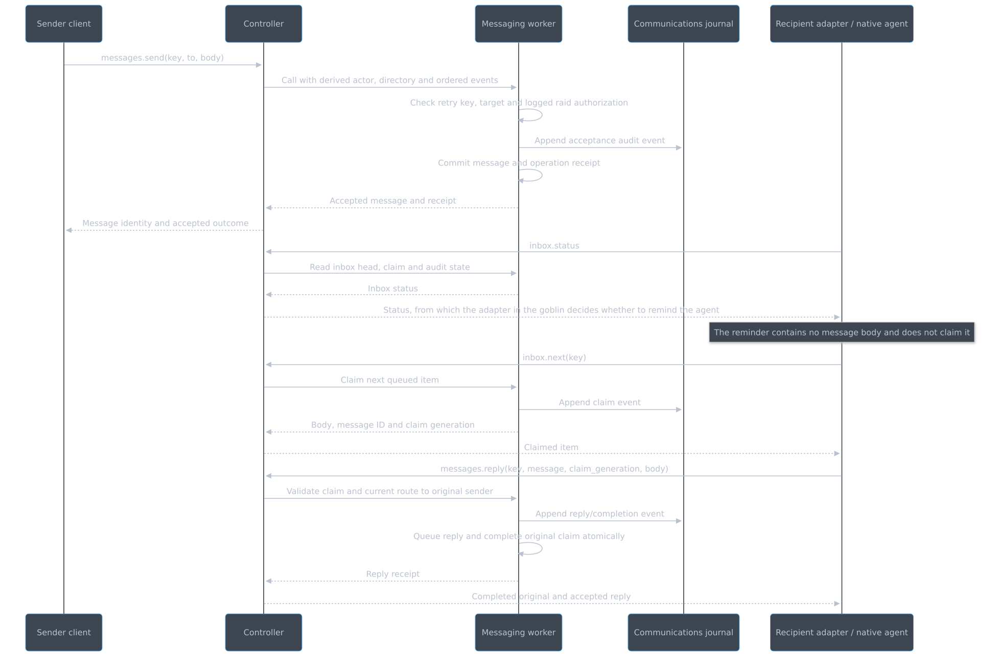
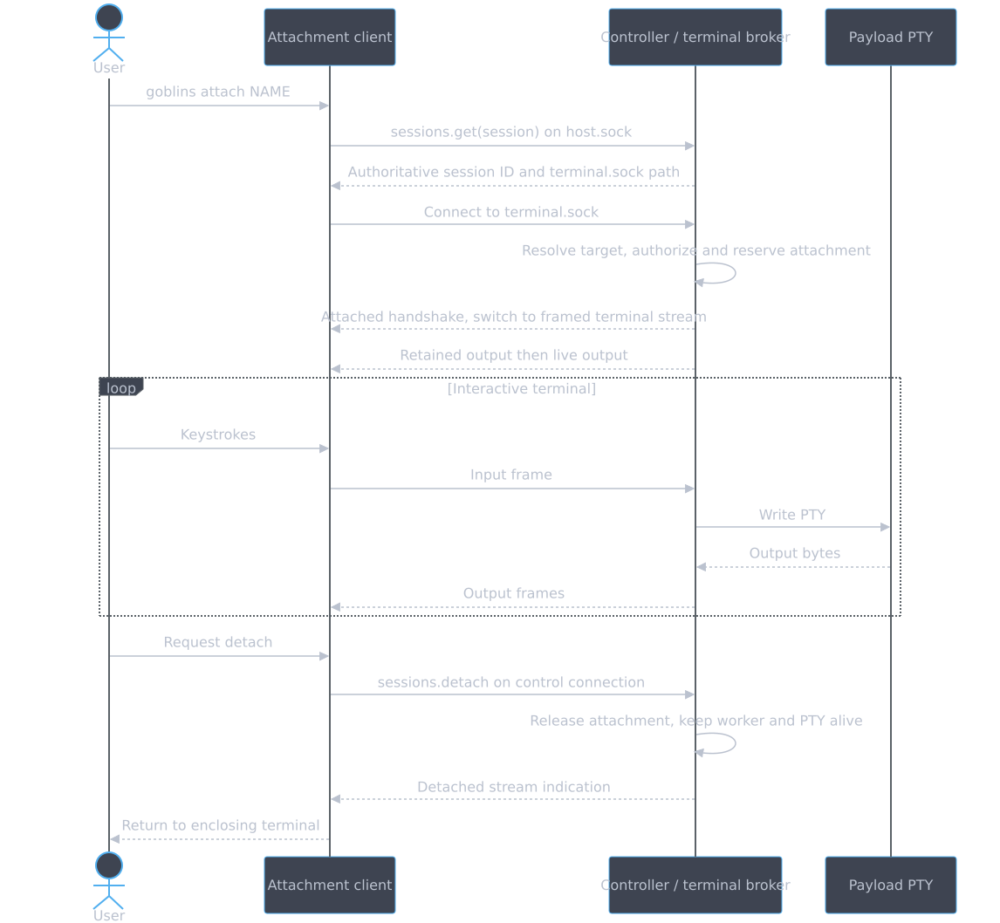
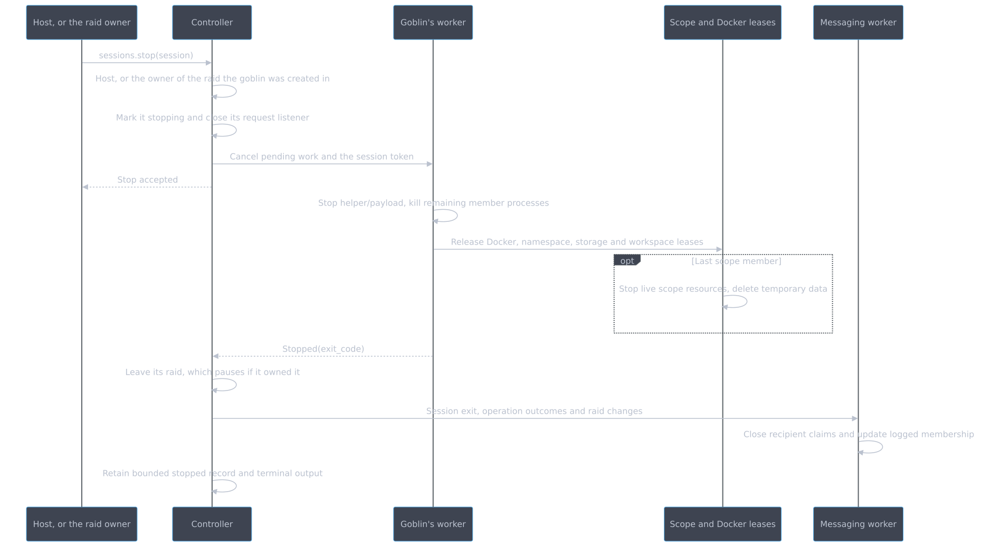

#+title: Architecture workflow sequences
#+startup: showall inlineimages hideblocks
#+property: header-args:mermaid :results file graphics replace :background-color "'#282c34'" :theme dark

* Conventions

These diagrams follow current code paths. =Controller= is the daemon event loop; =Worker= is one session's blocking worker thread; =Messaging= is the dedicated mailbox/journal thread. RPC exchanges begin with =initialize= on each public connection; diagrams omit that handshake after the first example. Dashed arrows are replies or completion events. Optional and alternative blocks describe branches, not extra required commands.

* Start the server

#+begin_src mermaid :file diagrams/workflows-start-the-server.svg :background-color "'#282c34'"
sequenceDiagram
    actor User
    participant CLI as Host CLI
    participant State as Private state directory
    participant Server as Background daemon process
    participant C as Controller
    User->>CLI: goblins server start
    CLI->>State: Lock server-control.lock and check live endpoint
    alt Server already responds
        CLI-->>User: Already running, with instance ID
    else No live daemon and daemon lock is free
        CLI->>Server: Spawn server start --foreground in new POSIX session
        Note over CLI,Server: Child stdin is null, stdout/stderr go to server.log
        Server->>C: Controller::new
        C->>State: Lock daemon.lock, bind private host.sock
        C->>State: Create communications journal and messaging worker
        loop Until ready or startup deadline
            CLI->>C: initialize api=1 on host.sock
        end
        C-->>CLI: Host role, instance, features and limits
        CLI-->>User: Server started
        loop While running
            Server->>C: tick, then sleep 5 ms
        end
    end
#+end_src

#+RESULTS:

Startup readiness is a successful API handshake. The daemon survives closing the launching terminal. The CLI only kills the child it just spawned if that startup fails; it never trusts a stale PID file. Implementation: [[file:../../packages/daemon/src/server.rs][server.rs]].

* Start a root goblin

#+begin_src mermaid :file diagrams/workflows-start-a-root-goblin.svg :background-color "'#282c34'"
sequenceDiagram
    actor User
    participant CLI as Host CLI
    participant C as Controller
    participant W as Session worker
    participant R as Nix and scope resources
    participant H as Mount helper / Bubblewrap
    participant I as Sandbox init and payload
    participant UI as State subscribers
    User->>CLI: goblins run CONFIG --name NAME
    CLI->>C: sessions.start(key, manifest, config, cwd, options)
    C->>C: Validate launch, allocate ID, name, terminal and starting record
    C->>W: Start worker with host launch source
    C-->>CLI: Session ID and state=starting
    C-->>UI: Replacement state snapshot
    W->>W: Read manifest and capture branch configurations
    W->>R: Root closures, prepare workspace, binds and scope lease
    opt Host chose --dev-shell
        W->>R: Snapshot trusted flake, evaluate and build launch generation
    end
    W->>H: Start with private control pipes, PTY slave and opened grants
    H->>I: Launch Bubblewrap, goblins-init and entry program
    H-->>W: Ready acknowledgement and namespace identity
    W-->>C: Started(PTY master, request listener, init control, inheritance)
    C->>C: Install handles, set running state
    C-->>UI: Replacement state snapshot
    opt Launch is attached
        CLI->>C: Connect to returned terminal.sock
        C-->>CLI: Attachment handshake and framed terminal stream
        CLI-->>User: Interactive payload terminal
    end
#+end_src

#+RESULTS:

The manifest path comes from the invoking host wrapper. New root launches can select a rebuilt manifest without restarting the daemon. Startup work can fail after the =starting= response; the final session record contains the failure. Launch keys make identical retries return the original result; reusing a key with different parameters is a conflict. Implementation: [[file:../../packages/daemon/src/controller.rs][Controller::start]], [[file:../../libs/supervisor/src/worker.rs][Worker::start]] and [[file:../../libs/supervisor/src/session.rs][Session::start]].

* Run a raid member

#+begin_src mermaid :file diagrams/workflows-run-a-raid-member.svg :background-color "'#282c34'"
sequenceDiagram
    participant O as Raid owner agent
    participant CLI as Sandbox goblin client
    participant C as Controller
    participant W as Member worker
    participant I as Member init and agent
    O->>CLI: goblin run CONFIG --name MEMBER
    CLI->>C: sessions.start via the owner's request.sock
    C->>C: Caller owns an unpaused raid, runs, and lists CONFIG
    C->>C: Hold the owner's scope, current manifest and approvals
    C->>C: Reserve the ID and name, join the raid as created by the owner
    C->>W: Start with the owner's inheritance capability
    C-->>CLI: Member session ID, name and starting state
    CLI-->>O: Launch acknowledged
    W->>W: Resolve CONFIG from the current manifest for the owner's scope
    Note over W: Share workspace, cwd, scope, dev shell generation and Docker attachment
    W->>W: Root the copied auto-approved packages
    W->>I: Launch the member's sandbox and entry program
    W-->>C: Started and member control handles
    opt Owner assigns work
        O->>CLI: goblin send MEMBER --message TASK
        CLI->>C: messages.send
        Note over C,I: Raid routing, then the inbox workflow below
    end
#+end_src

#+RESULTS:

Running does not transfer the owner's conversation or assign a task. The owner names a configuration from its own =allowedRunTargets= list; the member's file and package settings come from that configuration in the daemon's current manifest, the last validated one the host used. The member is not a child: it keeps running when the owner stops, and the owner can list and stop it only while it owns the raid. See [[file:../../packages/daemon/src/controller.rs][member_owner and start]] and [[file:../../libs/supervisor/src/session.rs][Session::member]].

* Request and grant a package

#+begin_src mermaid :file diagrams/workflows-request-and-grant-a-package.svg :background-color "'#282c34'"
sequenceDiagram
    participant CLI as Sandbox client
    participant C as Controller
    participant W as Session worker
    participant UI as TUI / Emacs approver
    participant N as Host Nix
    participant H as Mount helper
    CLI->>C: permissions.request(kind=package, package, reason)
    C->>C: Validate running session and reserve pending request
    Note over CLI,C: Request connection stays open until terminal outcome
    alt Exact output already granted to self or ancestor
        C->>W: Decide(approved, inherited output)
    else Human decision needed
        C->>W: Preview(package)
        C-->>UI: Pending record with request and approval identity
        W->>N: Evaluate package preview
        W-->>C: Preview result
        C-->>UI: Updated approval snapshot
        UI->>C: permissions.decide(session, request, approval, approved)
        C->>C: Check decision identity and requesting connection
        alt Denied
            C-->>CLI: status=denied
            C-->>UI: Denied record
        else Approved
            C->>W: Decide(approved, selected output)
            C-->>UI: Decision accepted, state=realizing
        end
    end
    opt Approved work
        W->>N: Realize output if needed, root output and query closure
        W-->>C: Progress mounting
        loop Missing closure store paths
            W->>H: Mount approved store path read-only
            H-->>W: Acknowledgement
        end
        W-->>C: Progress publishing
        W->>W: Atomically publish packages/current profile generation
        W-->>C: Granted output, or apply error
        C-->>CLI: status=ready or error
        C-->>UI: Terminal permission record and package list
    end
#+end_src

#+RESULTS:

Package preview evaluation is useful context, but unlike a dev shell preview it is not a prerequisite for accepting a package decision. Reused ancestor outputs are not resolved again. Grant application is local to the requesting session. Disconnect cancels an outstanding request; an uncertain transport outcome is reported by the client rather than automatically retried.

Permission lifecycle events also go to the messaging worker. Integrated agents receive operation notices as inbox items; notices contain operation facts and take =inbox complete= rather than a reply. See [[file:../../libs/supervisor/src/catalog.rs][catalog.rs]], [[file:../../libs/supervisor/src/session.rs][grant_observed]] and [[file:../../packages/daemon/src/operation.rs][operation.rs]].

* Enable Docker on demand

#+begin_src mermaid :file diagrams/workflows-enable-docker-on-demand.svg :background-color "'#282c34'"
sequenceDiagram
    participant CLI as Sandbox client
    participant C as Controller
    participant UI as Host approver
    participant W as Session worker
    participant S as Shared scope / Docker manager
    CLI->>C: permissions.request(kind=docker, reason)
    C->>C: Check scope declares docker.enable
    alt Session is already attached
        C->>W: Automatic approved operation
    else New attachment
        C-->>UI: Pending permission describing shared engine and grants
        UI->>C: permissions.decide with approval identity
        C->>W: Approved Docker operation
    end
    W->>W: Grant configured Docker client
    W->>S: Acquire engine lease and register filesystem grants
    alt First active engine lease
        S->>S: Start rootless Docker and wait for readiness
    else Engine already active
        S->>S: Reuse shared engine, validate new grant mappings
    end
    S-->>W: Ready engine socket and lease
    W->>W: Publish socket at /run/goblins/docker-socket/docker.sock
    W-->>C: Granted or failure
    C-->>CLI: ready or error
#+end_src

#+RESULTS:

This shows approval's successful branch; denial follows the ordinary permission path. Availability is a scope configuration property. Attachment is a session permission. A scope has at most one active engine; approved filesystem grants are combined and conflicting mappings are rejected. Goblins a raid owner runs start attached when it is. Startup =docker.enable= activates Docker as part of the host-chosen launch. See [[file:../../libs/supervisor/src/scope.rs][scope.rs]], [[file:../../libs/supervisor/src/docker.rs][docker.rs]] and [[file:../../libs/supervisor/src/session.rs][Session::enable_docker]].

* Refresh a dev shell

#+begin_src mermaid :file diagrams/workflows-refresh-a-dev-shell.svg :background-color "'#282c34'"
sequenceDiagram
    participant CLI as Sandbox client
    participant C as Controller
    participant W as Session worker
    participant E as Restricted evaluator / Nix
    participant UI as Host approver
    participant FS as Workspace and generation files
    CLI->>C: permissions.request(kind=devshell, update/lock, reason)
    C->>W: Refresh candidate with cancellation token
    C-->>UI: Pending request, evaluation in progress
    W->>FS: Compare workspace lock with trusted parsed lock
    W->>E: Snapshot source, compute candidate lock, evaluate and dry-run
    Note over W,E: Goblin network, no IFD, evaluation deadline, no workspace lock write
    E-->>W: Candidate environment, inputs, build/fetch facts
    W->>W: Root candidate and calculate structured preview
    W-->>C: Preview and candidate identity
    alt Same generation as self or an ancestor
        C->>W: Automatically approve trusted candidate
    else New generation
        C-->>UI: Preview including source, lock, package and environment changes
        UI->>C: permissions.decide
        alt Denied
            C->>W: Cancel candidate
            C-->>CLI: denied
        else Approved
            C->>W: Apply prepared candidate
        end
    end
    opt Approved candidate
        W->>E: Build candidate environment
        W->>W: Mount closure through helper
        W->>FS: Publish env.sh and approved candidate lock
        W->>W: Record trusted generation
        W-->>C: Updated inheritance and terminal result
        C-->>CLI: ready or error, source env.sh where needed
        CLI->>CLI: On ready, source env.sh in a sandbox Bash subprocess
    end
#+end_src

#+RESULTS:

A foreign or missing workspace lock fails before evaluation. Approval is only possible once the preview exists; denial is possible during evaluation. Rejection leaves the active generation and workspace lock unchanged. Existing processes retain their environment until they source =/run/goblins/devshell/env.sh=. A refresh changes only the requesting session; goblins it runs from then on start in its current generation. Apply failures are reported and are not a guarantee of rollback of already-mounted approved paths.

=devshell diff= performs preview work without creating a permission or applying a generation. =flake run= validates the workspace against the trusted generation, builds/mounts the selected app and returns a validated store program for the sandbox client to execute. See [[file:../../libs/supervisor/src/devshell.rs][devshell.rs]], [[file:../../libs/supervisor/src/evaluator.rs][evaluator.rs]] and [[file:../adr/0007-flake-dev-shells.md][ADR 0007]].

* Send, notify, claim and reply

#+begin_src mermaid :file diagrams/workflows-send-notify-claim-and-reply.svg :background-color "'#282c34'"
sequenceDiagram
    participant A as Sender client
    participant C as Controller
    participant M as Messaging worker
    participant J as Communications journal
    participant B as Recipient adapter / native agent
    A->>C: messages.send(key, to, body)
    C->>M: Call with derived actor, directory and ordered events
    M->>M: Check retry key, target and logged raid authorization
    M->>J: Append acceptance audit event
    M->>M: Commit message and operation receipt
    M-->>C: Accepted message and receipt
    C-->>A: Message identity and accepted outcome
    B->>C: inbox.status
    C->>M: Read inbox head, claim and audit state
    M-->>C: Inbox status
    C-->>B: Status, from which the adapter in the goblin decides whether to remind the agent
    Note over B: The reminder contains no message body and does not claim it
    B->>C: inbox.next(key)
    C->>M: Claim next queued item
    M->>J: Append claim event
    M-->>C: Body, message ID and claim generation
    C-->>B: Claimed item
    B->>C: messages.reply(key, message, claim_generation, body)
    C->>M: Validate claim and current route to original sender
    M->>J: Append reply/completion event
    M->>M: Queue reply and complete original claim atomically
    M-->>C: Reply receipt
    C-->>B: Completed original and accepted reply
#+end_src

#+RESULTS:

Native integration follows notify-then-fetch. Each agent's adapter runs inside its goblin (=goblins-codex=, or =goblins-claude= with Claude's hooks and plugin monitor), polls =inbox.status= and prompts the agent to use the inbox; it never turns untrusted bodies into terminal input, and the daemon keeps no driver state. Delivery is deferred while the agent is working. Manual inbox commands remain available without native integration.

Mutation keys recover the same accepted result on an identical retry within the daemon instance; conflicting reuse fails. Claim generations prevent an old claimant from completing a later claim. =inbox requeue= returns a claim to the queue, and =inbox complete= finishes without replying. Reply requires current messaging authorization; a dissolved raid can prevent reply even though the recipient can still complete the original claim. Audit acceptance is an append write, not a promise of durability through power loss. See [[file:../../packages/daemon/src/mailbox.rs][mailbox.rs]], [[file:../../packages/adapter-claude/src/lib.rs][claude/lib.rs]], [[file:../../packages/adapter-codex/src/lib.rs][codex/lib.rs]] and [[file:../../libs/api/src/messages.rs][protocol/messages.rs]].

* Attach and detach a terminal

#+begin_src mermaid :file diagrams/workflows-attach-and-detach-a-terminal.svg :background-color "'#282c34'"
sequenceDiagram
    actor User
    participant CLI as Attachment client
    participant C as Controller / terminal broker
    participant P as Payload PTY
    User->>CLI: goblins attach NAME
    CLI->>C: sessions.get(session) on host.sock
    C-->>CLI: Authoritative session ID and terminal.sock path
    CLI->>C: Connect to terminal.sock
    C->>C: Resolve target, authorize and reserve attachment
    C-->>CLI: Attached handshake, switch to framed terminal stream
    C-->>CLI: Retained output then live output
    loop Interactive terminal
        User->>CLI: Keystrokes
        CLI->>C: Input frame
        C->>P: Write PTY
        P-->>C: Output bytes
        C-->>CLI: Output frames
    end
    User->>CLI: Request detach
    CLI->>C: sessions.detach on control connection
    C->>C: Release attachment, keep worker and PTY alive
    C-->>CLI: Detached stream indication
    CLI-->>User: Return to enclosing terminal
#+end_src

#+RESULTS:

Resize/control RPC uses a control connection while the attachment carries the terminal stream. Host attachment uses the private =terminal.sock= path; goblins never attach to each other's terminals. Terminal detachment and closing approval frontends do not cancel the session. See [[file:../../packages/daemon/src/attachment.rs][attachment.rs]] and [[file:../../packages/daemon/src/terminal.rs][terminal.rs]].

A daemon with the =attach-handlers= feature takes attachments on =attach.sock= instead: the frontend first sends =attach.hello= with its version and size, and the daemon answers with =attach.waiting= notifications until it can attach. For a goblin without =onAttach= that is the flow above. For a goblin with =onAttach=, whose agent runs without a terminal, the controller waits until the variables the client needs were set during this run, starts the client as a =goblins-init= exec on a new PTY of the hello's size, and relays that PTY instead of the payload's. Detaching runs =onDetach=, then cancels everything the client's keeper holds; the goblin is detached once init reports the client exited. The client exiting by itself detaches without =onDetach=, and what it left behind is cancelled. See [[file:../../packages/daemon/src/controller/attach.rs][controller/attach.rs]].

* Stop a goblin and release resources

#+begin_src mermaid :file diagrams/workflows-stop-a-goblin-and-release-resources.svg :background-color "'#282c34'"
sequenceDiagram
    participant CLI as Host, or the raid owner
    participant C as Controller
    participant W as Goblin's worker
    participant S as Scope and Docker leases
    participant M as Messaging worker
    CLI->>C: sessions.stop(session)
    C->>C: Host, or the owner of the raid the goblin was created in
    C->>C: Mark it stopping and close its request listener
    C->>W: Cancel pending work and the session token
    C-->>CLI: Stop accepted
    W->>W: Stop helper/payload, kill remaining member processes
    W->>S: Release Docker, namespace, storage and workspace leases
    opt Last scope member
        S->>S: Stop live scope resources, delete temporary data
    end
    W-->>C: Stopped(exit_code)
    C->>C: Leave its raid, which pauses if it owned it
    C->>M: Session exit, operation outcomes and raid changes
    M->>M: Close recipient claims and update logged membership
    C->>C: Retain bounded stopped record and terminal output
#+end_src

#+RESULTS:

A stop, a natural exit or a failure stops only that goblin: the goblins it ran keep running. An owner leaving pauses its raid while members remain, and the host is asked to pick a new owner or dissolve it. =server.stop= applies cancellation to all sessions and then joins workers during daemon cleanup. Stop acceptance can precede completion; the server management CLI waits for the daemon lock to be released. See [[file:../../packages/daemon/src/controller.rs][stop and Controller::drop]], [[file:../../packages/daemon/src/controller/raids.rs][reconcile_raids]], [[file:../../libs/supervisor/src/session.rs][Session cleanup]] and [[file:../../libs/supervisor/src/scope.rs][scope leases]].
