#+title: Plan: a schema-first public API
#+date: 2026-10-29
#+startup: showall inlineimages hideblocks
#+property: header-args:mermaid :results file graphics replace :background-color "'#282c34'" :theme dark

Status: draft for discussion. The daemon's public JSON-RPC API, its host and sandbox endpoints, gets one machine-readable description. Rust types, the method reference and the Python tests' checks are generated from it, so code and documentation cannot drift apart. The API itself does not change.

Labels: *[E]* existing behaviour (master, 2026-10-29), *[P]* proposed change.

This plan is independent of [[file:SUPERVISOR-REFACTOR.org][SUPERVISOR-REFACTOR.org]]. That plan separates the public contract (=libs/jsonrpc= and =libs/api=) from the internal ones (section 4.10 there); this plan concerns only the public one. It names the library =libs/api=, which holds the unsplit =goblins-protocol= crate until that plan's phase 3B.

* 1. Where the API stands

- *[E]* [[file:../API.org][API.org]] is the reference: 51 method sections, a record section and the transport rules, all written by hand. =AGENTS.md= requires every API change to update it in the same change, and a missing update is a review defect.
- *[E]* Few results are typed. =controller.rs= builds most of them with =json!=, and only a handful of parameter types exist (=PermissionParams=, =FlakeRunParams=, =DevShellDiffParams= in the protocol crate; =HelloParams= and =ExecParams= in the controller).
- *[E]* Clients are written by hand in three languages: the Rust host CLI, TUI and sandbox =goblin=; the Emacs frontend through =jsonrpc.el=; and the Python tests' client in =tests/daemon_support.py=.
- *[E]* Nothing checks that a reply matches what API.org says.

* 2. The design

*[P]* One OpenRPC description per endpoint is the source of truth. OpenRPC is to JSON-RPC what OpenAPI is to HTTP: it lists every method with its parameters, result and errors as JSON Schema.

#+begin_src mermaid :file diagrams/api-schema.svg :background-color "'#282c34'"
flowchart LR
    subgraph Source["libs/api/schema: written by hand"]
        Host["host.openrpc.json"]
        Sandbox["sandbox.openrpc.json"]
        Common["common.json records, errors"]
        Host --> Common
        Sandbox --> Common
    end
    Source -->|"build.rs, typify"| Types["Rust types and method lists in libs/api"]
    Source -->|"just api-reference"| Reference["docs/API-REFERENCE.org"]
    Source -->|"bundled schema"| Python["Python tests check every reply and notification"]
    Types --> Daemon["daemon handlers"]
    Types --> Clients["goblin CLI, host CLI, TUI, supervisor gate"]
    Reference --> Emacs["Emacs and other hand-written clients"]
#+end_src

#+RESULTS:

** 2.1 The documents

- *Two documents and a shared file.* Some method names exist on both endpoints with different parameters, such as =sessions.detach=, so each endpoint gets its own document: =host.openrpc.json= and =sandbox.openrpc.json=. Records (=Session=, =Permission=, =Raid=, =HostJob=, =Message=, =Event=, =DevShellPreview=, =HistoryRecord=, =Snapshot=) and the error codes live once in =common.json= and are referenced from both.
- *JSON,* as the OpenRPC specification requires, so its meta-schema and tools apply to the files as written, with no conversion step and no YAML parser in the build. The =description= fields hold what API.org's method sections say today, including behaviour that no schema expresses, such as when a reply arrives.
- *Notifications.* OpenRPC can describe a notification as a method without a result, but its =methods= are what a client may call. The notifications here go the other way, from the daemon to the client, so listing them as methods would make them look callable and would put them in the endpoint's method list and the supervisor's allowlist. Each document therefore lists them under an =x-notifications= extension, each with a name and a parameter schema: =state.subscribe= updates, =host.submitted=, and the attach handshake's =attach.waiting=.
- *Errors.* Each method lists the error codes it can return, from the shared table in =common.json=.
- *Limits.* Size and count limits that are part of the contract become =maxLength=, =maxItems=, =minimum= and =pattern=, for example a =reason= of 1 to 1024 characters. JSON Schema counts characters, not bytes, so byte limits (such as 1 to 200 bytes per =update= name, or 12 KiB for a host command) use an =x-max-bytes= extension. The Python checks enforce it, and the existing Rust validators keep enforcing it in the daemon.
- *Absent, null and defaults.* Each parameter states whether it may be absent, whether =null= is accepted and what absence means, matching today's handlers: =required=, a type without =null= where =null= is refused, a =default= where absence has a meaning, and =additionalProperties: false= where unknown fields are refused today.
- *What stays prose.* The transport (framing, connections, deadlines), terminal attachment after the handshake and the general rules of [[file:../API.org][API.org]] are not message shapes. They stay hand-written in API.org.

** 2.2 What is generated

- *Rust types.* OpenRPC 1.3 embeds JSON Schema draft 7, which =typify= accepts. Bundling copies what an endpoint's document references from =common.json= into its =components= and rewrites the references, giving one self-contained OpenRPC document per endpoint. A small Python script does this for the meta-schema check, the reference generator and the Python checks; =build.rs= in =libs/api= does the same in Rust, and a test checks that both produce the same documents. =build.rs= then collects every method's parameters and result, each record and each notification into one draft-7 schema under =definitions=, and runs =typify= on it. Each method gets =…Params= and =…Result= types, each record and notification its own type, and each endpoint a list of its method names. The generated code goes to =OUT_DIR= and is never checked in, so it cannot go stale. Where a generated type would accept input today's code refuses, such as =null= for an optional field, =typify='s replacement setting substitutes the existing hand-written type for that schema, so behaviour does not change.
- *The method reference.* =just api-reference= writes [[file:../API-REFERENCE.org][API-REFERENCE.org]] from the documents: every method, notification and record with its fields, limits and errors. A check fails when the committed file differs from a fresh run. API.org keeps the transport and general sections and links to the reference.
- *Python checks.* The tests' =RPC= client in =tests/daemon_support.py=, which talks to both the host socket and a goblin's =request.sock=, knows its endpoint from the =initialize= result and the method of each request ID. It validates each result against that endpoint's document for that method, each error's code against the method's listed errors, and each notification against the endpoint's =x-notifications=, with =jsonschema= plus the =x-max-bytes= check. The attach tests' handshake helper validates =attach.waiting= and the attach reply the same way. Tests that deliberately send malformed frames keep their own assertions, and their replies are checked only against the error table. Every Python test that goes through these helpers then also checks the contract.

** 2.3 What stays hand-written

- The JSON-RPC envelope, framing and duplicate-key rejection in =libs/jsonrpc=: they are below the schema.
- The handlers and the dispatch: the documents describe messages, not behaviour. A test checks that each endpoint's dispatch handles exactly the methods its document lists.
- Validators the generated types do not enforce. Where a rule (such as an identifier pattern) is in the schema but =typify= does not check it, the existing validator stays, and the schema documents the same rule.
- The Emacs frontend. There is no elisp generator; Emacs gains the reference and a daemon whose replies the tests check.

* 3. Phases

Each phase is reviewed and gated as AGENTS.md requires. Every phase changes code or tests (phase 2 adds the generator and its staleness check), so each runs its feature tasks and =just test-merge=.

1. *Describe today's API.*
   - Write the three files from API.org and the code. No code changes.
   - A check validates them against the OpenRPC meta-schema.
   - The Python client validates every reply and notification. Each mismatch it finds is resolved in this phase: the document is corrected where it was wrong, and where the code was wrong the mismatch is reported to the user before anything changes.
2. *Generate the reference.*
   - Add =just api-reference= and its staleness check, and move API.org's method and record sections into the generated [[file:../API-REFERENCE.org][API-REFERENCE.org]].
   - Update the rule in =AGENTS.md=: an API change updates the documents and regenerates the reference in the same change, and a missing update is a review defect.
3. *Generate the Rust types* in =libs/api=, with the method lists and the dispatch-coverage test. Nothing uses the types yet.
4. *Use the types,* one method group per commit, each adding tests for absent, =null= and unknown parameters that pin today's answers: sessions, permissions, history, raids, host commands, messaging and state. Handlers take generated parameters and return generated results instead of building =json!= values, and the Rust clients use the same types. The existing tests and phase 1's checks keep behaviour unchanged.
5. *Feed the supervisor's gate.* Once both plans have reached this point, the gate of the supervisor plan (its section 4.8) takes the sandbox method list and parameter types from =libs/api= instead of hand-written ones.

* 4. Decisions

- *[P]* Schema first, not code first: the reviewed artefact is the contract. Deriving the schema from Rust types (=schemars=) would give more idiomatic Rust, but makes the code the contract. The user chose schema first on 2026-10-29.
- *[P]* OpenRPC rather than a custom format, so standard validators and viewers work, with one extension for notifications.
- *[P]* Generated Rust in =OUT_DIR= through =build.rs=, not checked in.
- *[P]* A generated reference file beside a hand-written API.org, rather than generated sections inside it.

* 5. Out of scope

- Changing the API: no method, field, code or limit changes here. Mismatches found in phase 1 are reported, not silently fixed.
- The internal protocols (the control channel, scope channel, init channel, mount helper and host jobs). Both ends come from one build, so they stay plain Rust types in =libs/runtime= and =libs/init=.
- Generating clients for Emacs or Python.
