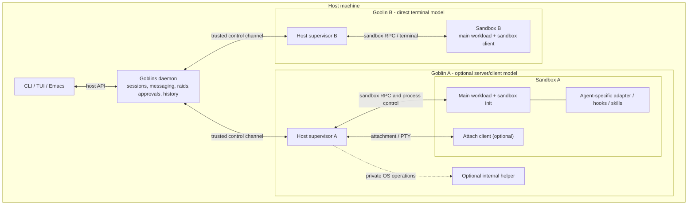
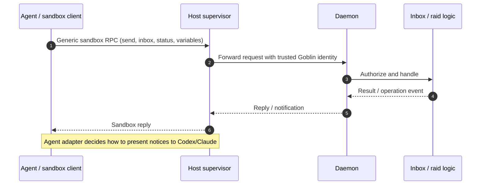
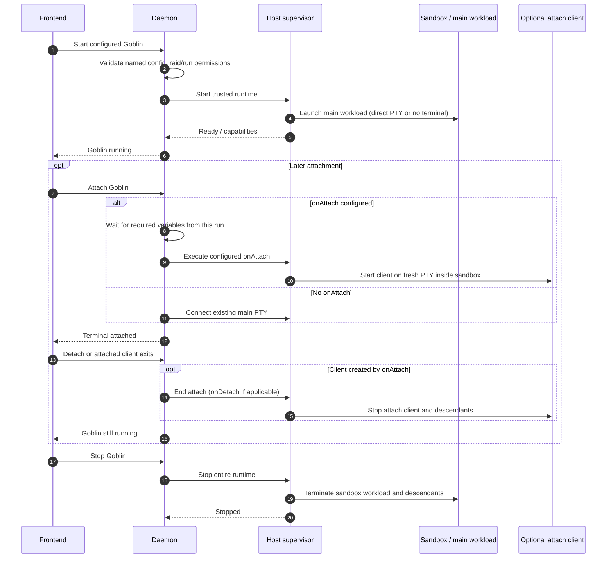

# Proposed architecture: per-Goblin supervisors and macOS support

**Status:** Proposal for future implementation, not a description of the current runtime.  
**Reviewed against:** Goblins `master`, 2026-10-29 (particularly ADRs 0011–0017).  
**Scope:** Architectural boundaries and a deliberately reduced first macOS milestone. The details of process layout, transport and operating-system APIs remain open.

## Motivation and agreed direction

Goblins is a personal tool for running and coordinating sandboxed coding agents and shells. Its Linux runtime uses namespaces, Bubblewrap, private mounts and helpers. The goal is to support a dedicated work Mac while preserving the existing Linux workflow, without rebuilding every Linux-specific feature on Darwin.

- **One dedicated host-side supervisor process per running Goblin.** It owns the sandbox's OS resources, launches and supervises all processes inside it, implements any supported runtime modifications, and mediates every sandbox-to-daemon request.
- **A backend-agnostic daemon.** It owns logical sessions, raids (including owner and created-member permissions), inboxes, messaging, approvals, history, agent-neutral state and frontend orchestration. It never needs to manipulate Linux namespaces or macOS Seatbelt policies.
- **No direct sandbox-to-daemon channel.** Sandbox-originated requests pass through their supervisor, with caller identity anchored to the trusted supervisor connection rather than values supplied by the sandbox.
- **Agent-specific functionality stays inside each Goblin.** Codex/Claude integrations, adapters, hooks, skills, notification delivery and provider-specific behavior are packaged into the sandbox. Neither daemon nor supervisor gains a provider driver.
- **Start and attach are distinct.** A Goblin can have a long-running main workload and optional `onAttach`/`onDetach` handlers that start and stop separate terminal clients without changing the Goblin's lifetime.
- **Existing Linux behavior is preserved.** Especially enforced live package grants, scopes, Docker, host-command approvals, Nix access and dev-shell workflows.
- **macOS v1 favors the essential workflow.** Shell/agent launch, messaging, raids, sandbox-only integrations, terminals and generic attach handlers are required. Existing opt-in Nix and host-command capabilities are targeted; live package grants, Linux-style namespace scopes, managed Docker and dev shells may be deferred.

This architecture should be implemented in terms of Goblins concepts rather than hard-coded knowledge of any particular coding agent.

## Vocabulary

| Term | Meaning | Ownership / distinction |
| --- | --- | --- |
| **Goblin** | One named, running instance of a Goblins configuration: logical session, host supervisor, sandbox and main workload. May contain a shell, a coding agent or a background server. | A Goblin is the whole managed unit, not just an agent or terminal. |
| **Configuration** | Reusable Nix declaration of a Goblin's program, initial tools, environment, permissions and optional attach handlers. | Many Goblins can use the same configuration. |
| **Daemon** | Central, platform-independent Goblins backend. | Owns session state, raid control, messaging, approvals, history, subscriptions and frontend semantics; no Codex/Claude driver. |
| **Session** | Logical identity and state of one Goblin execution in the daemon. | Not a separate OS process, nor a provider conversation ID. |
| **Supervisor** | Dedicated **host-side process**, one per running Goblin, responsible for its sandbox and for mediating sandbox communication. | Owns OS-level launch, process resources, restrictions, runtime changes, terminal process handles and cleanup; has no agent-specific knowledge. |
| **Sandbox** | Restricted execution environment for a Goblin's workload and in-sandbox utilities. | Linux namespace/Box or Darwin Seatbelt isolation, not the supervisor itself. |
| **Main workload** (or **payload**) | The Goblin's long-lived configured entry program and its process tree. | May be an interactive shell, Claude's terminal, or a Codex App Server plus adapter; its lifetime is the Goblin's lifetime. |
| **Agent** | Coding assistant such as Codex or Claude Code, possibly split into server and terminal client processes. | Runs entirely inside the sandbox; not every Goblin has an agent. |
| **Agent adapter** | Agent-specific in-sandbox integration code and configuration (hooks, skills, wakeups, state reporting and provider protocols). | Composed by the agent configuration; talks to Goblins through generic sandbox commands/APIs. |
| **Attachment** | A frontend's current connection to a Goblin's terminal. | Transient; does not define the lifetime of the Goblin. |
| **Attach handlers** | Optional generic `onAttach` and `onDetach` commands configured for a Goblin. | Allows an always-running main workload and a separate per-attachment client; not provider-specific. |
| **Attach client** | Program started inside the existing sandbox for one attachment when `onAttach` is configured. | Has its own PTY and lifetime; exits/detaches without stopping the main workload. |
| **Sandbox client** | The restricted `goblin` commands available to code within the sandbox. | Uses the supervisor as its route to the daemon, not a direct daemon socket. |
| **Sandbox init** | Trusted in-sandbox process runtime for additional execs, terminal clients and cancellation. | Distinct from the **host** supervisor; internals may need OS-specific porting. |
| **Helper** | Optional, low-level private subprocess used by a supervisor, e.g. a Linux namespace/mount worker. | Implementation detail, not a second public runtime boundary or daemon API. |
| **Host command** | An explicitly approved command run with host-user access outside the sandbox via `hostCommands.enable`. | Not the same as exposing a host executable within the sandbox or granting unrestricted host shell access. |
| **Control channel** | Trusted, bidirectional daemon–supervisor protocol. | Carries lifecycle, delegated execution, sandbox RPC relays and events; no agent-supplied authority. |
| **Scope** | Optional Linux trust/resource group with shared networking, storage and possibly Docker. | Independent from raids; native equivalent not required in macOS v1. |
| **Raid** | Daemon-owned grouping for permitted messaging and ownership of **created members**. | The raid owner may run/stop created members; ownership can transfer. Members continue running if the owner leaves, while the raid is paused. |
| **Host** | User's environment outside the sandbox. | Runs the daemon and supervisors; some approved host commands also execute here. |

Use **Goblin** for the whole instance and **session** for its daemon representation. A historical session record can be recreated as a new Goblin. **Supervisor** unambiguously refers to the proposed per-Goblin host process; existing host-command job guardians/supervisors are narrower subordinate mechanisms and should not be conflated with it.

## System boundaries

The diagram is a logical ownership map, not an implementation-mandated process tree. The agent integration is **inside** the sandbox. An attach client is part of the same Goblin and sandbox, not a separate Goblin or supervisor. A supervisor may use internal helpers, but the daemon addresses only the supervisor.

## Responsibility split

| Concern | Daemon | Host supervisor |
| --- | --- | --- |
| Goblin/session identity and historical records | Authority | Reports status and outcomes |
| Raids, run-target authorization and created-member rights | Authority; ownership/pause/transfer semantics | Launches/stops instances on trusted instruction; manages inherited runtime resources |
| Inbox, messaging, generic agent state and operation notices | Authorizes and routes; no provider-specific driver | Relays sandbox-originated calls and replies |
| Agent-specific integrations | No Codex/Claude logic; only generic session/API features | No provider logic; makes trusted generic configuration/material accessible to the sandbox |
| Configuration selection | Selects trusted named configuration and records semantics | Converts configuration to OS-specific launch and access policy |
| Sandbox filesystem, network and executables | Describes policy intent and supported capabilities | Enforces access restrictions and mutations |
| Permissions and package/host-command approval | Decides and records authority; surfaces approvals | Carries out requested runtime work or reports unsupported/failure |
| Host-command jobs | Authorizes the exact host-side operation and manages logical lifecycle | Executes/supervises host-side work through appropriate isolated mechanisms after approval |
| Goblin start and stop | Owns logical lifecycle and records | Owns actual workload, termination and cleanup |
| Terminal attachment and `onAttach` readiness | Owns frontend authorization, attach state and required current-run variables | Executes generic attach/detach commands, allocates PTYs and manages client lifetime |
| Terminal UI state | Owns frontend-facing state/subscriptions and ordering | Owns OS PTYs, streams and process handles |
| Backend capabilities | Chooses available operations from advertised capabilities | Reports capabilities; fails closed for unsupported actions |

The supervisor must not make Goblins authorization decisions, and the daemon must not execute arbitrary host commands without the approval boundary. All OS-specific execution remains on the supervisor side. A host-command job is a consciously broader trust boundary than running a tool *inside* the sandbox.

## Communication and integration

- All sandbox-facing calls (including messages, `sessions.set-state`, `sessions.set-variables`, permissions and generic agent integration) cross the supervisor; there is no direct sandbox–daemon endpoint.
- The daemon associates a supervisor with a particular session; a sandbox client cannot select or impersonate another Goblin by supplying an ID.
- The provider-specific wakeup ledger, hooks, app-server adapter and UI integration stay **inside the Goblin**. In particular the daemon does not parse provider hooks or generate terminal prompts for them.
- Generic RPC needs concurrent calls, long-lived waits, cancellation and bounded resource usage. Exact transport, multiplexing, framing and descriptor transfer are deliberately open.
- Terminal data may use a separate streaming path. The supervisor owns the actual PTY/process resources; daemon-facing attachment semantics and frontend subscriptions stay backend-independent.
- A supervisor forwards application-level messages rather than implementing inbox or raid behavior.

## Start, attach, detach and stop

A Goblin's main workload and its terminal attachment are **different lifecycles**. An ordinary Goblin keeps the existing single-PTY behavior. A Goblin configured with `onAttach` starts its main workload without a terminal, then launches a fresh client within the *same sandbox* for each attachment. This is a generic configuration capability: currently Codex uses it; Claude does not.

Preserve the generic handler semantics introduced in [ADR 0016](../adr/0016-server-and-client-goblins.md): a configured attach can wait for declared variables to be **set during this Goblin's current run**, not merely carried over from history. Attach refusal or the attached client's exit must not silently kill the long-lived workload. An explicit detach may invoke `onDetach` before cancelling the client; normal Goblin stop ends the whole sandbox. A frontend may attach/detach repeatedly without restarting an agent server.

Linux and Darwin supervisors should both implement these generic lifecycle operations without understanding which agent, if any, is behind the commands.

## Raids, independent Goblins and failure boundaries

The old parent/child ownership tree **no longer exists** (see [ADR 0014](../adr/0014-raids-replace-the-ownership-tree.md)). Every Goblin has its own logical session and independent supervisor. A raid owner may run configured member Goblins into its raid if allowed by `allowedRunTargets`. They have separate sandbox access and can inherit selected runtime resources, but **must survive their creator leaving or stopping**.

The daemon retains raid membership and control rights. The owner can stop members created within its raid, but cannot attach to another member's terminal. When an owner leaves and members remain, the raid pauses messaging until host intervention; member processes keep running. A new owner may assume control. Do not accidentally reintroduce parent-controlled termination when designing supervisor cleanup.

Invariants:

- The daemon allocates logical Goblin identity and authorizes raids/run targets; the supervisor owns only the corresponding runtime.
- A failed supervisor stops *that Goblin's* execution and produces a session event. It does not automatically stop other Goblins, including created raid members.
- Daemon death must still terminate its supervisors and sandboxes under the existing lifetime contract; a supervisor disappearing must not leave an uncontrolled agent running.
- Resource inheritance (workspace, scope, dev-shell generation, approved outputs) needs a trusted handoff independent of a creator's ongoing lifetime. A separate supervisor cannot inherit an in-daemon Rust reference directly.
- Shared Linux scopes have resource lifetime rules of their own; the daemon must not rely on namespace identities, PID/mount descriptors or Seatbelt details when deciding logical raid control.

## Platform behavior and macOS v1

The target is comparable **user workflow** rather than identical kernel isolation. Initial Darwin support should avoid features that demand substantial Linux namespace machinery.

| Feature | Linux requirement | macOS v1 target |
| --- | --- | --- |
| Generic daemon, frontends and messaging/raids | Preserve existing behavior | Required |
| Independent Goblins and owner-created raid members | Preserve latest raid semantics | Required |
| Main workload and generic `onAttach`/`onDetach` lifecycles | Preserve (including Codex server/client and Claude direct PTY) | Required |
| In-sandbox Codex and Claude adapters, hooks, skills and managed config | Preserve and keep provider-specific code sandbox-local | Required |
| Agent-neutral activity, inboxes and operation notices | Preserve | Required |
| Terminal connections, `goblins exec`, editor/TRAMP workflows | Preserve | Required where supported by native tools |
| Initial packages and file grants | Preserve | Required using macOS sandbox policy |
| `allowNix` | Preserve existing opt-in full-store and Nix-daemon semantics | Adapt as an explicit configuration option |
| `hostCommands.enable` | Preserve **per-command approval** and managed host-job lifecycle | Adapt the existing approval workflow if practical for v1; never silently remove per-command approval |
| `bypassPermissions` | Preserve the agent-config option and native default prompting behavior | Required for agent integrations |
| Live package requests | Preserve enforced in-place mounts | Deferred; report unavailable rather than quietly relying on `PATH` |
| Host-evaluated dev shells / live refresh | Preserve | Deferred |
| Shared scope network/PID namespaces, scope storage | Preserve | Deferred |
| Goblins-managed rootless Docker | Preserve | Deferred |

- Reuse the existing `agent-sandbox.nix` Darwin Seatbelt design where useful. A fixed launch policy need not grow dynamically in macOS v1.
- `allowNix` already exists: it exposes the full store and Nix daemon, a deliberate and substantial capability increase. Preserve the opt-in and its documented limitations, not a vague permission to add tools.
- `hostCommands.enable` already exists: it permits **asking for an approved command to run on the host**, outside the Goblin sandbox. It is not the same feature as adding host command paths to the sandbox's `PATH`. Its approvals remain authoritative.
- The adapter's selected skills should match supported operations; a Darwin Goblin without live grants should not be taught that it can request live packages.
- `bypassPermissions` is an agent launch preference, not the sandbox security boundary. Preserve per-agent behavior without adding provider logic to daemon/supervisor.
- Sandbox-only skills/hooks/settings must not rewrite the user's global agent configuration or casually copy authentication state.
- If an option cannot be implemented safely on Darwin, expose an explicit capability/error and keep the Linux behavior intact.

## Phasing (guidance, not an implementation plan)

1. **Move the Linux runtime behind a per-Goblin supervisor process** while preserving package grants, scopes, Docker, dev shells, current host jobs, raids and both attachment modes. Retain any Linux mount helper only as private supervisor implementation machinery.
2. **Route all sandbox-facing requests and execution control through the supervisor** without moving the daemon's authorization, inbox, raid or frontend semantics into it. Eliminate direct in-daemon OS-specific resources.
3. **Port only the generic runtime boundary to Darwin**: Seatbelt launch and static access grants, sandbox-client RPC proxy, sandbox init/exec, PTYs, process lifetime, generic attach handlers and configuration materialization.
4. **Exercise real workflows** for interactive shell, Claude direct terminal, Codex server plus repeated attach clients, sandbox-local messaging/adapters and raid members that outlive their creator.
5. **Evaluate deferred functionality separately** once a minimal native macOS version is usable, especially package requests, Nix evaluation/dev shells, scopes and Docker.

Do not prescribe crate layout, IPC implementation, helper binary names or file paths here. Consult current `master` and ongoing work before implementing these boundaries.

## Open questions for follow-up

- What is the minimum trusted supervisor registration/identity and per-sandbox RPC proxy protocol that preserves the daemon's authorization semantics?
- How do we transfer/hold shared workspace, scope and approved resources for raid-created members when the creator may stop immediately?
- How much terminal screen state belongs to the daemon, versus PTY ownership and byte streaming in the supervisor?
- How will the supervisor implement repeated `onAttach` clients and their lifecycle while preserving the main server's continuity, readiness variables and frontend behavior?
- What is the smallest portable sandbox-init/process-supervision contract that supports `goblins exec`, terminal clients, cancellation and reliable descendant cleanup on both operating systems?
- How should the existing approved host-job process guardian relate to the new per-Goblin supervisor, especially when the host command intentionally runs with broader host-user access?
- How should Darwin represent injected files, mutable agent configuration and authentication without Linux mount overlays?
- Which platform-specific capabilities should be advertised, and how will unsupported features be reflected in agent-injected instructions?
- Which regression tests are backend-agnostic contracts and which should run only on Linux or Darwin?

## Acceptance criteria and references

This is a proposal, not a claim that any supervisor refactor is already implemented.

- The daemon remains free of OS-specific sandbox lifecycle operations and provider-specific Codex/Claude integration drivers.
- Every sandbox-to-daemon request crosses exactly its own trusted host supervisor; the daemon authenticates the session binding.
- Generic attach handlers preserve **main workload vs attachment** lifetimes; a client leaving does not stop a server Goblin.
- Raids preserve the current **independent member** lifecycle, including owner departure, pause, transfer and authorized member control.
- The existing Linux sandbox, package requests, Nix access, scoped Docker, dev shells and approved host commands remain functional.
- macOS can launch configured shells and agents with generic messaging, in-sandbox integrations, initial tools, supported file grants and terminal attachment, with unsupported live-grant features clearly identified.
- Relevant tests cover identity/authority, terminal detach/reattach, daemon or supervisor failure, resource cleanup, and one Goblin operating without disturbing others.

**Current references:** [API](../API.org), [Architecture](../architecture/README.org), [Agent integration](AGENT-INTEGRATION.org), [Sandbox access](SANDBOX-ACCESS.org), [ADR 0011 — Nix access](../adr/0011-nix-in-a-goblin.md), [ADR 0012 — approved host commands](../adr/0012-host-commands.md), [ADR 0013 — agent prompts](../adr/0013-agent-permission-bypass.md), [ADR 0014 — raids](../adr/0014-raids-replace-the-ownership-tree.md), [ADR 0016 — attach handlers](../adr/0016-server-and-client-goblins.md), [ADR 0017 — agent integration](../adr/0017-claude-integration-in-goblin.md). These references describe the **current** runtime, whereas this document specifies the proposed future supervisor boundary.
