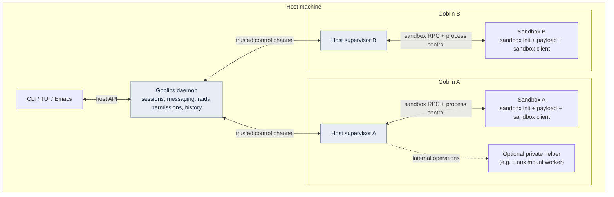
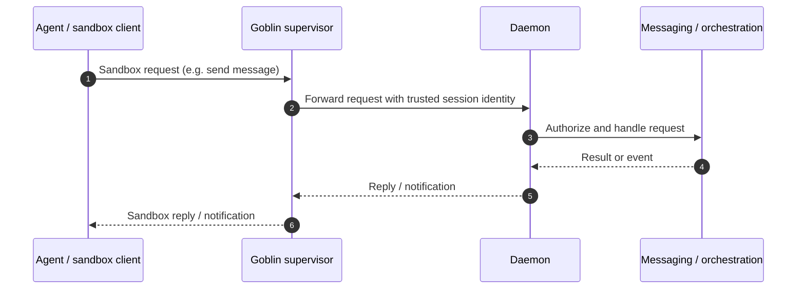
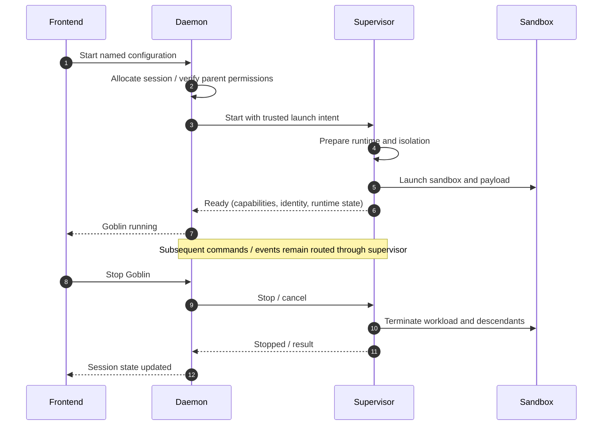

# Proposed architecture: per-Goblin supervisors and macOS support

**Status:** Proposal for future implementation; not a description of the current runtime.  
**Scope:** Architectural direction and a deliberately reduced first macOS milestone.  
**Intent:** A working document for follow-up work, not a prescriptive implementation plan.

## Motivation and goals

Goblins is a personal tool for running and coordinating sandboxed coding agents. It currently relies on Linux namespaces, Bubblewrap, private mounts and additional low-level helpers. The goal is to make a dedicated work Mac a viable option without replacing the Goblins workflow or compromising existing Linux behavior.

The agreed architectural direction is:

- **One host-side supervisor process per running Goblin.** It owns that Goblin's sandbox, process lifecycle, changes to its execution environment and all sandbox-facing communication.
- **A backend-agnostic daemon.** It owns orchestration, identity, parent/child relationships, raids, messaging, permissions, history and other logical state. It delegates execution to supervisors rather than handling Linux or Darwin internals.
- **No direct sandbox-to-daemon communication.** Every request from a sandbox passes through its supervisor. The daemon must derive the calling Goblin's identity from the trusted supervisor connection, never from a caller-supplied identity.
- **Linux remains fully functional.** Its existing security boundaries, dynamic package grants, scopes and Docker should be preserved through the refactor.
- **macOS first milestone favors workflow over full feature parity.** The primary requirements are agent integration, orchestration, messaging, sandbox-only hooks/skills/configuration, terminals and basic sandboxing. Dynamic package requests, scoped Docker and Linux-style namespace sharing can wait.

Platform-dependent details should be isolated behind the supervisor boundary, while the logical daemon protocol and its clients remain consistent.

## Vocabulary

| Term | Canonical meaning | Boundary / ownership |
| --- | --- | --- |
| **Goblin** | A named, running instance of a Goblins configuration: the managed unit consisting of its logical session, supervisor, sandbox and workload. It need not run an AI agent. | One Goblin has one supervisor and one sandbox for this design. |
| **Configuration** | A reusable Nix declaration describing a kind of Goblin, initial tools, entry program and permissions. Many Goblins may use the same configuration. | Selected at launch; distinct from a running Goblin. |
| **Daemon** | The central, platform-agnostic Goblins backend. | Owns logical sessions, orchestration, messaging, permission decisions, history and user-facing state. |
| **Session** | The daemon's logical representation and identity of a Goblin execution. | A session is a record/state concept, not another operating-system process. |
| **Supervisor** | The dedicated **host-side process** managing one Goblin's restricted runtime and mediating all sandbox traffic. | Owns sandbox launch, operating-system resources, runtime modifications, process cleanup and sandbox communication proxying. |
| **Sandbox** | The restricted execution environment containing the Goblin's workload. | Linux isolation or macOS Seatbelt; separate from the host-side supervisor. |
| **Payload** | The primary command or program and its descendants inside the sandbox. | Often an agent, but may be a shell or another program. |
| **Agent** | An AI coding application running as the payload, such as Codex or Claude Code. | Agent is not synonymous with Goblin. |
| **Sandbox client** | The restricted Goblins command-line entry points callable from inside the sandbox. | Talks to the supervisor, not directly to the daemon. |
| **Sandbox init** | Optional in-sandbox runtime responsible for launching and supervising additional processes and terminals. | Not the host-side supervisor; implementation may vary by platform. |
| **Helper** | Optional low-level subprocess used internally by the supervisor for operations requiring a separate process/namespace context. | Not a first-class architectural component or daemon API. Linux's mount worker is an example; Darwin need not have one. |
| **Host** | The user's machine context outside a Goblin's sandbox. | Runs the daemon and supervisors. |
| **Control channel** | Trusted, bidirectional daemon-supervisor communication. | Carries commands, logical events, forwarded sandbox calls and their results; not a direct agent authority. |
| **Scope** | An optional Linux resource/trust grouping for several Goblins. | Not required for macOS v1; scope semantics remain a separate concern from parent/child or raid relationships. |
| **Raid** | A logical communication grouping of Goblins. | Owned by the daemon; independent of platform-specific resource scopes. |

Use **Goblin** for the whole running unit, **session** for its daemon-side identity/state, **sandbox** for restricted execution, and **supervisor** for the host-side manager. A stopped Goblin has a historical session record; recreating it starts a new Goblin associated with that record.

## System boundaries

This is a logical diagram, not a required process-launch order or on-disk layout. The supervisor is **outside** its own sandbox; helpers, if any, remain internal supervisor implementation details. There is no sandbox-to-daemon bypass.

## Responsibility split

| Concern | Daemon | Supervisor |
| --- | --- | --- |
| Goblin/session identity, state and history | Authority | Reports runtime events for its Goblin |
| Parent/child creation rules and raids | Authority | Executes launch/stop requests; protects inherited runtime resources |
| Agent inboxes, message routing and notifications | Authority | Transparently relays sandbox messages and results |
| Permissions and approvals | Decides and records intent | Enforces supported runtime changes or returns unsupported/failure |
| Sandbox creation and configuration | Selects trusted logical configuration | Validates/prepares platform runtime and starts sandbox |
| Sandboxed files, network and executable access | Expresses requested policy without OS assumptions | Applies platform-appropriate restrictions |
| Sandbox-specific skills, hooks and settings | Coordinates configured Goblin features | Makes effective files/configuration available within the sandbox |
| Process execution and lifetime | Tracks logical outcomes | Owns processes, handles execution, signaling and teardown |
| Terminals | Owns frontend-facing state and orchestration semantics | Owns operating-system PTYs and sandbox process connections |
| Platform capabilities | Uses reported capabilities to determine available actions | Reports its supported operations; fails closed for unsupported actions |

The daemon must not become a generic host command executor. Supervisors must not decide whether an agent is *authorized* to perform a logical operation: that decision belongs to the daemon. Trusted supervisor commands are distinct from untrusted sandbox-originated requests.

## Communication

Communication expectations:

- The **supervisor** is the only reachable path between its sandbox and the daemon, including messaging, status, agent integration and permission requests.
- The daemon authenticates/associates each supervisor with exactly the intended session; sandbox-provided names and IDs never grant cross-session authority.
- Preserve concurrent requests, long-running calls, cancellation and bounded resource use. Exact transport, framing and descriptor-passing mechanisms are intentionally undecided.
- Terminal data may use a separate data path from structured commands. The supervisor owns OS-level PTYs; the daemon can retain UI-facing terminal state, subscriptions and notification decisions.
- The supervisor forwards application-level messages; it does **not** implement inbox, raid or agent-specific orchestration logic.

## Lifecycle and failure boundaries

Expected invariants:

- Each running Goblin has a dedicated host-side supervisor. Neither a frontend nor the daemon needs to enter the sandbox's OS isolation context.
- Supervisor exit or loss of the trusted channel must **not** leave an uncontrolled sandbox running. Daemon failure should similarly terminate its Goblins under the existing lifecycle contract. The mechanism is platform-specific.
- A stopped child cannot outlive its parent contrary to Goblins' parent/child lifecycle rules.
- The daemon should handle supervisor failures as session events and remain available for other Goblins.
- The supervisor owns cleanup and resource lifetime, including any internal helper. Its platform-specific identity and handles do not leak into logical session APIs.
- Inherited runtime resources for child Goblins need an explicit, trusted handoff mechanism; no assumption that Rust references or descriptors can be shared with a separate supervisor process.

## Platform behavior and first macOS milestone

The aim is **similar user-facing Goblins behavior**, not identical kernel isolation across Linux and macOS.

| Feature | Existing Linux behavior | Proposed macOS v1 |
| --- | --- | --- |
| Daemon, CLI/TUI, Emacs integration | Preserve | Required |
| Multiple Goblins, children and raids | Preserve | Required |
| Messaging, inboxes and agent integration | Preserve | Required |
| Injected Goblins-only skills, hooks and settings | Preserve | Required; use platform-suitable injection |
| Sandbox terminal, exec and lifecycle | Preserve | Required |
| Initial Nix packages and restricted filesystem grants | Preserve | Required; use native sandbox policy |
| Configurable Nix access | Keep current Linux policy unless deliberately changed | Allow configuration of Nix/store/daemon access, following upstream Darwin semantics |
| Configurable host commands | No implied changes | Allow explicitly configured host tools subject to sandbox policy |
| Live package requests | Preserve dynamic, enforced grants | **Deferred**; no claim of live-grant parity |
| Flake dev shells and live refresh | Preserve | Deferred for v1 |
| Shared scope network/PID namespaces and managed storage | Preserve | Deferred for v1 |
| Goblins-managed rootless Docker | Preserve | Deferred for v1 |
| Linux-specific mounts and syscalls | Existing behavior | No equivalent required for v1 |

Notes:

- On macOS, use the Seatbelt-based model already supported by `agent-sandbox.nix` where practical. A new execution policy is applied at sandbox launch, not dynamically expanded for live grants.
- `allowNix` is a conscious relaxation: access to the Nix daemon and full store is broader than the current Goblins package grant model. It should be opt-in, clearly documented and distinct from mere ability to execute selected host commands.
- Host commands must not silently imply access to arbitrary host files, sockets or services. Support should be explicit and platform-policy-controlled.
- Sandbox-only skill/hook/config injection must not unintentionally modify the agent's ordinary host configuration, authentication or persistent conversation state.
- Unsupported operations must be reported honestly. The daemon should rely on explicit supervisor capabilities, not silently approximate Linux behavior.

## Phasing (non-prescriptive)

1. **Define the boundary on Linux:** isolate the per-Goblin supervisor as an independent host process; move sandbox launch, low-level process ownership, sandbox endpoints and Linux-specific runtime operations out of the daemon. Preserve all existing Linux features and tested semantics.
2. **Make daemon communication backend-agnostic:** route sandbox calls and supervisor events through the trusted boundary; preserve messaging, frontend behavior, child relationships and failure handling.
3. **Introduce a minimal Darwin supervisor:** provide Seatbelt launch, initial tools, explicit host/Nix access, sandbox-specific configuration injection and process/terminal handling.
4. **Validate user workflows end-to-end:** launch Codex/Claude or a shell; send messages; create children/raids; inject hooks/skills; attach terminals and use Emacs; stop and clean up without leaving host processes.
5. **Reassess deferred features only as needed:** live package requests, dev shells, scoped resources or Docker should be independent follow-up decisions, not prerequisites for macOS v1.

Do not lock in crate boundaries, binary names, specific IPC transports, helper strategy or file layout before reviewing concurrent work in the repository.

## Open questions for implementation review

- How should the trusted supervisor identify itself to the daemon, and how are sandbox connections correlated without authority confusion?
- Should the supervisor-to-daemon link multiplex calls and terminals, or use distinct data/control paths?
- Which process is responsible for persistent terminal screen history versus OS-level PTY ownership?
- What minimal portable sandbox-init interface is needed for `goblins exec`, TRAMP and cleanup across macOS/Linux?
- How do child supervisors receive inherited workspace/configuration/resources without passing mutable authority through the daemon?
- What exact host-command configuration and Nix-access semantics can be safely supported on Darwin?
- How should agent-specific injected settings coexist with existing credentials and user configuration on macOS?
- What level of descendant-process cleanup can native Darwin guarantee, especially for detached processes?
- Which current Linux tests express platform-independent contracts, and which must become backend-specific?

## Compatibility and acceptance expectations

This is a design proposal, not an implementation report. Before describing the migration as complete:

- The daemon contains no direct Bubblewrap, namespace, mount, seccomp or Seatbelt lifecycle code.
- Every sandbox-originated daemon request crosses its session's host supervisor.
- Existing Linux package requests, sandbox restrictions, scopes, Docker and dev-shell workflows remain available with no intentional regression.
- Multiple Goblins can operate independently; an error or shutdown in one supervisor does not corrupt another's logical state.
- macOS can run a configured shell or coding agent with the required sandbox-only integration, messaging, orchestration and terminal workflow, without requiring dynamic package grants.
- Tests cover cross-session authority, cancellation, crashes, resource cleanup, messaging and basic agent launch on supported platforms.

**Related current documentation:** [Architecture](../architecture/README.org), [Daemon design](DAEMON.org), [Agent integration](AGENT-INTEGRATION.org), [Sandbox access](SANDBOX-ACCESS.org), [Shared scopes ADR](../adr/0006-shared-scopes.md). These describe the *current* implementation unless updated separately.
