#+title: Plan: move the goblin runtime behind per-goblin supervisors
#+date: 2026-10-29
#+startup: showall inlineimages hideblocks
#+property: header-args:mermaid :results file graphics replace :background-color "'#282c34'" :theme dark

Status: draft for discussion. It turns phases 1 and 2 of [[file:PER-GOBLIN-SUPERVISOR.md][PER-GOBLIN-SUPERVISOR.md]] into a sequence of reviewable refactors on Linux. macOS is out of scope: nothing here ports anything to Darwin, but every step leaves the daemon with less Linux knowledge than before, and section 4.4 defines how a second sandbox implementation would describe what it can do. The Nix configuration API stays unchanged throughout. The public JSON-RPC API keeps its methods, fields, codes, messages and limits. The visible changes are which refusal a sandbox request gets when it fails more than one check, and how two host methods answer when the sandbox's init cannot take a message (both in section 4.4).

Labels: *[E]* existing behaviour (master, 2026-10-29), *[P]* proposed change, *[Q]* a decision the user has taken, recorded in section 7.

Diagrams use Mermaid source blocks with rendered SVGs in [[file:diagrams/][diagrams/]], following the conventions of [[file:../architecture/README.org][the architecture documents]]. They show ownership and ordering, not a call for every arrow.

* 1. Goal and end state

*[P]* Each running goblin has one host-side supervisor process. The supervisor owns everything the session worker, the mount helper, goblins-init, the request listener, the exit pidfd, the goblin's terminals and host jobs own today. It is the only way into the sandbox and the only way out: it validates every request the sandbox makes against what the goblin may do before relaying it to the daemon, and it buffers and streams the goblin's terminals. The daemon keeps sessions, records, raids, messaging, approvals, history, launch receipts, subscriptions, the attach handshake and frontend semantics, and talks to each supervisor over one trusted control channel. Shared scopes get a process of their own, because no single goblin may own them.

#+begin_src mermaid :file diagrams/supervisor-target.svg :background-color "'#282c34'"
flowchart TB
    Frontends["CLI, TUI and Emacs"] -->|"host.sock, attach handshake"| Loop
    Frontends -.->|"terminal stream after the handshake"| SupA
    subgraph Daemon["Daemon process: no sandbox code"]
        Loop["Controller tick loop sessions, raids, approvals, history, attach handshake"]
        Messaging["Messaging thread"]
        Loop <--> Messaging
    end
    Loop <-->|"control channel"| SupA["Supervisor A validates and relays requests, owns terminals"]
    Loop <-->|"control channel"| SupB["Supervisor B raid member of A"]
    Loop <-->|"control channel"| Scope["Scope process"]
    SupA <-->|"request.sock, PTYs, init"| SandboxA["Helper, Bubblewrap, goblins-init, payload A"]
    SupA --> JobsA["Host jobs of A"]
    SupB <-->|"request.sock, PTYs, init"| SandboxB["Helper, Bubblewrap, goblins-init, payload B"]
    SupA <-->|"scope lease"| Scope
    SupB <-->|"scope lease"| Scope
#+end_src

#+RESULTS:

The end state is reached when:
- No daemon module uses Bubblewrap, namespaces, PTYs, SOCK_SEQPACKET, the init protocol, the mount helper or =/proc=. The daemon's only process handling is starting, watching and killing the supervisors and scope processes it started: one module, =supervised=, uses =posix_spawn=-style launch, a pidfd and =pidfd_send_signal= on those children, and nothing else. Two checks enforce this: the daemon package does not link the supervisor library at all (section 4.10), and a source check fails if any daemon file other than =supervised= names one of these interfaces.
- The daemon holds no descriptor that reaches into a sandbox. Every sandbox request reaches it as a validated message from that goblin's supervisor, and terminal bytes go between the supervisor and the frontend.
- No Rust value (=Arc=, =Weak=, =AtomicBool=, =Inheritance=, =Cancel=) is shared between the daemon and a goblin's runtime or between two goblins' runtimes. Everything crossing that line is serialisable data plus passed descriptors.
- What a goblin may do comes from three explicit inputs (section 4.4). The supervisor enforces the two that are fixed for the goblin's life on every sandbox request; the daemon decides with the third, the goblin's live state, and with the user's approvals.
- Killing one supervisor fails only its goblin; killing the daemon still stops every supervisor, sandbox, host job, scope and Docker engine.
- =just test-merge= passes with the existing tests plus the new tests in section 8.

* 2. Where the code stands

The session worker ([[file:../../crates/controller/src/worker.rs][worker.rs]]) is already a message boundary: =Source= and =Work= go in, =Completed= comes out. It is the seed of the supervisor. Four things keep it from being a process boundary.

#+begin_src mermaid :file diagrams/supervisor-today.svg :background-color "'#282c34'"
flowchart TB
    Frontends["CLI, TUI and Emacs"] -->|"host.sock"| Loop
    subgraph Daemon["Daemon process"]
        Loop["Controller tick loop sessions, raids, approvals, terminals, execs, host jobs"]
        Messaging["Messaging thread"]
        WorkerA["Worker thread A Session: Nix, roots, binds"]
        WorkerB["Worker thread B raid member of A"]
        Registry["Scope registry static NAMED"]
        Keeper["Scope keeper thread"]
        Loop <--> Messaging
        Loop <-->|"Work and Completed"| WorkerA
        Loop <-->|"Work and Completed"| WorkerB
        WorkerA -.->|"Arc: Inheritance, workspace, scope"| WorkerB
        WorkerA --> Registry
        WorkerB --> Registry
        Registry --> Keeper
    end
    WorkerA -->|"command and reply pipes"| HelperA["Mount helper A"]
    HelperA --> SandboxA["Bubblewrap, goblins-init, payload A"]
    WorkerB --> HelperB["Mount helper B"]
    HelperB --> SandboxB["Bubblewrap, goblins-init, payload B"]
    Keeper --> ScopeProcs["Scope keeper, pasta, Docker engine"]
    Loop -->|"helper --host-job"| Jobs["Host jobs"]
    Loop ==>|"PTY master, init socket, request.sock, pidfd"| SandboxA
#+end_src

#+RESULTS:

** 2.1 The controller holds runtime handles *[E]*

=Completed::Started= moves OS handles into =Active= ([[file:../../crates/controller/src/controller.rs][controller.rs]], the =Worker::poll= arm of =tick=):

| Handle | Created by | Used by the controller for |
|--------+------------+----------------------------|
| PTY master, or the server-log pipe for =onAttach= goblins | worker, =unix::pty= | =Terminal= buffering, =TIOCSWINSZ=, =ServerLog= |
| init control socket (SOCK_SEQPACKET) | =Session::start=, =init::pair()= | =Spawn=, =Signal=, =Cancel= and =KillAll= for =goblins exec=, attach clients and =onDetach= (=controller/exec.rs=, =controller/attach.rs=) |
| =request.sock= listener | =Session::start= | accepting =Role::Sandbox(id)= connections in =tick= |
| helper pidfd (=exit_watch=) | =Session= | noticing exit while the worker is blocked on Nix |
| =Inheritance= | =Session::inheritance()= | raid permits and metadata, member launches, host-job working directory |

The controller also spawns host jobs itself (=helper --host-job=, [[file:../../crates/controller/src/controller/host.rs][controller/host.rs]]), resolving their working directory through the pinned bind descriptors in =Inheritance=.

** 2.2 =Inheritance= mixes policy with capabilities *[E]*

=Inheritance= ([[file:../../crates/controller/src/session.rs][session.rs]]) carries plain policy (configuration key, run targets, description, =allowNix=, host commands, editor, integration) next to =Arc<Launch>=, =Arc<binds::Plan>= with O_PATH descriptors, the workspace snapshot descriptor, =Weak<scope::Shared>=, a live =Arc<AtomicBool>= for Docker, and =Arc<SessionDirectory>=, which keeps the owner's =resources/= alive after it stops.

The checks that decide what a goblin may do are scattered through =Controller::dispatch=: =allowNix= refuses package and dev shell requests, Docker requires a scope with =docker.enable=, host commands require =hostCommands.enable=, =devshell.diff= requires a dev shell. The sandbox's =initialize= result lists a fixed set of features for every goblin.

** 2.3 Raid members share the owner's runtime objects *[E]*

A member launch (=Source::Member=) carries the owner's =Inheritance=, an upgraded =Arc<scope::Shared>= and the daemon's =Arc<ManifestLease>=. The member reuses the owner's workspace and working-directory descriptors and its dev shell generation, and reads the owner's Docker flag. The owner's =resources/= directory, which holds the workspace snapshot and the owner's GC roots, is removed when the last =Arc<SessionDirectory>= drops; its shared =.gc-lease= lock keeps =goblins gc= away until then.

** 2.4 Scopes are per-daemon shared state *[E]*

[[file:../../crates/controller/src/scope.rs][scope.rs]] keeps a process-global registry (=static NAMED=) of =Weak<Shared>=. =Shared= holds the namespace files, a keeper thread (needed because =PR_SET_PDEATHSIG= follows the creating thread), pasta, the storage lock, and a =State= with the Docker engine, its grant list and two kinds of owner:
- =State._owner=, the first member's =Inheritance=;
- =State.owners=, one =Inheritance= per Docker user.

These keep those goblins' session resources and Nix roots alive for the scope's or the engine's lifetime. Other details that matter for the split:
- The scope's runtime directory lives inside the /first/ member's session directory.
- The engine's store skeleton (=State.store=) is the first Docker user's session store, and later grants bind into it.
- Scope membership and Docker use are counted separately. The engine stops when its last /Docker user/ leaves (=Lease::drop=), while the namespaces and storage stay for the remaining members.
- The registry slot serialises startup and teardown: a new member waits for a stopping instance to release its storage lock instead of reporting it as a foreign controller.
- A new member is checked against the running scope with =compatible= (definition, network, =allowNix=).
- =scope_storage::HELD= is another process-global set.

One goblin's supervisor cannot own any of this, because members must outlive whoever created the scope.

When a member stops, =Session::stop= kills the processes left in a shared PID namespace by mount namespace (=scope.kill_member=, session.rs). The member's goblins-init is not PID 1 there, so descendants that detach from it survive its death until that sweep.

** 2.5 Lifetime contract *[E]*

Daemon death stops everything:
- =PR_SET_PDEATHSIG= on the helper, pasta and Nix commands.
- =--die-with-parent= on the scope keeper.
- Lifetime-pipe EOF for the keeper, the Docker guardian and host jobs.

Five Python tests assert this contract:
- =test_abrupt_daemon_death_kills_multiple_payloads=
- =test_server_death_reaps_containers=
- =test_the_daemon_dying_stops_its_jobs=
- =test_daemon_death_stops_network_processes=
- the Docker GC-after-kill test

They cannot see processes that do not exist yet, so phase 6 adds explicit assertions for supervisor and scope processes.

* 3. Principles

- *[P]* *The supervisor enforces; the daemon decides.* The supervisor owns every endpoint that reaches into the sandbox: the request socket, the PTYs and init. Each sandbox request crosses it as a parsed message, and it refuses anything the goblin's =Policy= or =Support= does not allow before the daemon sees it. The daemon decides everything that needs its state or a human: whether the goblin is running, pending requests, capacity and approvals. A request's identity comes from which supervisor relayed it, never from its content. This follows the spec's "every sandbox-to-daemon request crosses exactly its own trusted host supervisor" (*[Q1]*) and its responsibility table for terminals (*[Q2]*) as written.
- *[P]* *Move behind an interface first, then into a library, then across a process boundary.* Each step lands in-process with all tests green before the next one changes where the code is compiled or runs.
- *[P]* *Nothing shared but descriptors and files.* Whatever two goblins share (scopes, the owner's resources, the manifest root) is reached through a passed descriptor, a lease file or a process with its own channel, never a Rust reference.
- *[P]* *A lease is a locked file description.* Existing leases are shared =flock=s on =.gc-lease= files. A lease travels to another process as a descriptor over SCM_RIGHTS. When a holder lets go, it removes the directory only if it can take the lock exclusively; otherwise the last holder or =goblins gc= removes it later. Because the kernel drops a lock when its last descriptor closes, every failure, cancellation and crash path releases a lease without extra code.
- *[P]* *Ask, don't assume.* The daemon learns what the sandbox implementation supports from the runtime, and the runtime refuses anything it does not support even if asked.
- *[P]* *Keep the lifetime contract.* Every new process dies with the daemon, and every sandbox dies with its supervisor.
- *[P]* *No provider logic.* Codex and Claude adapters are untouched; they keep talking to =/run/goblins/request.sock=, which their supervisor now serves.

* 4. The abstractions

This section names every new type the plan introduces and what it replaces. The sketches show shape and ownership, not final signatures.

#+begin_src mermaid :file diagrams/supervisor-abstractions.svg :background-color "'#282c34'"
flowchart LR
    subgraph Daemon["Daemon"]
        Controller["Controller"]
        Decides["State checks and approvals"]
        Runtime["Runtime trait send Command, poll Event"]
        Controller --> Decides
        Controller --> Runtime
    end
    subgraph Contract["libs/runtime"]
        Caps["Capabilities check, sandbox features"]
        Policy["Policy what the configuration allows"]
        Support["Support what the sandbox can do"]
        Caps --> Policy
        Caps --> Support
    end
    Decides --> Caps
    Runtime -.->|"phases 1 to 5"| Local["Local the runtime, in the daemon"]
    Runtime -.->|"phase 6"| Supervised["Supervised control channel"]
    Runtime -.->|"tests"| Fake["Fake records commands, replays events"]
    Supervised --> Supervisor["Supervisor process runs what Local ran"]
    Local -->|"from phase 5"| Gate
    Supervisor --> Gate["Request gate checks every sandbox request"]
    Gate --> Caps
    Supervisor -->|"Started carries"| Policy
    Supervisor -->|"Started carries"| Support
    Supervisor -->|"Exported carries"| Handoff["Handoff resource leases, workspace and working directory Fds dev shell, Docker"]
    Supervisor <-->|"scope lease"| ScopeProc["Scope process"]
#+end_src

#+RESULTS:

** 4.1 =Runtime=: the daemon's handle to one goblin

*[P]* Replaces =Active.worker=, =Active.init=, =Active.exit_watch=, =Active.listener= and the goblin's entries in =Controller.host_jobs=, and from phase 5 the goblin's =Terminal=, server log and sandbox =Connection=s. The controller's tick drains each goblin's runtime instead of polling five kinds of handle.

#+begin_src rust
/// The daemon's view of one goblin's runtime. Neither method blocks.
trait Runtime {
    /// Err gives the command back when the runtime's queue is full,
    /// as `try_send` on the worker channel does today.
    fn send(&mut self, command: Command) -> Result<(), Command>;
    /// The events of one round, then None. The daemon drains one round
    /// per tick, which bounds what one goblin costs it, as today's
    /// per-tick limits on results, init messages and accepts do.
    fn poll(&mut self) -> Option<Event>;
    /// True once every event has been polled and the runtime is gone.
    fn ended(&self) -> bool;
}
#+end_src

Three implementations, never more than two at once:
- =Local= (phases 1 to 5): today's worker thread plus the init socket, pidfd, listener and host jobs, all inside the daemon. From phase 3 it lives in =libs/supervisor=.
- =Supervised= (phase 6 on): a client of one supervisor's control channel. The supervisor runs the same code that =Local= wraps.
- =Fake= (tests): records commands and replays scripted events. It replaces =Worker::idle=, =Worker::completed= and =Worker::listening=.

=Local= is deleted once =Supervised= passes the merge gate.

Rules every implementation follows:
- *Only Nix work waits.* A runtime has a /dispatcher/ that receives every command, and one worker thread that runs Nix-bound work: =Preview=, =Decide=, =Refresh=, =Run= and =Diff=. The dispatcher handles everything else itself and never waits for the worker: cancellation, =Export=, =Stop=, the process and terminal commands, sandbox traffic and host jobs.
  - In =Local=, the dispatcher is =send= itself.
  - In a supervisor, it is the thread reading the control channel.
- *Cancellation reaches running work.* Today a =Cancel= atomic is seen inside running Nix work. The dispatcher keeps that: it maps each cancel ID to a local token that the worker's Nix commands observe, and flips it when =Cancel= arrives. A cancellable command's cancel ID is its own approval or serial, which the daemon already allocates uniquely, so the commands carry no separate ID.
- *Export never waits for Nix.* =Export= reads the runtime's current published state: the leases it holds, its workspace and working-directory descriptors, the Docker flag and the current dev shell generation. A refresh replaces that generation under a lock at the moment it publishes, so an export carries a complete generation even while a refresh or build is running.
- *Requests are bounded; cancellation and answers are never refused.* On the daemon side, every command goes into one ordered outbound queue, with these rules:
  - *Requests* can be refused when the runtime is busy, with today's capacity error: =Preview=, =Decide=, =Refresh=, =Run=, =Diff=, =Spawn=, =Attach=, =PrepareHostJob=, =RunHostJob= and =Export=. They keep today's limits (4 commands, 16 events).
  - *Cancellations* are idempotent and never refused: =Cancel=, =CancelProcess= and =CancelHostJob=. They are coalesced into a set and written ahead of everything unsent. A cancellation whose target has not been sent removes that target from the queue instead.
  - *Signals, =KillAll= and =Detach=* keep their order relative to =Spawn= and =Attach=, as today, where a process's =Spawn= is sent before its signals are accepted. They are appended in order and never coalesced, so a signal always follows its process's =Spawn=, distinct signals arrive in order, and =KillAll= covers every exec accepted before it. Like today's ignored init send failures, signals are best-effort: past 16 unsent signals for one process, newer ones are dropped.
  - *=Resize=* is coalesced per terminal; the latest size wins.
  - *Sandbox traffic* is never refused: =SandboxSend= and =SandboxClose= answer calls the runtime has already relayed, so refusing one would strand its caller. What produced them bounds them instead: today's per-connection call limit, and per connection the output cap a =Connection= has today. A connection over that cap is closed, as a =Connection= is marked dead today.
  - *=Stop=* is coalesced into one and written last.
  - *Never blocking.* =Supervised= reads and writes the control channel without blocking, with bounded output buffers, like a =Connection=.
- *Events are bounded by backpressure, not loss.* When its event queue is full, the runtime stops reading sandbox connections, init and finished work until the daemon drains it. Nothing is dropped, and the sandbox waits as it would on a slow daemon today.
- *Stopping is not dropping.*
  - *Stop* is the normal path. The controller asks the runtime to stop and moves it to a /retiring/ set. It keeps polling the runtime there, so the runtime answers what arrived before =Stop=, =Export= included, and delivers its final events. The runtime leaves the set when it ends: at =Stopped= until phase 5, and from phase 5 once its terminals can be evicted after =Stopped= (below), or on channel EOF once all its events are drained.
  - *On =Stop=*, the dispatcher cancels the worker's current operation, ends queued Nix requests as cancelled, answers any new sandbox call other than =initialize= and messaging with today's conflict error (section 4.4), and tears the sandbox down. Cancelled Nix commands are killed by process group, as today.
  - *Drop* is only for failures and daemon shutdown. Dropping closes the channel at once.
  - *=Stopped= is not exit.* =Stopped= means the sandbox, its processes, host jobs and leases are gone. From phase 5 a runtime then keeps only its terminals, until each one can be evicted under today's rule (=Terminal::can_evict=: output complete, interrupted, or detached with no frontend). It reports that through =Event::Terminal= and then ends; until then it stays in the retiring set without a kill deadline, because nothing it still holds touches a sandbox. The kill deadline covers the time up to =Stopped=.
- *Teardown differs per implementation, and nothing blocks the tick.*
  - =Local= keeps today's guard: drain every result before treating a disconnected worker as finished, and record a missing final result as =failed=. Its thread is joined only after it has exited (=worker_finished=) or in =Controller::drop=, as now.
  - =Supervised= watches its supervisor's pidfd in the tick without waiting on it. The kill deadline starts when the controller records the stop request, not when =Stop= is written. It covers the time until =Stopped=, not the terminal service after it. Nothing a healthy supervisor does on =Stop= waits for Nix, so 2 seconds is enough, even with a backlog on its bounded channel. A supervisor that has not reported =Stopped= by then, for example one stopped with =SIGSTOP=, is killed through its pidfd, matching today's helper fallback, and is reaped when the pidfd reports its exit. If it had not yet answered an =Export=, that member's launch fails as described in section 4.5.
  - =Controller::drop= stops every runtime and then waits for all of them within one bound before falling back to dropping.

** 4.2 =Command= and =Event=

*[P]* One vocabulary for everything the daemon asks of a runtime and everything a runtime reports. Today's =Work= and =Completed= become a subset; init's commands and events, host jobs, member export, terminals and relayed sandbox calls join them. The sketch shows the end state; the comments say which phase adds or removes a part.

#+begin_src rust
enum Command {
    // Today's Work, unchanged in meaning; Cancel atomics become ids. Each
    // cancellable command is cancelled by its approval or serial.
    Preview { approval: u64, package: String },
    Decide { request: Request, approved: bool, output: Option<PathBuf> },
    Refresh { approval: u64, changes: Changes },
    Run { serial: u64, app: String },
    Diff { serial: u64, changes: Changes },
    Cancel(u64),
    // Processes in the running sandbox, through goblins-init. Ids are
    // allocated by the daemon, as exec and attach ids are today.
    /// argv None runs the sandbox's configured shell, as today.
    Spawn { id: u64, argv: Option<Vec<String>>, env: Vec<(String, String)>,
            cwd: Option<String>, stdio: Stdio },
    Signal { id: u64, signal: i32 },
    /// The process group, or with `everything` all the process started
    /// (attach clients and their onDetach).
    CancelProcess { id: u64, everything: bool },
    KillAll,
    // Terminals (phase 5). The runtime writes the framed acceptance
    // and then raw bytes to the frontend's stream.
    Attach { terminal: TerminalId, stream: Fd, rows: u16, cols: u16 },
    Detach { terminal: TerminalId },
    Resize { terminal: TerminalId, rows: u16, cols: u16 },
    // Answers to relayed sandbox calls (phase 5).
    SandboxSend { connection: u64, message: Value }, // reply or notification
    SandboxClose { connection: u64 },
    // Approved host commands.
    PrepareHostJob { request: String, cwd: PathBuf },
    RunHostJob { request: String, argv: Vec<String>, env: Vec<(String, String)>,
                 timeout: Option<u64> },
    CancelHostJob { request: String },
    // Raid members.
    Export { member: String },
    Stop,
}

/// The goblin's own PTY, or the PTY of the attach client a process id names.
enum TerminalId { Main, Process(u64) }

enum Stdio {
    /// Frontend-provided stdin, stdout and stderr (`goblins exec`).
    Fds([Fd; 3]),
    /// A frontend-provided PTY slave (`goblins exec` with tty).
    Tty(Fd),
    /// A new PTY the runtime allocates (attach clients). Until phase 5
    /// the master comes back in `Spawned`; from phase 5 the runtime keeps it.
    NewPty { rows: u16, cols: u16 },
}

enum Event {
    // Today's Completed, with Started reshaped. Until phase 5 Started
    // also carries the main output: the PTY master, or the server-log
    // pipe for goblins with onAttach.
    Started { policy: Policy, support: Support, identity: Identity,
              state: StartState },
    Mode { server: bool },
    Manifest { sequence: u64, root: Option<PathBuf> },
    Progress { request: String, state: GrantState },
    Preview { approval: String, result: Result<catalog::Preview, String> },
    Refresh { approval: String, result: Result<Candidate, String> },
    Granted { reply: Reply, detail: String, output: Option<PathBuf> },
    /// The new current generation, as devshell.lock and status need it.
    DevShell { identity: String, generation: DevShellSummary },
    Call { serial: u64, result: Result<Value, String> },
    // From goblins-init. Spawned carries the PTY master of
    // Stdio::NewPty until phase 5; the pid is the {pid} of onDetach's
    // arguments, as today.
    Spawned { id: u64, pid: i32, master: Option<Fd> },
    /// code is init's (127 for a missing command, 126 otherwise); None
    /// when init could not be asked, which goblins exec answers with
    /// -32010 as today.
    SpawnFailed { id: u64, code: Option<i32>, message: String },
    Exited { id: u64, code: Option<i32>, signal: Option<i32> },
    /// The init channel closed: execs end and no attach client starts.
    InitLost,
    /// The payload exited. The daemon decides what follows: it stops the
    /// goblin, as it does on the pidfd today.
    PayloadExited,
    /// A request.sock connection for the daemon to serve. Phase 1 only;
    /// phase 5 replaces it with SandboxOpened.
    SandboxConnected(Fd),
    // Terminals (phase 5): the record fields the daemon keeps today.
    Terminal { terminal: TerminalId, status: TerminalStatus },
    // Relayed sandbox calls (phase 5). Connection ids are the runtime's.
    SandboxOpened { connection: u64 },
    SandboxCall { connection: u64, call: rpc::Call }, // already checked
    SandboxClosed { connection: u64 },
    // Host jobs and raid members.
    HostJobPrepared { request: String, cwd: PathBuf },
    HostJobFinished { request: String, outcome: Outcome },
    Exported { member: String, handoff: Handoff },
    Failed(String),
    Stopped { exit_code: Option<i32> },
}

/// What `tick` copies into the record today: pty_eof, terminal_complete,
/// terminal_interrupted, terminal_attached and terminal_detached.
struct TerminalStatus { eof: bool, complete: bool, interrupted: bool,
                        attached: bool, detached: bool }
#+end_src

What changes against today:
- =Completed::Started= no longer carries =Inheritance=, the init socket, the listener or the pidfd. It carries =Policy= and =Support= (section 4.4). It carries the output descriptor until phase 5 moves terminals into the runtime (section 4.9).
- =Completed::DevShell= no longer carries an =Inheritance=. The daemon gets the identity and a serialisable summary of the generation, which is what =devshell.lock= and =status= read today through =Inheritance::dev_shell=. The runtime keeps the generation itself and replaces it under a lock when a refresh publishes, so =Export= always carries the generation current at that moment without waiting for a refresh in progress (section 4.1).
- Resizing: until phase 5, =sessions.resize= keeps calling =TIOCSWINSZ= on the masters the daemon holds. From phase 5 it sends =Resize=.
- =Completed::Manifest= carries the path of the GC root instead of an =Arc<ManifestLease>=. The root stays under the daemon's state directory, so the daemon wraps it in a =ManifestLease= that removes it as today.
- The daemon decides what an init event means (attach client or exec), as it does now in =attach_event= and =exec_event=, but receives it as an =Event= instead of reading the init socket.
- Sandbox calls arrive as =SandboxCall= messages instead of on a socket the daemon accepted (section 4.8).

** 4.3 =Fd=: descriptors inside messages

*[P]* A wrapper around =OwnedFd= that lets =Command= and =Event= carry descriptors in one type, whichever side of a process boundary they cross. In-process (=Local=, =Fake=) it moves. Over the control channel the codec takes every =Fd= out of the message and serialises each one as its index among that frame's descriptors; the receiver puts them back. The transport rules are in section 4.7.

** 4.4 What a goblin may do: =Policy=, =Support=, =State= and =Capabilities=

This is how the plan represents the abilities of different sandbox implementations. The answer to "may this goblin do X now?" has three independent inputs, and today they are blurred together in =Inheritance= and in scattered checks. Two of them are fixed for the goblin's life and known to its supervisor, which checks them on every sandbox request. The third is the daemon's.

#+begin_src mermaid :file diagrams/supervisor-capabilities.svg :background-color "'#282c34'"
flowchart TD
    Request["The sandbox calls a method on request.sock"] --> Transport{"Supervisor: framing, envelope, known method, initialized, call limit, parameters"}
    Transport -->|"refused"| R1["Today's transport or parameter error"]
    Transport -->|"passed"| Static{"Supervisor: Capabilities Policy, then Support"}
    Static -->|"Policy refuses"| R2["Today's policy refusal, same code and message"]
    Static -->|"Support lacks it"| R3["Not supported by this sandbox, unreachable on Linux"]
    Static -->|"passed"| Relay["SandboxCall to the daemon"]
    Relay --> State{"Daemon: running, pending request, busy, capacity"}
    State -->|"refused"| R4["Today's state refusal"]
    State -->|"passed"| Act["Ask the host, then send the Command to the runtime"]
    Act --> Recheck{"Runtime re-checks Policy and Support"}
    Recheck -->|"no"| Closed["Failed, fail closed"]
    Recheck -->|"yes"| Done["Carry it out"]
#+end_src

#+RESULTS:

*** Policy: what the configuration allows

*[P]* Plain data resolved from the manifest by the runtime and reported in =Started=. It is the serialisable half of today's =Inheritance= and =Launch=, and it is fixed for the goblin's life. It holds no descriptors or references. It may hold host paths and commands as opaque display or argument data where results show them today, such as the dev shell's source directory for =devshell.lock= and the editor command.

#+begin_src rust
struct Policy {
    configuration: String,
    description: String,
    run_targets: Vec<String>,          // allowedRunTargets
    integration: Option<String>,
    bypass_permissions: bool,
    editor: Option<Editor>,
    nix: bool,                         // allowNix
    host_commands: bool,               // hostCommands.enable
    scope: Option<ScopePolicy>,        // name, docker.enable, shared PID
    dev_shell: Option<DevShellPolicy>, // configured source and lock path
    initial_packages: Vec<PathBuf>,    // exact store outputs, for initially_available
    handlers: Option<Handlers>,        // onAttach and onDetach
}
#+end_src

*** Support: what the sandbox implementation can do

*[P]* A set of features, reported by the runtime in =Started=. It describes the implementation, not the configuration. Linux reports every feature. A future Darwin supervisor would report fewer, and nothing in the daemon would change. It is a set of named features rather than a struct of booleans so that it serialises as a list of strings, in the same style as the =initialize= =features= list.

#+begin_src rust
#[serde(rename_all = "kebab-case")]
enum Feature {
    /// Mount new store paths into the running sandbox and publish a
    /// new package profile generation (permissions.request package).
    LivePackages,
    /// Evaluate a host dev shell and refresh it in place
    /// (permissions.request devshell, devshell.diff, devshell.lock).
    DevShells,
    /// Build a flake app and mount its closure (flake.run).
    FlakeApps,
    /// The whole store and the host Nix daemon (allowNix).
    NixDaemon,
    /// Run approved commands on the host (hostCommands.enable).
    HostJobs,
    /// Start more processes in the running sandbox (goblins exec, TRAMP).
    Exec,
    /// A fresh PTY client per attachment (onAttach).
    AttachClients,
    /// Join a scope's network namespace and storage.
    Scopes,
    /// Share a scope's PID namespace.
    SharedPid,
    /// Use the scope's Docker engine.
    Docker,
}
struct Support(BTreeSet<Feature>);
#+end_src

Some things are not features, because every implementation must provide them:
- launching the main workload with its initial packages and file grants;
- a PTY or server log for its output, and direct-PTY attachment;
- the sandbox request socket;
- stop and cleanup.

A feature is checked only where it is needed. =Scopes= is checked when a configuration names a scope, =SharedPid= only when that scope's definition shares its PID namespace, =AttachClients= only for a goblin with =onAttach=, and =Docker= only for Docker requests and inherited Docker. A missing =AttachClients= therefore never affects a single-terminal goblin.

The internal =Feature= names are not protocol strings. Each one that gates sandbox RPC maps to the =initialize= feature it controls:

| =Feature= | Sandbox =initialize= feature it gates |
|-----------+---------------------------------------|
| =LivePackages= | =package-grants= |
| =Docker= | =docker-enable= |
| =DevShells= | =devshell-diff= |
| =FlakeApps= | =flake-run= |
| =HostJobs= | =host-commands= |
| =Scopes= | =scopes= |
| =NixDaemon=, =Exec=, =AttachClients=, =SharedPid= | none; they affect launches and host operations |

The other sandbox features are baseline and always listed: =terminal-detach=, =sandbox-status=, =agent-activity-v1=, =agent-inbox-v1=, =run-targets=, =raids=, =raid-owner=, =editor-open= and =variables=. The host =initialize= list describes the daemon, not one goblin, and stays as it is.

*** State: what is true now

*[P]* The live facts the daemon already keeps in =Active=: lifecycle state, pending request, Docker attached, granted outputs and attachment. It also holds the complete current dev shell summary (source path, lock, generation and identity). Its initial value comes in =Started=; =Event::DevShell= replaces it. =Policy= and =Support= are fixed for a goblin's life; =State= changes through =Event=s and lives only in the daemon.

*** Capabilities: what a goblin may do, whatever is true now

*[P]* A view over =Policy= and =Support= in =libs/runtime=, so the supervisor and the daemon use the same code. It replaces the policy checks scattered through =dispatch=, =host_spec= and =sandbox_control=.

#+begin_src rust
struct Capabilities<'a> {
    policy: &'a Policy,
    support: &'a Support,
}
enum Operation {
    Package, DevShellRefresh, DevShellDiff, FlakeRun, Docker,
    HostCommand, Exec, Attach, RunMember { configuration: String },
}
enum Refusal {
    /// The configuration does not allow it; today's code and message.
    Policy { code: i64, message: &'static str },
    /// This sandbox implementation cannot do it.
    Unsupported(Feature),
}
impl Capabilities<'_> {
    /// Policy first, then Support.
    fn check(&self, operation: &Operation) -> Result<(), Refusal>;
    /// The `features` list in a sandbox's `initialize` result.
    fn sandbox_features(&self) -> Vec<&'static str>;
}
#+end_src

Who checks what:
- *The supervisor's request gate checks every sandbox call* (from phase 5, section 4.8). After the transport and parameter checks it maps the call to an =Operation= and calls =check=. Only calls that pass reach the daemon. =initialize= and the messaging calls (=messages.*=, =inbox.*=) map to no operation and pass after the transport checks, as they skip the policy checks today.
- *The daemon checks host operations* with the =Policy= and =Support= from =Started=: =goblins exec= (=Exec=) and attaching (=Attach=) come from frontends, not from the sandbox. It also builds =initialize= results with =sandbox_features= and =sessions.status= from all three inputs.
- *The daemon does not repeat the gate's checks* for relayed calls. The control channel is trusted, and the runtime re-checks every =Command= it is sent.
- *Phase 2 introduces =Capabilities= in the daemon,* replacing the scattered checks in their current positions, so today's order holds until phase 5 moves the sandbox-side checks into the gate.

One order for every sandbox call, by layer:
1. *Transport and parameters, in the supervisor:* framing, the JSON-RPC envelope, the method allowlist, =initialize= first, one-shot trailing input, the call limit, and parsing and validating parameters. Today's codes and messages.
2. *=Policy=, then =Support=, in the supervisor.*
3. *State, capacity and approval, in the daemon:* running, pending request, call in progress, limits that count live state, backlogs, and the user's decision.

Rules:
- *The compatibility boundary.* Every sandbox call gets today's answer, with two exceptions. Codes and messages are unchanged, and [[file:../API.org][API.org]] does not specify the order of refusals, so it needs no change. Only phase 5's first commit changes anything.
  1. *Policy before state.* Today's operations do not share one order: =permissions.request= checks for a pending request before =allowNix=, for example. A request that fails both a policy check and a state check now gets the policy refusal. A running =allowNix= goblin with a pending request that asks for a package gets =NIX_PACKAGES= instead of =conflict=.
  2. *A short window at shutdown.* Today a call made while the daemon shuts down is refused with =conflict= before its parameters are read. The runtime learns of a stop or shutdown only when =Stop= reaches it, so in the moment between the daemon starting to stop and =Stop= arriving, a call with bad parameters or one the policy forbids gets that refusal instead of =conflict=. Every call that passes the gate still gets =conflict= from the daemon, as today.
- *Two host calls, from phase 1.* Process commands go through =Runtime::send= and their failures come back as events, so a failure to hand a message to the sandbox's init is no longer known when the call is answered. The owner accepted both differences:
  1. =sessions.kill_execs= is best effort, like signals (section 4.1). Today it answers =-32010= when its message to init cannot be sent; now it answers =accepted=, and still =conflict= once init has gone. [[file:../API.org][API.org]] says so in its entry.
  2. A =sessions.exec= whose =Spawn= cannot be sent to init still gets =-32010= with today's message, but one tick later, through the exec's waiting state, so its connection closes after that answer as it does after any finished exec.
- *A stopped goblin still answers conflict first.* A sandbox cannot call before =Started=, because the runtime accepts on =request.sock= only after it has sent =Started=. After =Stop=, the runtime answers every new call except =initialize= and messaging with today's =conflict=, right after the transport checks and before the method's own checks, so the =running= check keeps its place. =initialize= and messaging calls are still relayed until =Stopped= and get the daemon's answer, as today, where they branch before the per-goblin =running= check.
- *Unsupported is new but unreachable on Linux.* When a later backend first reports a smaller =Support=, =Refusal::Unsupported= needs an error code and an entry in [[file:../API.org][API.org]]. That belongs to the change that adds the backend, not to this refactor.
- *=initialize= features follow support only.* Today's list is fixed for every sandbox, including =package-grants= for an =allowNix= goblin. =sandbox_features= drops only the protocol features whose =Feature= is missing from =Support=, so Linux keeps today's exact list. Policy differences stay visible through =sessions.status=, as now.
- *Launch-time mismatch fails closed in the runtime.* The runtime resolves the configuration, so it refuses one whose =Policy= needs a feature it lacks (a scope on an implementation without =Scopes=) with =Failed= and a clear message, before creating anything.
- *Every command is re-checked.* The runtime refuses a =Command= that needs a missing feature or that its =Policy= forbids, even though neither the gate nor the daemon should let one through.
- *Skills are out of scope.* Which skills the Nix builder installs into a goblin is decided at build time. Keeping them consistent with =Support= on another platform belongs to the macOS work.

Where each existing refusal goes, from =Controller::dispatch=, =host_spec= and =sandbox_control= (in each cell, today's order is kept):

| Sandbox call | Supervisor: transport and parameters | Supervisor: =Policy=, then =Support= | Daemon: state, capacity, approval |
|--------------+--------------------------------------+--------------------------------------+-----------------------------------|
| every call | framing and envelope errors; the per-method frame limit; =initialize= relayed; before =initialize= → =-32001= | | |
| =initialize= and messaging | relayed after the transport checks, also after =Stop= until =Stopped= | | today's checks, including =conflict= for messaging while the daemon shuts down |
| every other call | after =Stop= → =conflict=; then unknown method → =-32601=; then the method's checks below | | shutting down or not =running= → =conflict= (reached only in exception 2 of the compatibility boundary) |
| =permissions.request= =package= | trailing input → =-32600=; parameters → =-32602= | =allowNix= → =NIX_PACKAGES=; =LivePackages= | pending → =conflict=; 64 packages → capacity; operation or permission backlog full → capacity |
| =permissions.request= =devshell= | as above | =allowNix= → =NIX_DEV_SHELL=; no dev shell → invalid params; =DevShells= | pending → =conflict=; backlogs → capacity |
| =permissions.request= =docker= | as above | no scope with =docker.enable= → invalid params; =Docker= | pending → =conflict=; backlogs → capacity |
| =permissions.request= =host-command= | as above | =hostCommands.enable= off → invalid params; =HostJobs= | pending → =conflict=; too many running jobs → =-32003=; directory not resolvable (the runtime's =PrepareHostJob=) → invalid params; preview too long → invalid params; pinned approvals over their size limit → =-32003=; backlogs → capacity |
| =flake.run=, =devshell.diff= | trailing input → invalid request; invalid parameters | =allowNix= → =NIX_DEV_SHELL=; no dev shell → invalid params; =FlakeApps= or =DevShells= | another call in progress → =-32009=; worker queue full → capacity |
| =sessions.start= (=goblin run=) | parameters | the configuration is in =allowedRunTargets=, today's refusal | raid, naming and launch checks as today |

How a second implementation fits: it speaks the same =Command= and =Event= protocol, runs the same gate and reports its own =Support=. The daemon, the frontends, raids and messaging need no change. Inside the supervisor, splitting =Session::start= into a platform-neutral launch plan and a Linux launcher (section 9) is where that implementation would plug in.

** 4.5 =Handoff=: what a raid member takes from its owner

*[P]* Replaces passing the owner's =Inheritance= object to the member's worker. The owner's runtime produces a =Handoff= on =Command::Export=. The daemon carries it to the new member's runtime without looking inside its descriptors.

#+begin_src rust
/// A shared lock on one goblin's resources directory, and which
/// directory it protects, so the last holder removes the right one.
struct ResourceLease {
    directory: PathBuf,
    lock: Fd, // its own open file description, never a dup
}

struct Handoff {
    /// Fresh leases on every resources directory the owner itself holds:
    /// its own, plus each one it inherited. Held for the member's whole
    /// life. They keep the workspace snapshot (wherever it lives along
    /// the chain), the dev shell and every approved output the member
    /// may auto-approve, after any owner in the chain stops.
    leases: Vec<ResourceLease>,
    workspace: Fd,
    /// Absent when the owner launched without a working directory; the
    /// member then gets none either, as today.
    working_directory: Option<(Fd, PathBuf)>,
    dev_shell: Option<DevShell>, // generation current at export
    docker: bool,                // read once, no longer a live flag
}
#+end_src

#+begin_src mermaid :file diagrams/supervisor-member-handoff.svg :background-color "'#282c34'"
sequenceDiagram
    autonumber
    participant O as Owner sandbox
    participant D as Daemon
    participant SO as Owner supervisor
    participant SM as Member supervisor
    O->>D: sessions.start CONFIG (goblin run)
    D->>D: check owner Policy.run_targets, copy approvals, hold the manifest lease, open a scope lease
    D->>SO: Export(member)
    SO-->>D: Exported(Handoff with lease, workspace and working-directory descriptors)
    D->>SM: spawn, then Start(Member: configuration, Handoff, scope lease, auto-approve set)
    SM->>SM: keep the lease for life, root its own outputs, join the scope, launch the sandbox
    SM-->>D: Started(Policy, Support)
    D->>D: drop the launch's manifest lease
    Note over SO,SM: The owner may stop at any point after Exported. Its resources stay while the member holds the lease.
#+end_src

#+RESULTS:
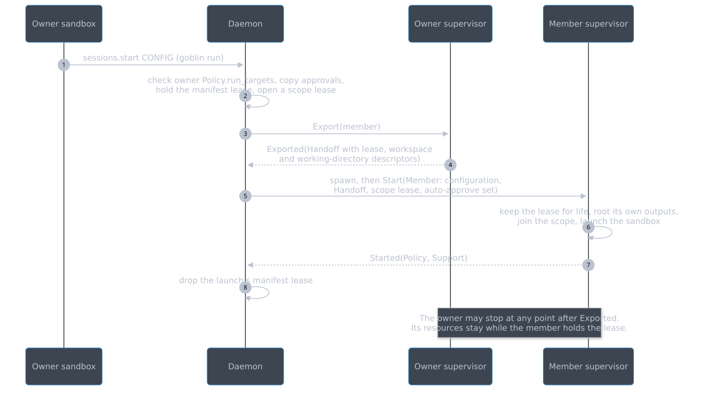

The leases are what make this safe across processes. Today an =Arc<SessionDirectory>= keeps a goblin's =resources/= until the last goblin using it stops, and the shared workspace keeps the =Arc= of the goblin that made the snapshot. That goblin can be further up a chain: if A runs B, and B, now owning a raid, runs C, then C's workspace lives in A's resources, not in B's.

Every runtime therefore keeps a list of =ResourceLease=s: its own resources directory and every lease it was handed. =Export= opens each listed =.gc-lease= again, takes a fresh shared =flock= and passes all of them. Each must be a new open file description, not a =dup=, because the exclusive-lock test cannot tell =dup=s apart. In the example, C holds leases on B's and A's resources, so stopping A and B and running =goblins gc= leaves C's workspace intact.

=SessionDirectory::drop= becomes =ResourceLease::drop=: "release my lock, then remove =directory= only if an exclusive non-blocking lock succeeds". The last holder in any process removes the directory, and =goblins gc= removes it if every holder died. A member holds its leases for its whole life, exactly as its =Inheritance= keeps those =Arc=s today, so a re-root before =Started= is no longer what keeps the owner's roots alive. While the handoff sits in the daemon between =Exported= and =Start=, the daemon holds the descriptors. If the launch fails, is cancelled, or the daemon dies, closing them releases the lease.

When things are pinned:
- *The owner's resources are pinned when the owner's runtime answers =Export=.* The daemon sends =Export= when it accepts the launch.
  - An owner stopped after that acceptance still answers. =Stop= is written after every queued command (section 4.1), so =Export= reaches the runtime first. The dispatcher answers =Export= from published state without waiting for Nix work in progress, before it handles =Stop=. A retiring runtime stays polled until =Stopped=, so the =Exported= reply is read.
  - Only a failure path fails the member's launch, with an error naming the owner: the owner's supervisor dies, misses its stop deadline, or the daemon drops the runtime.
  - Tests cover =Export= still waiting in the daemon's outbound queue when the owner is stopped, and =Exported= still waiting on the return channel.
- *The scope is pinned at acceptance, by the daemon, not by the owner.* Before phase 4, =Source::Member= keeps carrying the =Arc<scope::Shared>= that =member_owner= upgrades today; that is the one transitional in-process owner. From phase 4, the daemon opens the member's scope lease from the scope process when it accepts the launch, and passes it in =Start=.

The daemon keeps everything it already owns: the copied approvals and auto-approve set (=copied_approvals=, =approve_inherited_requests=) and the manifest lease, which it now holds itself until the member's =Started= instead of moving an =Arc= into the worker.

** 4.6 Scope processes and scope leases

*[P]* Replaces =static NAMED=, =scope::Shared=, the keeper thread, =Lease= and =owners: Vec<Inheritance>=.

#+begin_src mermaid :file diagrams/supervisor-scope.svg :background-color "'#282c34'"
flowchart TB
    Daemon["Daemon scope name to channel"] -->|"starts on first member, control channel"| Scope
    subgraph Scope["Scope process"]
        Namespaces["User, network and optional PID namespaces"]
        Pasta["pasta"]
        Storage["Storage directory and lock"]
        Engine["Docker engine, guardian and store skeleton"]
        Leases["Docker users' resource leases"]
        Members["Member mount namespaces"]
    end
    SupA["Supervisor A Docker user"] <-->|"membership lease and Docker lease"| Scope
    SupB["Supervisor B"] <-->|"membership lease"| Scope
    SupA --> SandboxA["Sandbox A joins the namespaces"]
    SupB --> SandboxB["Sandbox B joins the namespaces"]
#+end_src

#+RESULTS:

*Starting and finding a scope:*
- The daemon keeps a map from scope name to the scope process's control channel. It starts the process, the scope mode of =packages/supervisor-bwrap= (*[Q3]*), when it accepts the first member of a scope.
- For every member, the daemon opens a membership lease and passes it in =Start=; for a raid member it does so at acceptance (section 4.5).
- The scope process checks each new member with today's =compatible= rules (definition, network, =allowNix=) and refuses a mismatch.
- A scope process that is stopping stays in the daemon's map until it exits and has released its storage lock. A launch that needs the scope meanwhile waits, as it waits for the registry slot today, instead of meeting its own previous instance as a foreign controller.

*Two kinds of lease, counted separately:*
- A *membership lease* is the member runtime's connection to the scope process. Its first request, =Join=, returns the namespace descriptors. The namespaces, pasta and storage stay until the last membership lease closes, or until the daemon's channel closes.
- A *Docker lease* is taken on that connection with =AttachDocker= and grown with =ExtendDocker=. Both send the grant descriptors and fresh copies of all the member's =ResourceLease=s (section 4.5), including the leases on inherited workspaces, and return the socket path. Closing the connection, or =DetachDocker=, ends it. The engine stops when the last Docker lease ends, while non-Docker members keep the scope, as =Lease::drop= does now.

*What the scope owns:*
- Its runtime directory moves out of the first member's session directory to =STATE/scopes/NAME/=. The engine's store skeleton moves there too, instead of living in the first Docker user's session store.
- It holds every Docker user's =ResourceLease=s, inherited workspaces included, until the engine stops. That replaces =State.owners= and =State._owner= and keeps the backing directories and Nix roots of the engine's grants alive, even after a donating member stops or its supervisor crashes.
- Later grants bind into the skeleton as today. Their store paths stay rooted by the leases the scope holds.

*Cleaning up after a member.* =kill_member= moves into the scope process, because the member's runtime cannot run it if its supervisor is killed.
- After its sandbox's mount namespace exists and before the payload starts, a member runtime registers that namespace with =RegisterMember=, and the payload starts only after the scope acknowledges it. The helper's =--block-fd= gate on Bubblewrap is the intended point, but the exact hook has to be checked during implementation.
- When a membership lease closes for any reason, the scope process kills every process in its PID namespace that is in that member's mount namespace.
- A member whose supervisor dies before registering has no payload yet, so nothing is left to clean up.

** 4.7 The control channel

*[P]* One SOCK_STREAM Unix socket pair per supervisor and per scope process, created by the daemon. Frames use the JSON-RPC Content-Length framing of =libs/jsonrpc= (today's [[file:../../crates/protocol/src/rpc.rs][rpc.rs]]), with SCM_RIGHTS descriptors attached as described in section 4.3. It is not SOCK_SEQPACKET, because the daemon's side must stay portable. The message types live in =libs/runtime=, which no sandbox-side package links (section 4.10).

Neither existing descriptor path is a general transport: =init::send= treats a short write as an error and uses fixed ancillary buffers, and the host =Connection= receiver accepts descriptors for one request. The control channel needs its own, specified and tested on its own:
- *Its own budget.* A private per-frame descriptor limit sized for the largest message (=Exported=), with batching if that is ever exceeded. =init::MAX_FDS= stays 3, because it also bounds what host connections may send, which is a public limit.
- *Association.* Each frame's header declares its descriptor count, and the sender attaches that frame's descriptors to the frame's first =sendmsg=. The receiver queues incoming descriptors in arrival order and gives each decoded frame the number it declared. A count that does not match the indices in the frame, or descriptors left over at EOF, is a protocol error: the channel closes and every queued descriptor is closed.
- *Partial I/O.* Writes and reads are queued and resumable, with descriptors only on a frame's first chunk. Output queues are bounded, as with =Connection=.
- *Frame size.* A relayed sandbox call or answer travels in one frame, so the channel's frame limit is above the sandbox endpoint's request and reply limits.
- *Tests:*
  - fragmented and coalesced frames with different descriptor counts;
  - short writes under backpressure;
  - EOF in the middle of a frame;
  - every descriptor closed after a protocol error.

** 4.8 Relaying sandbox requests

*[P]* From phase 5 the runtime owns =request.sock= and every connection on it, and the daemon sees only messages. Today's =Connection= splits in two: the runtime takes the transport half, and the daemon keeps the call half.

#+begin_src mermaid :file diagrams/supervisor-relay.svg :background-color "'#282c34'"
sequenceDiagram
    autonumber
    participant C as Sandbox client
    participant S as Supervisor
    participant D as Daemon
    participant H as Host frontend
    C->>S: connect request.sock
    S-->>D: SandboxOpened(connection)
    C->>S: initialize
    S-->>D: SandboxCall(initialize)
    D->>S: SandboxSend(result with features)
    S->>C: result
    C->>S: permissions.request package
    S->>S: transport and parameters, then Policy and Support
    S-->>D: SandboxCall(checked)
    D->>D: running, pending, capacity
    D->>H: pending request
    H->>D: permissions.decide
    D-->>H: decided
    D->>S: Decide
    S-->>D: Granted
    D->>S: SandboxSend(reply)
    S->>C: reply
#+end_src

#+RESULTS:
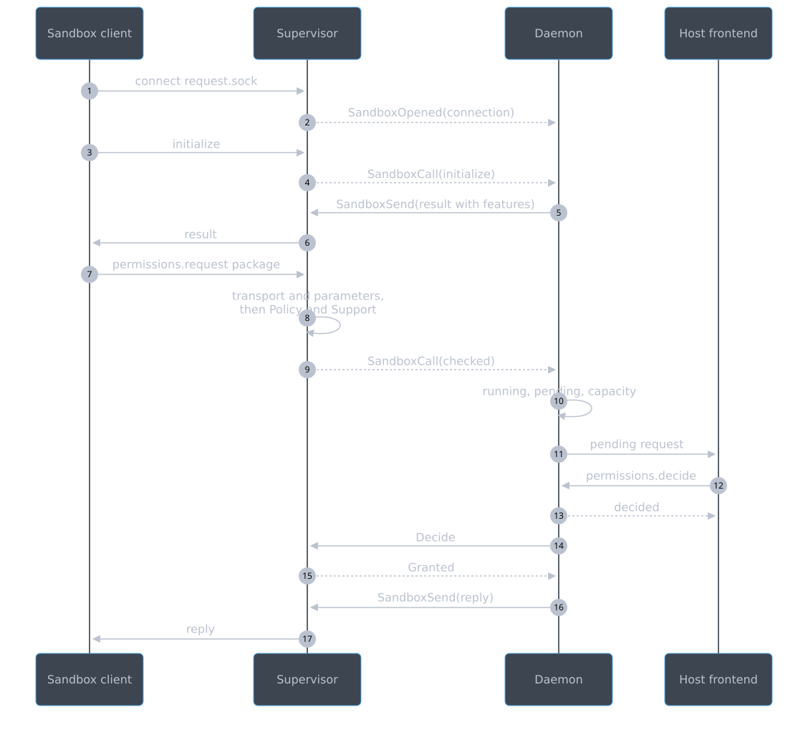

- *The runtime's half:* the socket, framing and size limits, the JSON-RPC envelope, the sandbox method allowlist, =initialize= before other calls, one-shot calls and their trailing-input check, today's per-connection call limit, EOF, and the gate of section 4.4. It answers the refusals of the first two layers itself, with today's codes and messages, in today's order: frame and size errors, then the per-method frame limit, then =initialize=, then =-32001= for a call before it. =initialize= and messaging calls are then relayed. Any other call gets =conflict= after =Stop=, then =-32601= for an unknown method, then its own checks and the gate.
- *One call at a time, as today.* The runtime handles a connection's calls in arrival order and does not evaluate the next until the daemon has answered the previous one, keeping today's handling of input that arrives while a call waits. A call pipelined after =initialize= is therefore gated only after the daemon's reply, by which time the runtime knows whether =initialize= succeeded, matching today's dispatch, which marks the connection initialized before it handles the next call.
- *Notifications are dropped, as today.* A call without an ID is ignored before its parameters or policy are looked at, and is not relayed.
- *The daemon's half, a /relayed connection/:* which call waits, =host.submitted= before the reply, the reply itself, closing one-shot connections, and =withdraw=. It is keyed by goblin and connection id, never by path.
- *Ordering a decision against a hang-up.* Today =decide= reads the requester's socket and refuses with =conflict= if it finds EOF or unexpected bytes, so that unread input cannot hide a peer that has gone. The runtime now keeps reading every connection with a waiting call, and on EOF or unexpected input closes it and sends =SandboxClosed= at once; nothing is left unread to hide a hang-up. =decide= stays synchronous: it checks whether the relayed connection is closed, where it reads the socket today, and refuses with =conflict= and withdraws, as today. The hang-up is noticed one hop later than today. A hang-up that has not reached the daemon when it decides is handled like a hang-up just after =decide= today: the decision stands and its reply has no reader.
- *Disconnects.* EOF, a transport error, or unexpected input while a call waits closes the connection in the runtime and sends =SandboxClosed=. The daemon then withdraws that connection's calls, as it does on disconnect today.
- *Ending a runtime ends its connections.* The daemon withdraws every call relayed on them. =SandboxOpened= or =SandboxCall= arriving after =Stopped= is ignored, and the runtime has already closed those connections.

** 4.9 Terminals

*[P]* From phase 5 the runtime owns every PTY master and the server log, and streams them to frontends directly. The daemon keeps the attach handshake and everything that decides whether an attachment may happen.

#+begin_src mermaid :file diagrams/supervisor-attach.svg :background-color "'#282c34'"
sequenceDiagram
    autonumber
    participant F as Frontend
    participant D as Daemon
    participant S as Supervisor
    participant P as Payload or attach client
    F->>D: connect attach.sock, attach.hello(rows, cols)
    D-->>F: attach.waiting while variables are missing
    opt onAttach configured
        D->>S: Spawn(onAttach, NewPty)
        S->>P: start the client on a new PTY
        S-->>D: Spawned(id)
    end
    D->>S: Attach(terminal, frontend stream, rows, cols)
    S-->>F: attached true, then raw bytes
    S-->>D: Terminal(attached)
    F->>S: keystrokes
    S->>P: keystrokes
    F--xS: closes the stream
    S-->>D: Terminal(detached)
#+end_src

#+RESULTS:
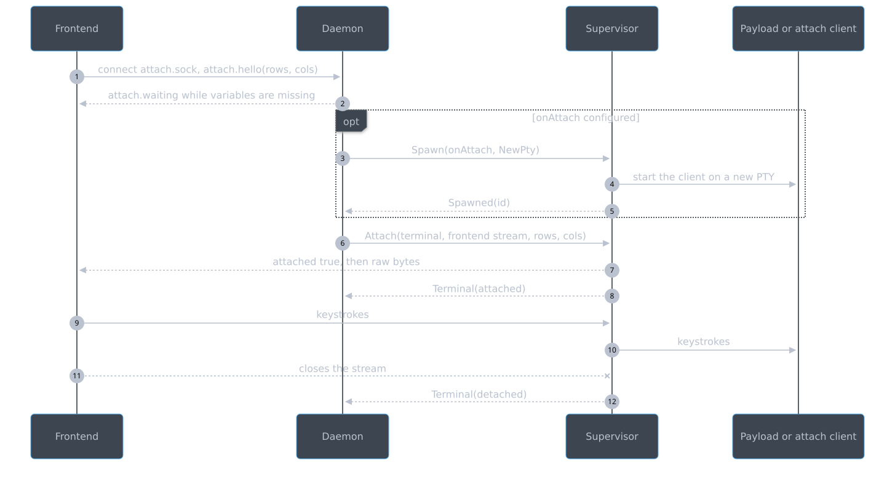

- *The runtime owns:* the goblin's own PTY, or the server-log pipe and its bounded log file (=ServerLog=); the PTYs it allocated for attach clients; =Terminal='s buffers; the older =terminal.sock= listener with its hold, release and refusal rules, which it can apply because it knows =Policy.handlers=; and resizing.
- *The daemon keeps* =attach.sock= and the handshake: the 3-second =attach.hello=, =attach.waiting= while variables are missing, the one-attachment rule and its refusals, and =onAttach= and =onDetach= through =Spawn= and =Signal=. On success it passes the frontend's stream in =Attach=; the runtime writes the framed acceptance and then raw bytes, as =Terminal::attach= does today.
- *One attachment, reserved by the daemon.* The daemon marks the terminal attached when it sends =Attach=, before the runtime answers, so a second =attach.hello= is refused at once, as today. The mark clears when =Event::Terminal= reports the terminal detached. That includes an =Attach= the runtime cannot carry out because the terminal has ended; the runtime then writes today's refusal to the frontend's stream itself. =attached_since= and the rest of the attach state stay in the daemon's =attach::Attach=, and an attach client's pid comes in =Spawned=, as today.
- *Ordering.* Commands for one terminal are carried out in the order sent. =Resize= is coalesced in place and never overtakes the =Attach= before it, and =Detach= follows it. A frontend that closes its stream before or after the runtime has attached it is reported as detached once the runtime sees the closed stream.
- *After the payload ends.* Today a stopped goblin's =Terminal= stays in the daemon until it can be evicted, so a frontend that attaches late still gets the buffered output. The runtime keeps that: after =Stopped= it keeps serving its terminals, =terminal.sock= included, until each can be evicted, and only then ends (section 4.1). A stopped goblin whose output nobody reads keeps its record today; it now also keeps a supervisor holding that buffer and no sandbox.
- *Records.* The runtime reports changes with =Event::Terminal=. The daemon copies them into the record fields, as =tick= copies them from =Terminal= today.
- *Detaching.* =sessions.detach= sends =Detach=. A frontend closing its stream is seen by the runtime and reported as detached.
- =goblins exec= keeps passing the frontend's own descriptors (=Stdio::Fds= or =Stdio::Tty=); those never were the daemon's PTYs.
- *What this buys.* A goblin that floods its terminal costs its own supervisor, not the daemon's tick, and the daemon holds no PTY at all.

** 4.10 Where the code lives

*[P]* Directories say what they hold: =packages/= for what is built into something runnable, =libs/= for libraries. Library names say whether a contract is public or internal (*[Q5]*).

#+begin_src mermaid :file diagrams/supervisor-layout.svg :background-color "'#282c34'"
flowchart LR
    subgraph Packages["packages/: runnable, one Nix package each"]
        Daemon["daemon goblins: daemon, host CLI, TUI"]
        SupBwrap["supervisor-bwrap supervisor and scope process"]
        Helper["mount-helper"]
        Cli["sandbox-cli goblin, goblins-init, goblins-editor"]
        Adapters["adapter-codex adapter-claude"]
        Docker["docker Nix only"]
    end
    subgraph Public["libs/: public contracts"]
        Jsonrpc["jsonrpc values and framing"]
        Api["api host and sandbox endpoints"]
    end
    subgraph Internal["libs/: internal"]
        Init["init supervisor and goblins-init"]
        Runtime["runtime Command, Event, Policy, Support, Handoff"]
        Supervisor["supervisor the Linux runtime"]
    end
    Daemon --> Api
    Daemon --> Runtime
    Daemon -.->|"phases 3 to 5 only, for Local"| Supervisor
    SupBwrap --> Supervisor
    Supervisor --> Runtime
    Supervisor --> Api
    Supervisor --> Init
    Cli --> Api
    Cli --> Init
    Adapters --> Api
    Init --> Api
    Api --> Jsonrpc
    Runtime --> Jsonrpc
#+end_src

#+RESULTS:

| Directory | Holds | Today |
|-----------+-------+-------|
| =packages/daemon= | the =goblins= binary: daemon, host CLI and TUI | =crates/controller= minus the runtime |
| =packages/supervisor-bwrap= | the supervisor and scope-process binary for Linux; a thin =main= over =libs/supervisor= | new |
| =packages/mount-helper= | the supervisor's private helper | the root =src/= |
| =packages/sandbox-cli= | the =goblin= binary, with =goblins-init= and =goblins-editor= | =crates/client= and =nix/packages/internal-goblins.nix= |
| =packages/adapter-codex=, =packages/adapter-claude= | the agent adapters | =crates/codex=, =crates/claude= |
| =packages/docker= | patched rootless Docker, Nix only | =nix/packages/docker.nix= |
| =libs/jsonrpc= | JSON-RPC values and Content-Length framing, with no methods | the method-free half of =crates/protocol/src/rpc.rs= |
| =libs/api= | the public host and sandbox endpoints, their parameter types and limits, the client terminal relay and the shared validators | the rest of =crates/protocol=, including the method types of =rpc.rs= |
| =libs/init= | the supervisor's channel to =goblins-init= | =crates/protocol/src/init.rs= |
| =libs/runtime= | =Command=, =Event=, =Fd=, =Policy=, =Support=, =Capabilities=, =Handoff=, the scope messages, and the plain data both sides use: the manifest, =Skipped=, the dev shell generation and summary | new, and the data halves of =config=, =binds=, =history= and =devshell= |
| =libs/supervisor= | the runtime: session, worker, binds, Nix work, scopes, Docker, terminals and the request relay | the runtime modules of =crates/controller= |

Rules:
- *Packages depend on libraries, never on each other.*
- *Sandbox-side packages never link host authority.* =sandbox-cli= and the adapters link =jsonrpc=, =api= and =init=, never =runtime= or =supervisor=.
- *The daemon links =supervisor= only while =Local= exists* (phases 3 to 5). From phase 6 it links =runtime= and the public libraries, so the end state in section 1 is a compile-time fact.
- *Public and internal differ in how they change.* =jsonrpc= and =api= have clients outside the Rust build (Emacs, the Python tests, scripts) and are documented in [[file:../API.org][API.org]]; the schema-first plan in [[file:API-SCHEMA.org][API-SCHEMA.org]] covers them. =init=, =runtime= and =supervisor= connect two ends from the same build, may change in any commit, and are described by ADRs and the architecture documents.
- *One Linux runtime library for now.* Until the launch split in section 9, the whole runtime is Linux code in =libs/supervisor=. The Darwin work later splits out its platform-neutral core, and =packages/supervisor-darwin= would link that core and its own backend.
- *Nix.* Each package has its =default.nix= beside its =Cargo.toml=, sharing one Rust builder that replaces =nix/packages/rust.nix=. =nix/= keeps the builders, =lib.nix= and the goblin definitions; the adapters' settings and skills stay in =nix/goblins=. =mkGoblins= pins the daemon, the supervisor and the helper by store path in the runtime configuration, as it pins the helper today.
- *Checked.* A test over =cargo metadata= fails when a dependency breaks these rules.

* 5. Phases

Every phase is one or more commits, each reviewed and gated as AGENTS.md requires. All of them touch broad-routed paths (=controller.rs=, =session.rs=, =worker.rs=, =src/=, =crates/protocol= and, after phase 3, their new homes), so every commit needs =just test-merge=.

#+begin_src mermaid :file diagrams/supervisor-phases.svg :background-color "'#282c34'"
flowchart LR
    P1["1 Runtime handle in the controller"] --> P2["2 Policy, Support, Capabilities, Handoff"]
    P2 --> P3["3 packages and libs, runtime in its own library"]
    P3 --> P4["4 Scope processes supervisor-bwrap appears"]
    P4 --> P5["5 Runtime owns the sandbox's endpoints: relay, gate, terminals"]
    P5 --> P6["6 A supervisor process per goblin, Local deleted"]
    P6 --> P7["7 Documents"]
#+end_src

#+RESULTS:

** Phase 1: the =Runtime= handle, in-process

*[P]* Introduce =Runtime=, =Command=, =Event=, =Fd= and the =Local= and =Fake= implementations (sections 4.1 to 4.3), in a new =controller/runtime.rs=.

- =poll_init=, the per-session =request.sock= accept loop, the pidfd check and =poll_host_jobs= in =tick= collapse into draining each goblin's =Runtime=. The accepted sandbox streams still come to the controller in this phase, as =Event::SandboxConnected=; phase 5 replaces them with relayed calls.
- The runtime reports the payload's exit as =Event::PayloadExited=, and the controller calls =stop= on it as it does on the pidfd today, so a pending request is still answered at once with today's message.
- Cancellation becomes =Command::Cancel(id)= instead of shared =Cancel= atomics in =Pending=, =Call= and =Work=. =Local::send= handles it at once, without queueing (section 4.1).
- The dispatcher and stopping versus dropping follow section 4.1 from this phase on. =Local='s dispatcher is =send= itself and hands every command to the worker or init at once, so commands already take effect in the order sent and a cancellation already overtakes queued work. The outbound queue of section 4.1 and its ordering tests therefore land in phase 6 with =Supervised=, its only user. An init socket that refuses a message keeps today's answers: =-32010= for =goblins exec= and an attach client that cannot start, and nothing for signals. The exceptions for =sessions.kill_execs= and =sessions.exec= are in section 4.4.
- An =accept= error on =request.sock= other than =WouldBlock= used to end the daemon's tick with an error. =Local= now stops accepting for that round and tries again in the next.
- The sessions map plays the retiring set: a stopping goblin's record stays there, polled, until its runtime ends, and is evicted only after. A separate set comes with =Supervised= and its kill deadline.
- Attach clients ask the runtime for a PTY (=Stdio::NewPty=) instead of the controller allocating one, and get the master back in =Spawned= until phase 5. =goblins exec= passes the frontend's descriptors through unchanged (=Stdio::Fds= or =Stdio::Tty=).
- Host jobs:
  - =host_spec= sends =PrepareHostJob=; the runtime resolves the directory through the bind descriptors, keeps the pinned descriptor by request ID and returns the display path for the preview.
  - =decide_host= sends =RunHostJob=. =withdraw= and =end_host_jobs= send =CancelHostJob=.
  - The helper's =--host-job= mode and the job directory layout are unchanged.
- =editor.open= stays in the daemon: it runs =emacsclient= on the host as a frontend integration and never touches the sandbox.
- =Started= still carries =Inheritance= in this phase; phase 2 removes it.

Tests: =Fake= replaces =Worker::idle=, =Worker::completed= and =Worker::listening=. The fixture helpers =session_with_results_id= and =live= absorb most of the change. These tests are rewritten against =Fake=:
- =exec_descriptors_wait_for_their_whole_request=
- the three attach-handler tests
- the record tests that assert =Work=

** Phase 2: =Policy=, =Support=, =Capabilities= and =Handoff=

*[P]* Split =Inheritance= (sections 4.4 and 4.5). This phase can land as two commits.

1. *What a goblin may do.*
   - =Started= carries =Policy= and =Support= instead of =Inheritance=.
   - Every policy check in =dispatch=, =host_spec= and =sandbox_control= moves into =Capabilities::check=, still called by the daemon in today's positions, with today's messages and today's order.
   - =initialize= and =sessions.status= use =sandbox_features= and the three inputs.
   - =Local= reports full =Support=.
   - Tests: a =Fake= with reduced =Support= exercises the =Unsupported= path and the =initialize= feature list.
2. *What a raid member takes from its owner.*
   - =Command::Export= returns a =Handoff=; =Source::Member= carries it instead of the owner's =Inheritance=, scope =Arc= and manifest =Arc=.
   - =SessionDirectory= becomes =ResourceLease=, which works across processes: the last holder removes the directory (principle 4). Each runtime keeps its own and its inherited leases.
   - =DevShell= and the other =Handoff= payload types gain =Serialize= and =Deserialize=.
   - =Completed::Manifest= becomes =Event::Manifest= with a root path; the daemon holds each launch's manifest lease until its =Started=. This replaces the =held= tuple in =worker.rs=.
   - Until phase 4, =Source::Member= keeps carrying the scope =Arc= taken at acceptance, the one transitional in-process owner (section 4.5).
   - =Completed::DevShell= becomes =Event::DevShell= with a serialisable generation summary.

** Phase 3: packages and libraries

*[P]* Move to the layout of section 4.10, still one process and with no behaviour change. Two commits:
1. *Mechanical moves.*
   - =crates/= becomes =packages/= and =libs/=, and the root =src/= becomes =packages/mount-helper=, so the root =Cargo.toml= is a pure workspace.
   - =crates/protocol= splits three ways. =libs/jsonrpc= takes the method-free half of =rpc.rs=: values, envelope, =Decoder=, framing and its limits. =libs/api= takes everything that names a method or a public limit: =PermissionParams=, =HostCommand= and its limits, =FlakeRunParams=, =DevShellDiffParams=, =input_name=, and the argument and environment limits =HostCommand= checks, which move there from =init.rs= because API.org publishes them. =libs/init= takes the rest of =init.rs= and uses those limits from =libs/api=.
   - Each package's Nix expression moves beside it, over one shared Rust builder. The adapters' Rust builds move out of =nix/goblins=, which keeps their settings and skills.
   - The routing in =tests/features.toml=, =tests/build_support.py=, the =justfile= and document links follow.
2. *The runtime gets its own libraries.*
   - =Command=, =Event=, =Fd=, =Policy=, =Support=, =Capabilities= and =Handoff= move to =libs/runtime=, with the plain data both sides use: the manifest as Nix writes it (=Manifest=, =Launch='s serialised fields, =Editor=, =Handlers=, =binds::Declarations=), =history::Skipped=, the serialisable dev shell generation and its summary, and =ManifestLease='s path and drop.
   - Only data moves down. A type whose inherent methods need OS or Nix services is split: the data goes to =libs/runtime=, and each such method becomes a free function in =libs/supervisor= that takes the data. =Launch::etc_mounts= becomes a =sandbox_etc= function; =ManifestLease::create=, which validates and roots the manifest, becomes a supervisor function that returns the root path the daemon wraps (section 4.2). =Launch='s fields that the runtime fills in at launch (=scope=, =dev_shell=, =protected_paths=, the current =editor=) leave =Launch= for a supervisor-side launch struct, and =binds::Plan= with its descriptors stays in the supervisor.
   - =libs/runtime= depends on neither the daemon nor =libs/supervisor=, so there is no cycle.
   - The runtime modules move to =libs/supervisor=: =session=, =worker=, =binds=, =seccomp= and =sandbox_etc=; =devshell=, =evaluator= and =catalog=; =scope*=, =network= and =docker=; =process=, =exec= and the Linux parts of =unix=. =Local= and the launcher move with them.
   - The daemon reaches the runtime only through =libs/runtime= and =Local=. A daemon module that reaches further fails to compile.
   - The Python =sandbox= harness's ignored =session::tests::host_driver= test moves with =Session=.

Tests: the =cargo metadata= dependency check of section 4.10, and =nix flake check= building every package on its own.

** Phase 4: scope processes

*[P]* Move scopes into their own processes (section 4.6, *[Q4]*). =packages/supervisor-bwrap= is created here, with only its scope mode; phase 6 adds the supervisor mode. =mkGoblins= pins it in the runtime configuration, and the Python tests build it with Cargo beside the daemon.

The binary's entry point is minimal from the start, for both modes. It accepts only the inherited control socket, runs no CLI, daemon or client start-up, and reads everything else from its first message. Before anything else it:
- sets =PR_SET_PDEATHSIG=;
- checks that its parent is still the daemon that started it, closing the race between fork and the =prctl=;
- closes every descriptor except the control socket, as the helper's =close_range= allowlist does today.

This is the riskiest step and lands as two commits, each green:
1. *Namespaces, pasta, storage, membership leases and member clean-up.* The Docker engine stays in the daemon for this commit. What remains of =Shared= is a per-scope Docker state keyed by scope name. It holds its owners as =Inheritance= values, as today, and starts the engine in the namespaces it receives from the scope process.
2. *The Docker engine, Docker leases and the store skeleton* move into the scope process, and the bridge and =Shared= are deleted.

=HELD= becomes per scope process. The cross-process =flock= on persistent scope storage stays.

** Phase 5: the runtime owns the sandbox's endpoints

*[P]* Still in-process, the runtime takes over everything that touches the sandbox. Two commits:
1. *Relay and gate* (sections 4.4 and 4.8).
   - The runtime accepts on =request.sock= only after =Started=, runs the transport half of today's =Connection= and the gate, and emits =SandboxOpened=, =SandboxCall= and =SandboxClosed=.
   - The daemon's =Role::Sandbox= connections become relayed connections. =decide= checks whether the relayed connection has closed instead of reading a socket.
   - The sandbox-side policy checks leave the daemon for the gate. This is the commit that changes the refusal order (section 4.4).
2. *Terminals* (section 4.9).
   - =Terminal=, =ServerLog= and the =terminal.sock= listener move into the runtime. =Started= and =Spawned= stop carrying PTY masters and the log pipe.
   - =attach::Attach= stays in the daemon and passes the frontend's stream in =Attach=. =sessions.resize= and =sessions.detach= send =Resize= and =Detach=.

After this phase the controller holds no sandbox socket, PTY master or log pipe, only its control over each runtime.

** Phase 6: a supervisor process per goblin

*[P]* Replace =Local= with =Supervised=, and add the supervisor mode to =packages/supervisor-bwrap=.

- *Spawning.* The daemon starts one supervisor per goblin, passing the control socket as an inherited descriptor and =Start(Source)= as the first message. The entry point is the one phase 4 introduced.
- *Main loop.* The supervisor runs what =Local= ran: the dispatcher and worker, init, the request relay and gate, the terminals, the pidfd and host jobs. Blocking Nix work stays on its own thread, so process exits, init events, sandbox calls and terminal output are still handled during a build. That is the job =exit_watch= does in the daemon today.
- *Launch sequence:*

#+begin_src mermaid :file diagrams/supervisor-launch.svg :background-color "'#282c34'"
sequenceDiagram
    autonumber
    participant F as Frontend
    participant D as Daemon
    participant S as Supervisor
    participant B as Sandbox
    participant C as Sandbox client
    F->>D: sessions.start CONFIG
    D->>D: name, launch receipt, raid rights
    D->>S: spawn with the control socket
    D->>S: Start(Source)
    S->>S: resolve the configuration, check Policy against Support
    S->>B: helper, Bubblewrap, goblins-init, payload
    S-->>D: Started(Policy, Support, identity)
    D-->>F: running
    C->>S: connect /run/goblins/request.sock
    S-->>D: SandboxOpened(connection)
    C->>S: initialize, then one call
    S-->>D: SandboxCall, once each has passed the gate
#+end_src

#+RESULTS:
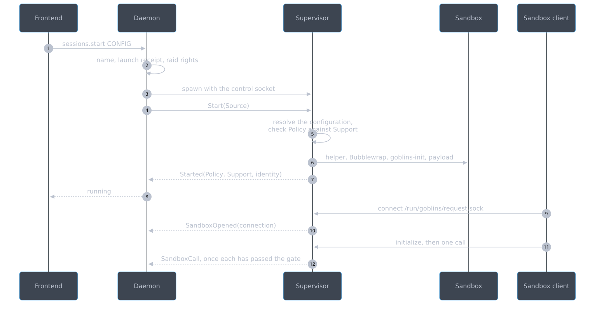

- *Versioning.* =mkGoblins= pins the daemon and the supervisor from one build, so in a packaged install they always match. The control protocol carries a =supervisor_api= number, like =helper_api=, and a supervisor refuses a =Start= with another number. That catches a mismatched pair during development, such as a Cargo-built daemon with an older supervisor.
- *The daemon stops linking =libs/supervisor=* once =Local= is deleted. =Supervised= lives in the daemon's =supervised= module, the one place that launches, watches and kills its children (section 1).
- *Lifetime and failure.* See section 6.

Keep =Local= behind a debug flag only until =Supervised= passes =just test-merge=, then delete it in the same series.

** Phase 7: documents

- *[P]* ADR 0018 records the decisions in section 7.
- *[P]* [[file:../architecture/components.org][components.org]], [[file:../architecture/daemon.org][daemon.org]] and [[file:../architecture/workflows.org][workflows.org]] describe the supervisor, the relay and the layout, with regenerated diagrams.
- *[P]* The internals sections of USAGE.org are updated where they describe the helper, the request socket and terminals.
- *[P]* [[file:../API.org][API.org]] needs no change: its methods, codes and limits stay, and it does not specify the order of refusals.

* 6. Lifetime and failure

#+begin_src mermaid :file diagrams/supervisor-lifetime.svg :background-color "'#282c34'"
flowchart TD
    DaemonDies["Daemon dies"] --> EOF["Every control channel reaches EOF; PDEATHSIG as a backstop"]
    EOF --> SupStops["Each supervisor stops its goblin"]
    EOF --> ScopeStops["Each scope process tears down"]
    SupStops --> Helper["Helper: PDEATHSIG from the supervisor thread that started it; kills init by pidfd"]
    SupStops --> Jobs["Host jobs: lifetime pipe closes"]
    SupDies["One supervisor dies"] --> Helper2["Its helper, sandbox and host jobs die"]
    SupDies --> Failed["Daemon sees EOF: that goblin failed, its relayed calls withdrawn, raid membership reconciled"]
    SupDies --> Frontend["An attached frontend's stream reaches EOF"]
    SupDies --> LeaseClosed["Its scope leases close: the scope kills what is left in its mount namespace and continues for other members"]
    SupDies --> Kept["Its resources stay while a raid member or the Docker engine holds a lease on them"]
#+end_src

#+RESULTS:

- *[P]* *A supervisor stops on control-channel EOF*, and also sets =PR_SET_PDEATHSIG= against the daemon.
- *[P]* *The helper keeps =PR_SET_PDEATHSIG= against the supervisor thread that spawned it.* That thread must live as long as the goblin, as the worker thread does today.
- *[P]* *A scope process tears down on EOF from the daemon*, as well as when its last membership lease closes. It stops the engine when the last Docker lease ends.
- *[P]* *A member's leftovers are the scope's job.* When a membership lease closes, for any reason, the scope process kills the processes left in that member's mount namespace (section 4.6). A killed supervisor therefore leaves nothing running in a shared PID namespace.
- *[P]* *A supervisor that exits without =Stopped= marks its goblin =failed=.* This matches a worker that ends without a final result today. It does nothing to any other goblin, including created raid members.
- *[P]* *A stalled supervisor cannot block the daemon.* =Supervised= never blocks on its channel and reports a full queue as today's capacity error (section 4.1).
- *[P]* *Ending a runtime ends its sandbox connections and terminals.* The daemon withdraws every call relayed for that goblin (section 4.8). A supervisor that ends normally does so only once its terminals can be evicted (section 4.9). One that dies holds the frontend's terminal stream, so an attached frontend sees EOF, the record shows the terminal interrupted, and any output not yet delivered is lost, as when the daemon dies today.
- *[E]* The five daemon-death tests in section 2.5 must pass unchanged. Phase 6 adds assertions that the supervisor and scope processes are gone too.

* 7. Decisions

The user took these decisions on 2026-10-29. ADR 0018 records them (phase 7).

- *[Q1] Sandbox requests are relayed, and the supervisor checks them.* The supervisor owns =request.sock=, parses every call, refuses what =Policy= or =Support= does not allow, and relays the rest as messages (sections 4.4 and 4.8). This follows the spec's "every sandbox-to-daemon request crosses exactly its own trusted host supervisor" as written.
  - The cost is the split =Connection=: the hang-up check in =decide= reads a flag the runtime's =SandboxClosed= sets, so a hang-up is noticed one hop later, and disconnects and backpressure become messages.
  - The visible effect is one change of refusal order (section 4.4).
  - The alternative considered was handing accepted streams to the daemon, which would have kept =Connection= whole but left the daemon speaking directly to the sandbox.
- *[Q2] Terminals live in the supervisor.* The supervisor owns every PTY master, the server log and the buffers, and streams to the frontend once the daemon has completed the attach handshake (section 4.9). This matches the spec's responsibility table. The alternative considered was keeping =Terminal= in the daemon, fed by masters from the supervisor.
- *[Q3] The supervisor is its own binary,* =packages/supervisor-bwrap=, which also runs scope processes. =mkGoblins= pins it by store path beside the daemon, and =supervisor_api= catches mismatched development builds (phase 6). The alternatives considered were a hidden subcommand of =goblins= and a mode of the mount helper.
- *[Q4] Each scope has its own process, started by the daemon* (section 4.6, phase 4). It keeps separate membership and Docker leases, serialised start-up and teardown, compatibility checks and clean-up after crashed members. The alternatives considered were keeping scopes in the daemon, which would leave namespaces, pasta and Docker there, and letting the first member's supervisor own the scope, which breaks members that outlive their creator.
- *[Q5] Code is laid out as =packages/= and =libs/=,* with public and internal contracts in separate libraries (section 4.10, phase 3). The public API is to become schema-first, under its own plan, [[file:API-SCHEMA.org][API-SCHEMA.org]].

* 8. Tests

*[E]* The existing suites are the regression contract:
- =lifecycle=, with its daemon-death tests;
- =exec=: attach, attach handlers and exec signals;
- =sandbox=: grants, binds, workspace and roots;
- =raids=, including =test_members_outlive_their_owner_and_a_new_owner_takes_them_over= and =test_member_shares_the_owners_scope=;
- =scopes=, =docker=, =devshell= and =host-tools=;
- the =codex= and =claude= adapters.

*[P]* New tests, added in the phase that makes them possible:
- *Phase 1:*
  - The =Fake= runtime for the controller unit tests.
  - A denial cancels a dev shell evaluation that is blocked in Nix, and a stop cancels a blocked package build, both promptly.
- *Phase 2:*
  - With a =Fake= reporting reduced =Support=, every operation is refused as =Unsupported=, and =initialize= drops exactly the matching features.
  - An owner is stopped right after the launch is accepted, before =Exported=; and separately between =Exported= and the member's =Started=. In both cases the member starts with the owner's workspace, dev shell and auto-approved outputs.
  - The owner's runtime is blocked in Nix work (a dev shell refresh or package build) when a member launch is accepted and the owner is then stopped. The member starts with the owner's handoff without waiting for that work, and the owner stops within the deadline.
  - A chain: A runs B, B owns a raid and runs C. Stop A and B and run =goblins gc=; C still reads and writes the workspace.
  - B, with a workspace inherited from A, attaches to Docker and stops. The engine keeps working with that workspace.
  - Overlapping refusals keep today's order, for example a running =allowNix= goblin with a pending request asking for a package gets =conflict=. Phase 5 changes this expectation.
  - =initialize= feature lists for full and reduced =Support= match the mapping in section 4.4.
  - =goblins exec= with a supplied PTY, with three descriptors, and without =argv= behaves as today.
  - =initialize= and messaging calls behave as today while a goblin is starting and stopping.
  - The member still reads and writes the owner's workspace after the owner has fully stopped and =goblins gc= has run.
  - The owner's =resources/= are removed by whichever of owner and member stops last, and by =goblins gc= if both die.
- *Phase 3:*
  - The =cargo metadata= dependency check of section 4.10.
  - Every package builds on its own with =nix flake check=.
- *Phase 4:*
  - The first member of a scope stops while a second keeps the network, storage and Docker engine.
  - The last Docker user leaves while a non-Docker member remains: the engine stops and the namespaces and storage stay.
  - The first Docker user stops, =goblins gc= runs, and a surviving Docker user then gets a new live grant into the engine.
  - A scope is relaunched while its previous instance is still stopping; the launch waits instead of reporting a foreign controller.
  - A temporary scope's storage goes after its last member; a persistent scope's stays.
- *Phase 5:*
  - The transport refusals the runtime now answers keep today's codes and messages: malformed frames, an oversized body, an unknown method, a call before =initialize=, trailing input after a one-shot call, and a call over the per-connection limit.
  - Every row of the refusal table in section 4.4, with overlapping failures, follows the new order. The phase 2 example now gets =NIX_PACKAGES=.
  - With a =Fake= or =Local= reporting reduced =Support=, the gate refuses each operation as =Unsupported= without the daemon seeing the call.
  - The requester disconnects, or sends unexpected bytes, while its request waits: the request is withdrawn, and a later =permissions.decide= answers =conflict=, as today.
  - After =Stop= and before =Stopped=: a policy-forbidden call and an unknown method both get =conflict=, a call before =initialize= gets =-32001=, and =initialize= and a messaging call get the daemon's answers, as today. A =SandboxCall= that arrives after =Stopped= is ignored and its connection is closed.
  - A sandbox that floods calls while the runtime's event queue is full loses none of them and does not delay another goblin's calls.
  - Attach, attach handlers, =terminal.sock=, resize and detach behave as today, for single-terminal and =onAttach= goblins.
  - A frontend that attaches after the payload has exited gets the buffered output, and the runtime ends only once the terminal can be evicted.
  - =initialize= pipelined with the next call in one write, a failed =initialize= followed by a call, and a call without an ID all get today's answers.
  - A goblin flooding its terminal does not slow host RPC or another goblin's terminal.
- *Phase 6:*
  - Killing one supervisor fails only that goblin. Its sandbox and host jobs are gone, while another goblin, including a raid member it created, keeps running and messaging. An attached frontend sees its stream end, and the record shows the terminal detached.
  - Two members share a PID namespace, and one has =setsid= descendants. Killing that member's supervisor removes its descendants, and the other member keeps running.
  - A supervisor stopped with =SIGSTOP= while enough commands are queued to fill its channel does not block the daemon's tick, host RPC or other goblins, and the excess requests get capacity errors.
  - With its outbound queue full, a goblin's sandbox caller disconnects, a host job is cancelled and the goblin is stopped. The supervisor gets =SIGCONT= before the stop deadline; then no host job is orphaned, no cancelled build keeps running, and the goblin stops. Without =SIGCONT=, the supervisor is killed at the deadline and the same holds.
  - =Export= is waiting in the outbound queue when its owner is stopped, and separately =Exported= is waiting on the return channel; the member launch succeeds in both cases.
  - A supervisor given a =Start= with another =supervisor_api= refuses it, and the launch fails with a clear message.
  - Killing the daemon stops every supervisor and scope process, checked by their PIDs, in addition to the existing daemon-death tests.
  - The control-channel transport tests listed in section 4.7.
  - Outbound ordering: a queued =Spawn= followed by a =Signal= delivers the signal after the spawn; two different queued signals arrive in order; =KillAll= after a queued =Spawn= also covers that exec; a cancellation for an unsent request removes it.
  - The source check of section 1: no daemon file other than =supervised= uses pidfds or process signals, and none uses Bubblewrap, namespaces, PTYs, SOCK_SEQPACKET, init or =/proc=.

* 9. Out of scope

- Darwin, Seatbelt and per-platform skill selection.
- Splitting =Session::start= into a platform-neutral launch plan and a Linux launcher. This is a natural follow-up once the runtime has its own library, and it is where a second implementation of =Support= would plug in.
- Daemon restart recovery: supervisors still die with the daemon.
- Any change to raids, messaging, approvals or the public API beyond the refusal order in section 4.4.
- Making the public API schema-first, which has its own plan, [[file:API-SCHEMA.org][API-SCHEMA.org]], and does not block this one.
